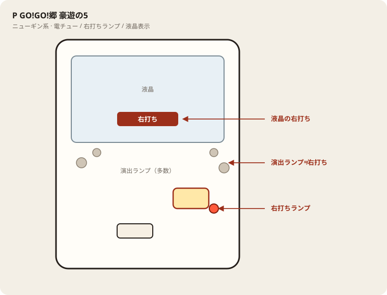

# P GO!GO!郷 豪遊の5

## 基本情報

| 項目 | 内容 |
| --- | --- |
| メーカー | ニューギン |
| 型式名 | PGO！GO！郷～豪遊の5～N-VYLT |
| タイプ | P機 / 甘デジ / 1種2種 / LT / 遊タイム |
| 導入日 | 2024年12月2日 |

## スペック

| 項目 | 内容 |
| --- | --- |
| 大当り確率 | 通常 1/99.9、RUSH中 1/32.9 |
| HYPER GO!GO! RUSH | 突入 51% / 転落まで / 継続 約70% |
| LUCKY GO!GO! RUSH（LT） | 継続 約92.3% / 遊タイム299回転でも突入 |
| 賞球 | 1&2&4&6&5&8 |
| 出玉 | 2R約100 / 5R約250 / 10R約840個 |

郷ひろみ甘デジLT。歌パチ。

## 天井・遊タイム・LT

| 項目 | 内容 |
| --- | --- |
| 天井 | 非搭載（遊タイムで代替） |
| 遊タイム | 搭載。低確299回転でLUCKY GO!GO! RUSH。 |
| カウントのリセット | 大当りでリセット。詳細は機種表示を優先 |

## ボーダー

現金・削りなし。1000円あたり。

| 交換 | ボーダー |
| --- | --- |
| 4.00円（等価） | 17.7 |
| 3.57円（28玉） | 18.5 |
| 3.33円（30玉） | 19.0 |
| 3.03円（33玉） | 19.7 |

持玉で回している間は等価側に寄る。朝イチの現金区間は28玉側で見る。

## 狙い目

18.5回転以上を目安。遊タイムがあるのでハマり回転も確認する。通常時の回転率を優先。

## やめ時

電サポ・RUSHが終わって通常に戻ったとき。回転率が18.5未満なら即やめ。以上なら続けてよい。遊タイムが近い場合は例外として残す判断もあり。

## 朝イチ

閉店スタートは使わない。1000円を通常時だけで数え、18.5回転に届かなければやめる。電サポ中の回転は測定に入れない。遊タイム残りが近い台は別判断。

## 盤面の場所

ニューギン系。演出ボタン周辺のランプと右打ちランプを取り違えない。

系列: **ニューギン系**（機種ごとの目安。個体差あり）

| 項目 | 場所 | 見方 |
| --- | --- | --- |
| 液晶（右打ち表示） | 盤面中央の液晶 | 「右打ち」表示中が電サポ中。切替の最終判断 |
| ヘソ（始動口） | 盤面中央下寄り | 通常時の始動口 |
| 電チュー | 盤面右下〜中央右（液晶の右下寄り） | 羽根が開く入賞口。右打ちの始動口 |
| 右打ちランプ | 電チュー付近、または盤面下部のランプ群 | 点灯中は右打ち。位置は機種差あり。液晶と併用 |
| アタッカー | 盤面下部中央寄り | 大当りラウンドの入賞口 |
| 電サポ | （状態）時短・ST・RUSH・遊タイム中 | 部品ではない。液晶の右打ち表示中 |
| 保留ランプ | 液晶下または盤面下部 | 保留の目安。右打ち終了直後の残保留に注意 |

- ヘソは中央下寄り、アタッカーは下部中央寄りが多い。
- 迷ったら液晶の指示を優先。ランプだけ見て打ち方を決めない。
- 遊タイム残は液晶表示で確認。深さだけで座らない。

## おすすめカスタム

- カスタムは演出の出方だけが変わる。抽選は変わらない。
- 先バレ／先読みがあればON。ない場合はデフォルト。

## 打ち方

- 通常時は左打ち（右打ち指示が出たら従う）。
- 電サポ中・RUSH中は打ち切る。通常に戻ったら回転率を見て継続かやめを決める。

- 遊タイムがある。等価の目安は1000円あたり約17.7回転。

## 総評

HYPER GO!GO! RUSH継続約70%。LUCKY（LT/遊タイム）継続約92%。

出典: P-WORLD

## 注意

コンプリート機能あり。公開値の幅あり・現地確認。釘と取りこぼしで前後する。
