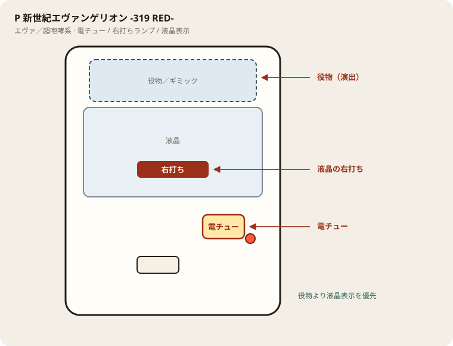

# P 新世紀エヴァンゲリオン -319 RED-

## 基本情報

| 項目 | 内容 |
| --- | --- |
| メーカー | ビスティ |
| 型式名 | P新世紀エヴァンゲリオン17 はじまりの記憶G |
| タイプ | ミドル / V-ST |
| 導入日 | 2026年10月19日 |

## スペック

| 項目 | 内容 |
| --- | --- |
| 図柄揃い | 通常・時短 約1/319.7、ST中 約1/98.9 |
| インパクトモード | ST161回 / トータル突入 約75% / 継続 約81% |
| 時短 | 100回。引き戻し 約26.9〜28% |
| 賞球 | 1&5&15 |
| ラウンド | 2R or 10R / 10カウント |
| 出玉 | 2R約300個、10R約1500個 |

ヘソは 10R+ST 約1% / 2R+ST 約64% / 2R+時短100 約35%。電チューはALL 10R+ST。LT・遊タイム非搭載。

## 天井・遊タイム・LT

| 項目 | 内容 |
| --- | --- |
| 天井 | 非搭載 |
| 遊タイム | 非搭載 |
| カウントのリセット | 天井・遊タイムがないため、ハマり回転数は次の抽選に影響しない |

## ボーダー

現金・削りなし。1000円あたり。

| 交換 | ボーダー |
| --- | --- |
| 4.00円（等価） | 16.9 |
| 3.57円（28玉） | 17.5 |
| 3.33円（30玉） | 17.9 |
| 3.03円（33玉） | 18.5 |

持玉で回している間は等価側に寄る。朝イチの現金区間は28玉側で見る。

## 狙い目

17.5回転以上。遊タイムはないのでハマりでは狙わない。通常時の回転率だけを見る。

## やめ時

電サポ・RUSHが終わって通常に戻ったとき。回転率が17.5未満なら即やめ。以上なら続けてよい。

## 朝イチ

閉店スタートは使わない。1000円を通常時だけで数え、17.5回転に届かなければやめる。電サポ中の回転は測定に入れない。

## 盤面の場所

エヴァ系（超咆哮筐体含む）。役物が大きくても、右打ち切替の本命は液晶表示。

系列: **エヴァ／超咆哮系**（機種ごとの目安。個体差あり）

| 項目 | 場所 | 見方 |
| --- | --- | --- |
| 液晶（右打ち表示） | 盤面中央の液晶 | チャンスタイム／インパクト／RUSH中の「右打ち」 |
| ヘソ（始動口） | 盤面中央下寄り | 通常時の始動 |
| 電チュー | 盤面右下寄り | 右打ち中の始動口。役物の陰になりやすいので位置を先に把握 |
| 右打ちランプ | 盤面下部〜電チュー付近 | 点灯中は右打ち。液晶と矛盾したら液晶優先 |
| 役物／ギミック | 液晶上〜中央 | 演出用。打ち分けの判断材料にはしない |
| アタッカー | 盤面下部中央寄り | ラウンド消化 |
| 電サポ | （状態）チャンスタイム／インパクト／RUSH中 | 部品ではない |

- 役物動作中も右打ち指示が続いていないか液晶を見る。
- 筐体が大きいので、隣台からでも電チュー位置を座前に確認する。

## おすすめカスタム

- カスタムは演出の出方だけが変わる。抽選は変わらない。
- 先告知・先読みがあればON。ない場合はデフォルト。
- 楽曲は好み。

## 打ち方

- 通常時は左打ち（右打ち指示が出たら従う）。
- 電サポ中・RUSH中は打ち切る。通常に戻ったら回転率を見て継続かやめを決める。
- 遊タイムがないため、深くハマった履歴だけでは拾わない。等価の目安は1000円あたり約16.9回転。

## 総評

はじまりの記憶の319版。ST突入75%・継続81%。遊タイムなし。

出典: P-WORLD、HAZUSE、ちょんぼりすた

## 設置店舗

台入れ替えがあるため、各店の**全台データ取得時点**の設置。取得日時は Asia/Tokyo。

| 店舗 | 台数 | データ取得日時 |
| --- | --- | --- |
| エスパス日拓渋谷駅前新館 | 20 | 2026-11-13 09:57〜09:59（Asia/Tokyo） |
| エスパス日拓西武新宿駅前店 | 7 | 2026-11-12 09:57（Asia/Tokyo） |
| 中山UNO | 7 | 2026-11-14 12:26〜12:29（Asia/Tokyo） |
| 中山ZoRoN | 6 | 2026-11-14 12:31（Asia/Tokyo） |
| 楽園渋谷道玄坂店 | 7 | 2026-11-13 16:35（Asia/Tokyo） |
| 楽園渋谷駅前店 | 21 | 2026-11-13 09:57〜09:59（Asia/Tokyo） |
| 楽園町田店 | 17 | 2026-11-14 08:38〜08:40（Asia/Tokyo） |

## 注意

コンプリート機能あり。公開解析の概数で、釘と取りこぼしで前後する。
