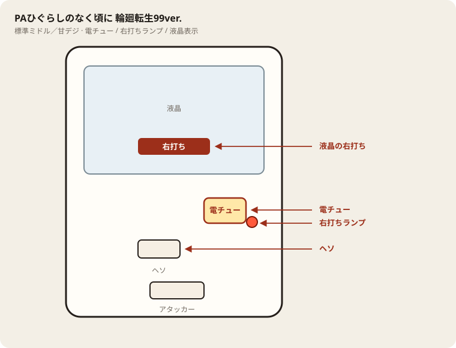

# PAひぐらしのなく頃に 輪廻転生99ver.

## 基本情報

| 項目 | 内容 |
| --- | --- |
| メーカー | D-light（大一商会系） |
| 型式名 | PAひぐらしのなく頃に・輪廻転生99FD-TH |
| タイプ | 甘デジ / 1種2種混合 / 時短突破型 / 転落式 / 遊タイム |
| 導入日 | 2025年3月17日 |
| 枠 | LunaresⅡ（シグナス系の案内もあり） |

## スペック

| 項目 | 内容 |
| --- | --- |
| 大当り確率 | 通常時・エンジェルモート中 1/99.9 |
| 大当り確率（真惨劇RUSH中） | 1/49.9 |
| 真惨劇RUSH突入率 | 約65%（時短100回の引き戻しを含む） |
| 真惨劇RUSH継続率 | 約73% |
| 転落抽選 | 1/133.7 |
| 時短 | エンジェルモート 100回 |
| 賞球 | 1&4&9（アタッカーは9個・10カウント） |
| ラウンド | 4R or 10R |
| 出玉 | 4R 約360個 / 10R 約900個 |
| 右打ち | エンジェルモート、真惨劇RUSH、遊タイム |

確率は特図当りとV入賞当りの合算。V入賞が条件の小当り経由がある。

| 入賞 | ラウンド | 行き先 | 割合 |
| --- | --- | --- | --- |
| ヘソ | 4R | 真惨劇RUSH（転落まで） | 5% |
| ヘソ | 4R | エンジェルモート（100回） | 95% |
| 電チュー | 10R | 真惨劇RUSH | 20% |
| 電チュー | 4R | 真惨劇RUSH | 80% |

エンジェルモートの引き戻し期待度は約63.4%。RUSHは大当りか転落まで続き、何も起きずに回数だけで終わるSTではない。転落を先に引くと出玉なしで終わることがある。

## 天井・遊タイム・LT

| 項目 | 内容 |
| --- | --- |
| 天井 | 遊タイムが天井を兼ねる |
| 遊タイム | 低確率状態を199回転消化 |
| 恩恵 | 真惨劇RUSHへ。遊タイム経由の初回は転落せず、次回の大当りまで継続する |
| ラッキートリガー | 非搭載 |
| リセット | 低確率の回転数で数える。大当りや電サポに入ると低確率のカウントは止まる |

通常の真惨劇RUSHは「大当りまたは転落まで」。遊タイム経由だけは初回転落がなく、事実上その回の大当りが付くまで続く。

## ボーダー

終日の理論値。資料で等価が16.7〜18.9に分かれるため、朝イチの円計算は28玉の19.3を使う。

| 交換 | 終日ボーダー |
| --- | --- |
| 4.00円（等価） | 16.7〜18.9 |
| 3.57円（28玉） | 19.3 |

遊タイムを考慮した、残り回転ごとのボーダー（この回転数以上なら期待値プラス）。

| 残り | 等価 | 3.57円 |
| --- | --- | --- |
| 199（スタート0） | 15.0 | 16.8 |
| 150（スタート49） | 12.9 | 14.5 |
| 100（スタート99） | 9.8 | 11.0 |
| 50（スタート149） | 5.5 | 6.1 |

スタート0からでも、16.8回転以上出る台なら遊タイム込みで理論上はトントンに近い。実際の釘が11〜12回転なら、スタート0は明確にマイナス。

## 狙い目

- 回転率が終日ボーダー付近（19前後）なら、残り100（スタート99）から。
- 12回転前後しか出ないなら、残り50（スタート149）まで待つ。173や180は、この条件でも拾う。
- スタート8や30は対象外。199のうちほとんどが残っている。

到達直前はヘソ保留を0にする。199回転目を最後のヘソ保留にして、遊タイムの電サポが始まった瞬間に右へ行く。保留を抱えたまま突入すると、左の消化で電サポを潰す。

## やめ時

エンジェルモート（時短100）か真惨劇RUSHが終わったら即やめ。

遊タイムで当たったあとのRUSHも、転落か大当り処理が終わって通常に戻ったらやめる。通常時のスタートはそこでリセットされる。

## 朝イチ

前日閉店のスタートだけが持ち越す。99未満は並ばない。149以上なら、回転が遅くても優先。

履歴に「遊タイム」があり、その日の閉店スタートが小さい場合は、すでに誰かが消化したあと。翌日の朝イチには使わない。

電サポ中と時短100回転は、通常の回転率に混ぜない。199に向かう低確率の区間だけで速度を見る。

## 盤面の場所

電サポは部品ではなく状態。目印は液晶の「右打ち」と右打ちランプ。

系列: **標準ミドル／甘デジ**（機種ごとの目安。個体差あり）

| 項目 | 場所 | 見方 |
| --- | --- | --- |
| 液晶（右打ち表示） | 盤面中央の液晶 | 「右打ち」表示中が電サポ中。切替の最終判断 |
| ヘソ（始動口） | 盤面中央下寄り | 通常時の始動口 |
| 電チュー | 盤面右下〜中央右（液晶の右下寄り） | 羽根が開く入賞口。右打ちの始動口 |
| 右打ちランプ | 電チュー付近、または盤面下部のランプ群 | 点灯中は右打ち。位置は機種差あり。液晶と併用 |
| アタッカー | 盤面下部中央寄り | 大当りラウンドの入賞口 |
| 電サポ | （状態）時短・ST・RUSH・遊タイム中 | 部品ではない。液晶の右打ち表示中 |
| 保留ランプ | 液晶下または盤面下部 | 保留の目安。右打ち終了直後の残保留に注意 |

- ヘソは中央下寄り、アタッカーは下部中央寄りが多い。
- 迷ったら液晶の指示を優先。ランプだけ見て打ち方を決めない。
- 遊タイム残は液晶表示で確認。深さだけで座らない。

## おすすめカスタム

- カスタムは演出の出方だけが変わる。抽選は変わらない。
- 先読み・告知系のカスタムがあれば先バレ寄りを優先。ない場合はデフォルトでよい。
- 奉納演舞ZONE焔や梨花パターンなど、画面側の先読み表示を優先して見る。

## 主なモード・演出の見方

- 真発症BONUS、または雛見沢BONUSの成功で真惨劇RUSH。失敗するとエンジェルモート。
- 真惨劇モードは、レナに捕まらない限りRUSH継続、という見せ方。
- 赤眼モードは、沙都子の眼が光れば大当り濃厚。
- 白熱降臨は「二人の繰り返す者」リーチが濃厚。
- 繰り返す者ZONEは突入時点で期待が大きく、金文字ならさらに上。
- フレデリカ擬似連は、詩と一緒にフレデリカが出れば熱い。
- 奉納演舞ZONE焔、梨花パターンは期待度が大きい先読み。

## 打ち方

- 通常時は左打ち。初当りの95%は4R約360個のあと、時短100回のエンジェルモート。5%だけRUSH直行。
- エンジェルモートは100回を打ち切る。引き戻しは約63%で、当たれば真惨劇RUSH。
- 真惨劇RUSHは転落抽選1/133.7と大当り1/49.9の競争。転落表示が出るまで右打ちを続ける。出玉なし転落もあるので、右打ちに入った瞬間から勝ちが確定しているわけではない。
- 遊タイムは199回転。残りが見えるなら、ボーダー程度に回る店では残り70回付近、回りにくい店では残り50回付近から打ち出す目安になる。
- 199回転目はヘソ保留を0個にして到達させる。最後の1回転を保留に残したまま遊タイムに入ると、電サポ開始後にヘソ保留を消化してしまう。近づいたら1発ずつ打って調整する。
- やめ時は、エンジェルモートを突破できず通常に戻ったあと、または真惨劇RUSHが転落して通常に戻ったあと。遊タイム到達後の初回大当りまでは打つ。

## 総評

甘デジの時短突破型で、初当り出玉は4R約360個と小さい。本体は時短100回を抜けたあとの転落式RUSH。継続率約73%は、大当り1/49.9と転落1/133.7の差から来ている。右打ち中の8割は4Rのままなので、連チャンしても一回の出玉は控えめ。10R約900個は20%。

遊タイム199回は甘デジとしては短く、到達すれば初回転落なしの次回までなので恩恵は強い。導入台数は約1000台と少なく、置いてある店ではハマり台の残り回転を見る価値がある。賞球がアタッカー9個なので、15個賞球の台より出玉の伸びはおとなしい。

出典: P-WORLD、なな徹、G-net、スロパチクエスト、パチンコスペック解析

## 設置店舗

台入れ替えがあるため、各店の**全台データ取得時点**の設置。取得日時は Asia/Tokyo。

直近の全台CSVにこの機種の設置は見当たらない（最終確認日: 2026-11-13）。

## 注意

コンプリート機能あり。遊タイムの2107個は平均で、4Rの360個から始まるばらつきがある。継続73%のRUSHなので、到達＝万発ではない。
