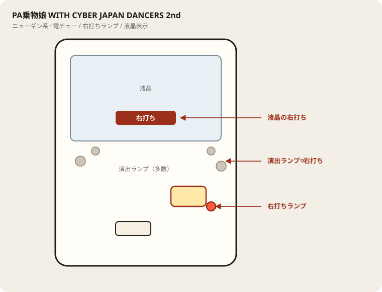

# PA乗物娘 WITH CYBER JAPAN DANCERS 2nd

## 基本情報

| 項目 | 内容 |
| --- | --- |
| メーカー | ニューギン |
| 型式名 | PAぱちんこ乗物娘 with CYBERJAPANDANCERS 2nd season（関連スペック） |
| タイプ | P機 / 甘デジ / ST / 遊タイム / 設定付きの可能性あり |
| 導入日 | 2026年頃導入 |

## スペック

| 項目 | 内容 |
| --- | --- |
| 大当り確率 | 設定により 約1/60〜1/53帯（公開値の幅あり） |
| 乗物RUSH | 突入 100% / ST約40 / 継続 約53〜57% |
| 遊タイム | 低確約160回転消化で長時短 |
| 賞球 | 1&5&7 前後 |
| 出玉 | 4R約280 / 10R約700個前後 |

乗物娘2nd系。ファイル名は店舗表記に合わせた。

## 天井・遊タイム・LT

| 項目 | 内容 |
| --- | --- |
| 天井 | 非搭載（遊タイムで代替） |
| 遊タイム | 搭載。遊タイム搭載。発動回転は現地・ver差を確認。 |
| カウントのリセット | 大当りでリセット。詳細は機種表示を優先 |

## ハイエナ基準

運用は過去分析と共通: **線入り時のみ割り込み**。線外は通常本命にしない。期待差玉の具体数は公開表がある場合のみ。無い場合は未掲載とし捏造しない。

| 項目 | 内容 |
| --- | --- |
| 天井 | 非搭載（遊タイムで代替） |
| 遊タイム | 搭載。遊タイム搭載。発動回転は現地・ver差を確認。 |
| 線入り目安 | 発動回転は ver／現地差あり（ガイド未確定）。公開の数値線は未掲載。液晶の残が浅いときのみ線入り扱い。 |
| 座る | 線入り相当＋液晶確認後のみ座る。線外はウォーク確認・測りに留め、天井消化を本命にしない。 |
| 切る | 線外のまま、または1000円測りでBD未満なら切る。遊タイム／天井恩恵の消化で終了。 |
| 液晶確認 | 必須。現在ST・残・右打ち表示を座前に見る。データ欠落時は液晶のみ。 |
| BD（28玉） | 19.0（ガイド記載） |
| BD（等価） | 17.0（ガイド記載） |

## ボーダー

現金・削りなし。1000円あたり。

| 交換 | ボーダー |
| --- | --- |
| 4.00円（等価） | 17.0 |
| 3.57円（28玉） | 19.0 |
| 3.33円（30玉） | 20.4 |
| 3.03円（33玉） | 22.4 |

持玉で回している間は等価側に寄る。朝イチの現金区間は28玉側で見る。

## 狙い目

19.0回転以上を目安。遊タイムがあるのでハマり回転も確認する。通常時の回転率を優先。

## やめ時

電サポ・RUSHが終わって通常に戻ったとき。回転率が19.0未満なら即やめ。以上なら続けてよい。遊タイムが近い場合は例外として残す判断もあり。

## 朝イチ

閉店スタートは使わない。1000円を通常時だけで数え、19.0回転に届かなければやめる。電サポ中の回転は測定に入れない。遊タイム残りが近い台は別判断。

## 盤面の場所

ニューギン系。演出ボタン周辺のランプと右打ちランプを取り違えない。

系列: **ニューギン系**（機種ごとの目安。個体差あり）

| 項目 | 場所 | 見方 |
| --- | --- | --- |
| 液晶（右打ち表示） | 盤面中央の液晶 | 「右打ち」表示中が電サポ中。切替の最終判断 |
| ヘソ（始動口） | 盤面中央下寄り | 通常時の始動口 |
| 電チュー | 盤面右下〜中央右（液晶の右下寄り） | 羽根が開く入賞口。右打ちの始動口 |
| 右打ちランプ | 電チュー付近、または盤面下部のランプ群 | 点灯中は右打ち。位置は機種差あり。液晶と併用 |
| アタッカー | 盤面下部中央寄り | 大当りラウンドの入賞口 |
| 電サポ | （状態）時短・ST・RUSH・遊タイム中 | 部品ではない。液晶の右打ち表示中 |
| 保留ランプ | 液晶下または盤面下部 | 保留の目安。右打ち終了直後の残保留に注意 |

- ヘソは中央下寄り、アタッカーは下部中央寄りが多い。
- 迷ったら液晶の指示を優先。ランプだけ見て打ち方を決めない。
- 遊タイム残は液晶表示で確認。深さだけで座らない。

## おすすめカスタム

- カスタムは演出の出方だけが変わる。抽選は変わらない。
- 先バレ／先読みがあればON。ない場合はデフォルト。

## 打ち方

- 通常時は左打ち（右打ち指示が出たら従う）。
- 電サポ中・RUSH中は打ち切る。通常に戻ったら回転率を見て継続かやめを決める。

- 遊タイムがある。等価の目安は1000円あたり約17.0回転。

## 総評

乗物RUSH突入100%。継続約53〜57%。遊タイムあり。

出典: P-WORLD（関連スペック）

## 設置店舗

台入れ替えがあるため、各店の**全台データ取得時点**の設置。取得日時は Asia/Tokyo。

直近の全台CSVにこの機種の設置は見当たらない（最終確認日: 2026-11-14）。

## 注意

コンプリート機能あり。公開値の幅あり・現地確認。釘と取りこぼしで前後する。
