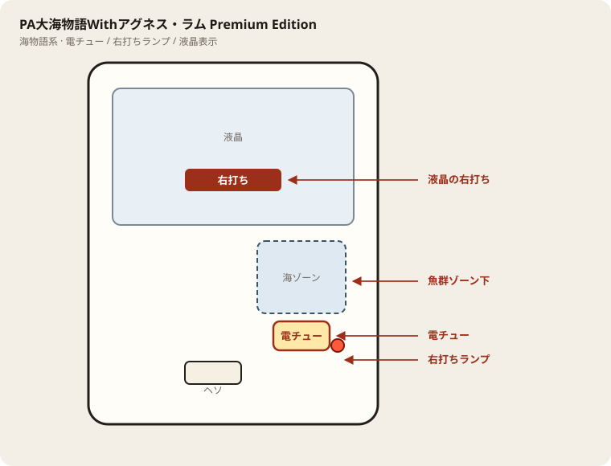

# PA大海物語Withアグネス・ラム Premium Edition

## 基本情報

| 項目 | 内容 |
| --- | --- |
| メーカー | 三洋物産 |
| 型式名 | PA大海物語アグネスプレミアRBA |
| タイプ | P機 / 甘デジ / ST / 遊タイム |
| 導入日 | 2026年9月7日 |

## スペック

| 項目 | 内容 |
| --- | --- |
| 大当り確率 | 通常 約1/99.9、ST中 約1/19.5 |
| ST | 突入 100% / 10回 |
| 電サポ | 25 or 50 or 100回転 |
| 賞球 | 3&2&5&12 |
| 出玉 | 4R約432個、6R約648個、10R約1080個 |

遊タイム残りが浅い台は回転率が悪くても拾える。終了後は残り回転を見て判断。

## 天井・遊タイム・LT

| 項目 | 内容 |
| --- | --- |
| 天井 | 非搭載 |
| 遊タイム | 低確率239回転 → 時短10000回転 |
| カウントのリセット | 遊タイム到達で実質当り濃厚。時短中の回転もカウント |

## ハイエナ基準

型式名は PA大海物語アグネスプレミアRBA と同系統。運用は Agnes 遊タイム239・線入り時のみ割り込み。

| 項目 | 内容 |
| --- | --- |
| 天井 | 非搭載 |
| 遊タイム | 低確率239回転 → 時短10000回転 |
| 線入り目安 | 遊タイム239に対し、残りがおおよそ100回転以内（または液晶で到達間近）を線入りとする。過去分析どおり **線入り時のみ割り込み**。 |
| 座る | 線入り＋液晶で現在ST／残が浅いときだけ座る。線外は通常画面の本命にしない（ウォーク確認のみ）。 |
| 切る | 線外のまま、または1000円測りで28玉BD未満なら切る。遊タイム到達・消化で終了。 |
| 液晶確認 | 必須。データ上の現在STだけでは足りない。右打ち表示と残表示を座前に見る。 |
| BD（28玉） | 18.6（ガイド記載） |
| BD（等価） | 18.0（ガイド記載） |

## ボーダー

現金・削りなし。1000円あたり。

| 交換 | ボーダー |
| --- | --- |
| 4.00円（等価） | 18.0 |
| 3.57円（28玉） | 18.6 |
| 3.33円（30玉） | 19.1 |
| 3.03円（33玉） | 19.8 |

持玉で回している間は等価側に寄る。朝イチの現金区間は28玉側で見る。

## 狙い目

18.6回転以上、または遊タイム（低確239→時短10000）の残りが浅い台。

## やめ時

電サポ・RUSHが終わって通常に戻ったとき。遊タイム直後でなければ、回転率がボーダー未満なら即やめ。

## 朝イチ

閉店スタートと遊タイム進捗を見る。残りが浅ければ優先。そうでなければ1000円を通常時だけで数え、18.6回転に届かなければやめる。

## 盤面の場所

海物語系。魚群・ボタン演出より、液晶の「右打ち」表示と電チュー開放を優先して見る。

系列: **海物語系**（機種ごとの目安。個体差あり）

| 項目 | 場所 | 見方 |
| --- | --- | --- |
| 液晶（右打ち表示） | 盤面中央の液晶 | 「右打ち」が出ているあいだが電サポ中。切替の最終判断 |
| ヘソ（始動口） | 盤面中央下寄り | 通常時の始動。左打ちの玉が落ちる位置 |
| 電チュー | 盤面右側・海／魚群ゾーン下寄り | 右打ち時の始動口。羽根の開閉を目視 |
| 右打ちランプ | 盤面右下〜電チュー周辺 | 点灯＋液晶表示をセットで確認。ランプ単独では決めない |
| アタッカー | 盤面下部中央寄り | 大当りラウンドの入賞口 |
| 電サポ | （状態）時短・ST・RUSH中 | 部品ではない。液晶の右打ち表示中 |
| 保留ランプ | 液晶下または盤面下部 | 保留消化の目安。右打ち中も残保留に注意 |

- 魚群やボタン演出に目が行っても、打ち分けは液晶優先。
- 海系は右打ち中の取りこぼしが回転率を崩しやすい。電チューの拾いを見る。

## おすすめカスタム

- カスタムは演出の出方だけが変わる。抽選は変わらない。
- 海物語系は魚群・ボタンオート・音量くらい。魚群はONのままでよい。
- 当たりやすさは変わらない。台選びと回転率を優先。

## 打ち方

- 通常時は左打ち（右打ち指示が出たら従う）。
- 電サポ中・RUSH中は打ち切る。通常に戻ったら回転率を見て継続かやめを決める。
- 遊タイムがある。等価の目安は1000円あたり約18.0回転。

## 総評

アグネスPremium。遊タイム239回転で時短1万回。シリーズ最短天井寄り。

出典: P-WORLD、なな徹、ぱちタウン、パチンコスペック解析

## 設置店舗

台入れ替えがあるため、各店の**全台データ取得時点**の設置。取得日時は Asia/Tokyo。

| 店舗 | 台数 | データ取得日時 |
| --- | --- | --- |
| 中山UNO | 4 | 2026-11-14 10:47〜10:49（Asia/Tokyo） |
| 中山ZoRoN | 4 | 2026-11-13 14:37（Asia/Tokyo） |
| 楽園渋谷道玄坂店 | 4 | 2026-11-13 16:35（Asia/Tokyo） |
| 楽園町田店 | 5 | 2026-11-14 08:38〜08:40（Asia/Tokyo） |

## 注意

コンプリート機能あり。公開解析の概数で、釘と取りこぼしで前後する。
