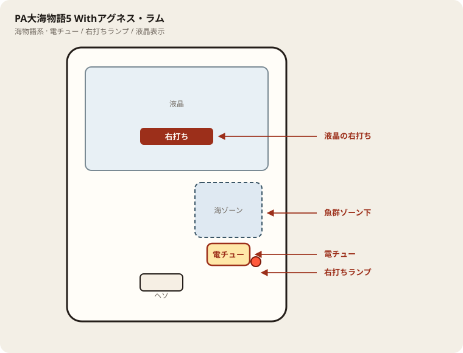

# PA大海物語５ ARBC

ホール表記は「PA大海物語５ ARBC」（型式 PA大海物語5ARBC／商品名 Withアグネス・ラム）。

## 基本情報

| 項目 | 内容 |
| --- | --- |
| メーカー | 三洋物産 |
| 型式名 | PA大海物語5ARBC |
| タイプ | P機 / 甘デジ / ST |
| 導入日 | 2023年7月3日 |

## スペック

| 項目 | 内容 |
| --- | --- |
| 大当り確率 | 通常 約1/99.9、ST中 約1/19.5 |
| ST | 突入 100% / 10回 |
| 電サポ | 25 or 50 or 120回転（ハピネスチャンスは120） |
| ハピネスチャンス | 10R起点 / 継続 約80.5% |
| 賞球 | 3&2&1&2&4&12 |
| 出玉 | 4R約432個、6R約648個、10R約1080個 |

初当り後は右打ち。ハピネスチャンス終了後は実質残り約189回転で遊タイム。

## 天井・遊タイム・LT

| 項目 | 内容 |
| --- | --- |
| 天井 | 非搭載 |
| 遊タイム | 低確率299回転 → 時短379回転 |
| カウントのリセット | 遊タイム到達で時短。通常ハマりそのものは次の抽選に影響しない |

## ボーダー

現金・削りなし。1000円あたり。

| 交換 | ボーダー |
| --- | --- |
| 4.00円（等価） | 17.2 |
| 3.57円（28玉） | 18.0 |
| 3.33円（30玉） | 18.4 |
| 3.03円（33玉） | 19.0 |

持玉で回している間は等価側に寄る。朝イチの現金区間は28玉側で見る。

## 狙い目

18.0回転以上、または遊タイム（低確299→時短379）の残りが浅い台。

## やめ時

電サポ・RUSHが終わって通常に戻ったとき。遊タイム直後でなければ、回転率がボーダー未満なら即やめ。

## 朝イチ

閉店スタートと遊タイム進捗を見る。残りが浅ければ優先。そうでなければ1000円を通常時だけで数え、18.0回転に届かなければやめる。

## 盤面の場所

海物語系。魚群・ボタン演出より、液晶の「右打ち」表示と電チュー開放を優先して見る。

系列: **海物語系**（機種ごとの目安。個体差あり）

| 項目 | 場所 | 見方 |
| --- | --- | --- |
| 液晶（右打ち表示） | 盤面中央の液晶 | 「右打ち」が出ているあいだが電サポ中。切替の最終判断 |
| ヘソ（始動口） | 盤面中央下寄り | 通常時の始動。左打ちの玉が落ちる位置 |
| 電チュー | 盤面右側・海／魚群ゾーン下寄り | 右打ち時の始動口。羽根の開閉を目視 |
| 右打ちランプ | 盤面右下〜電チュー周辺 | 点灯＋液晶表示をセットで確認。ランプ単独では決めない |
| アタッカー | 盤面下部中央寄り | 大当りラウンドの入賞口 |
| 電サポ | （状態）時短・ST・RUSH中 | 部品ではない。液晶の右打ち表示中 |
| 保留ランプ | 液晶下または盤面下部 | 保留消化の目安。右打ち中も残保留に注意 |

- 魚群やボタン演出に目が行っても、打ち分けは液晶優先。
- 海系は右打ち中の取りこぼしが回転率を崩しやすい。電チューの拾いを見る。

## おすすめカスタム

- カスタムは演出の出方だけが変わる。抽選は変わらない。
- 海物語系は魚群・ボタンオート・音量くらい。魚群はONのままでよい。
- 当たりやすさは変わらない。台選びと回転率を優先。

## 打ち方

- 通常時は左打ち（右打ち指示が出たら従う）。
- 電サポ中・RUSH中は打ち切る。通常に戻ったら回転率を見て継続かやめを決める。
- 遊タイムがある。等価の目安は1000円あたり約17.2回転。

## 総評

甘デジ海のアグネス。10Rでハピネスチャンス。遊タイムあり。

出典: P-WORLD、なな徹、ぱちタウン、パチンコスペック解析

## 設置店舗

台入れ替えがあるため、各店の**全台データ取得時点**の設置。取得日時は Asia/Tokyo。

| 店舗 | 台数 | データ取得日時 |
| --- | --- | --- |
| エスパス日拓渋谷駅前新館 | 7 | 2026-11-13 09:57〜09:59（Asia/Tokyo） |

## 注意

コンプリート機能あり。公開解析の概数で、釘と取りこぼしで前後する。
