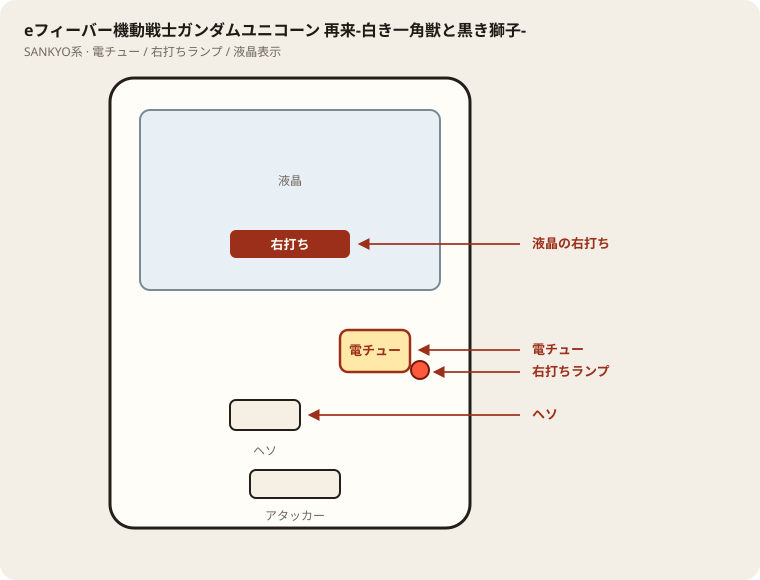

# PF.機動戦士ガンダムユニコーンb

## 基本情報

| 項目 | 内容 |
| --- | --- |
| メーカー | ビスティ（SANKYO） |
| 型式名 | Pフィーバー機動戦士ガンダムユニコーンb |
| タイプ | P機 / ミドル / 1種2種混合 / 転落 |
| 導入日 | 2021年8月2日 |
| 商品名 | Pフィーバー機動戦士ガンダムユニコーン |

## スペック

| 項目 | 内容 |
| --- | --- |
| 大当り確率 | 通常 約1/319.7、右打ち中実質 約1/41.1 |
| RUSH突入 | 約60% |
| RUSH継続 | 約81%（転落小当り 約1/153.7） |
| 電サポ | 0回 or 10000回（転落まで） |
| 賞球 | 3&1&5&15 |
| 出玉 | 10R約1500 / 3R約450個（払い出し）。初当り約20%で3000個 |

## 天井・遊タイム・LT

| 項目 | 内容 |
| --- | --- |
| 天井 | 非搭載 |
| 遊タイム | 非搭載 |
| カウントのリセット | 天井・遊タイムがないため、ハマり回転数は次の抽選に影響しない |

## ボーダー

現金・削りなし。1000円あたり。

| 交換 | ボーダー |
| --- | --- |
| 4.00円（等価） | 17.9 |
| 3.57円（28玉） | 20.1 |
| 3.33円（30玉） | 21.5 |
| 3.03円（33玉） | 23.7 |

持玉で回している間は等価側に寄る。朝イチの現金区間は28玉側で見る。

## 狙い目

20.1回転以上。遊タイムはないのでハマりでは狙わない。通常時の回転率だけを見る。

## やめ時

電サポ・RUSHが終わって通常に戻ったとき。回転率が20.1未満なら即やめ。以上なら続けてよい。

## 朝イチ

閉店スタートは使わない。1000円を通常時だけで数え、20.1回転に届かなければやめる。

## 盤面の場所

SANKYO系。液晶の右打ち表示と電チューを優先。

系列: **SANKYO系**（機種ごとの目安。個体差あり）

| 項目 | 場所 | 見方 |
| --- | --- | --- |
| 液晶（右打ち表示） | 盤面中央 | 右打ち指示の最終判断 |
| ヘソ | 盤面中央下寄り | 通常時の始動 |
| 電チュー | 盤面右側 | 右打ち時の始動 |
| 右打ちランプ | 電チュー周辺 | 液晶と併用 |
| アタッカー | 盤面下部中央寄り | ラウンド入賞 |
| 電サポ | （状態）RUSH中 | 液晶表示中 |
| 保留ランプ | 液晶下または盤面下部 | 残保留に注意 |

- 再来とは別機種。本機は転落型の初代ユニコーン。

## おすすめカスタム

- カスタムは演出の出方だけが変わる。抽選は変わらない。

## 打ち方

- 通常時は左打ち。右打ち指示が出たら従う。
- RUSH中は打ち切る。通常に戻ったら回転率で継続かやめを決める。
- 遊タイムなし。等価目安は約17.9回転/1000円。

## 総評

ホール表記 PF.機動戦士ガンダムユニコーンb。転落RUSH・遊タイムなし。再来シリーズとは別。

出典: P-WORLD、パチンコスペック解析

## 設置店舗

台入れ替えがあるため、各店の**全台データ取得時点**の設置。取得日時は Asia/Tokyo。

| 店舗 | 台数 | データ取得日時 |
| --- | --- | --- |
| エスパス日拓西武新宿駅前店 | 5 | 2026-11-12 09:57（Asia/Tokyo） |

## 注意

コンプリート機能あり。公開解析の概数で、釘と取りこぼしで前後する。
