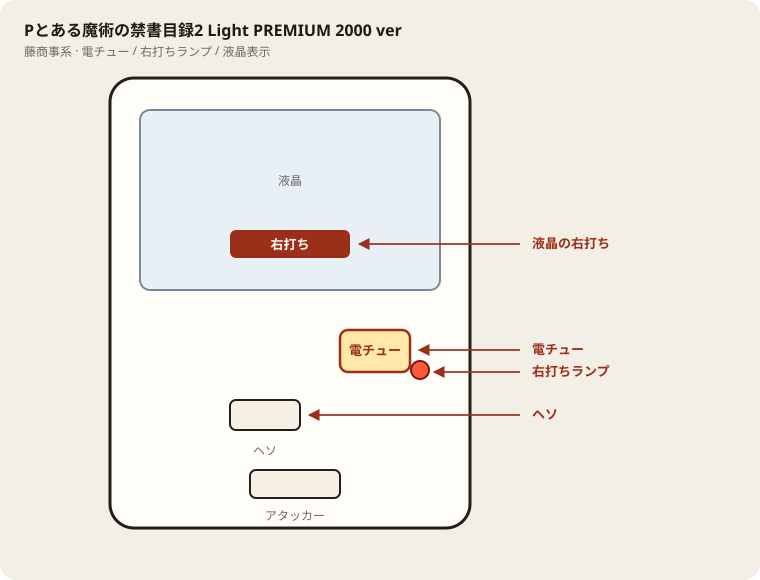

# Pとある魔術の禁書目録2 Light PREMIUM 2000 ver

## 基本情報

| 項目 | 内容 |
| --- | --- |
| メーカー | JFJ |
| 型式名 | Pとある魔術の禁書目録2LightJWX |
| タイプ | P機 / 甘デジ / LT / 1種2種混合 |
| 導入日 | 2025年2月3日 |

## スペック

| 項目 | 内容 |
| --- | --- |
| 大当り確率 | 通常 約1/99.9（特図1小当り経由・V入賞条件） |
| RUSH（最強激突） | 突入 約50% / ST70 / 継続 約65% |
| LT（最強領域） | ST162 / 継続 約91% |
| 賞球 | 1&1&2&4&10 |
| 出玉 | 約200／300／1150／2000個（払い出し。右打ちは特図2×2合算あり） |

RUSH/LT終了後は通常に戻ったら回転率で判断。

## 天井・遊タイム・LT

| 項目 | 内容 |
| --- | --- |
| 天井 | 非搭載 |
| 遊タイム | 非搭載 |
| ラッキートリガー | 最強領域（ST162・継続約91%） |
| カウントのリセット | 天井・遊タイムがないため、ハマり回転数は次の抽選に影響しない |

## ボーダー

現金・削りなし。1000円あたり。

| 交換 | ボーダー |
| --- | --- |
| 4.00円（等価） | 17.6 |
| 3.57円（28玉） | 19.7 |
| 3.33円（30玉） | 21.1 |
| 3.03円（33玉） | 23.2 |

持玉で回している間は等価側に寄る。朝イチの現金区間は28玉側で見る。

## 狙い目

19.7回転以上。遊タイムはないのでハマりでは狙わない。通常時の回転率だけを見る。

## やめ時

電サポ・RUSHが終わって通常に戻ったとき。回転率が19.7未満なら即やめ。以上なら続けてよい。

## 朝イチ

閉店スタートは使わない。1000円を通常時だけで数え、19.7回転に届かなければやめる。電サポ中の回転は測定に入れない。

## 盤面の場所

藤商事系。液晶の右打ち表示を最終判断にする。

系列: **藤商事系**（機種ごとの目安。個体差あり）

| 項目 | 場所 | 見方 |
| --- | --- | --- |
| 液晶（右打ち表示） | 盤面中央の液晶 | 「右打ち」表示中が電サポ中。切替の最終判断 |
| ヘソ（始動口） | 盤面中央下寄り | 通常時の始動口 |
| 電チュー | 盤面右下〜中央右（液晶の右下寄り） | 羽根が開く入賞口。右打ちの始動口 |
| 右打ちランプ | 電チュー付近、または盤面下部のランプ群 | 点灯中は右打ち。位置は機種差あり。液晶と併用 |
| アタッカー | 盤面下部中央寄り | 大当りラウンドの入賞口 |
| 電サポ | （状態）時短・ST・RUSH・遊タイム中 | 部品ではない。液晶の右打ち表示中 |
| 保留ランプ | 液晶下または盤面下部 | 保留の目安。右打ち終了直後の残保留に注意 |

- ヘソは中央下寄り、アタッカーは下部中央寄りが多い。
- 迷ったら液晶の指示を優先。ランプだけ見て打ち方を決めない。
- 遊タイム残は液晶表示で確認。深さだけで座らない。

## おすすめカスタム

- カスタムは演出の出方だけが変わる。抽選は変わらない。
- 先バレ／先読みがあればON。LT中は告知寄り。

## 打ち方

- 通常時は左打ち（右打ち指示が出たら従う）。
- 電サポ中・RUSH中は打ち切る。通常に戻ったら回転率を見て継続かやめを決める。
- 遊タイムがないため、深くハマった履歴だけでは拾わない。等価の目安は1000円あたり約17.6回転。

## 総評

とある2甘デジLT。RUSH突入50%、LT継続約91%。遊タイムなし。

出典: P-WORLD、なな徹、ぱちタウン、パチンコスペック解析

## 設置店舗

台入れ替えがあるため、各店の**全台データ取得時点**の設置。取得日時は Asia/Tokyo。

直近の全台CSVにこの機種の設置は見当たらない（最終確認日: 2026-11-13）。

## 注意

コンプリート機能あり。公開解析の概数で、釘と取りこぼしで前後する。V入賞条件の取りこぼしに注意。
