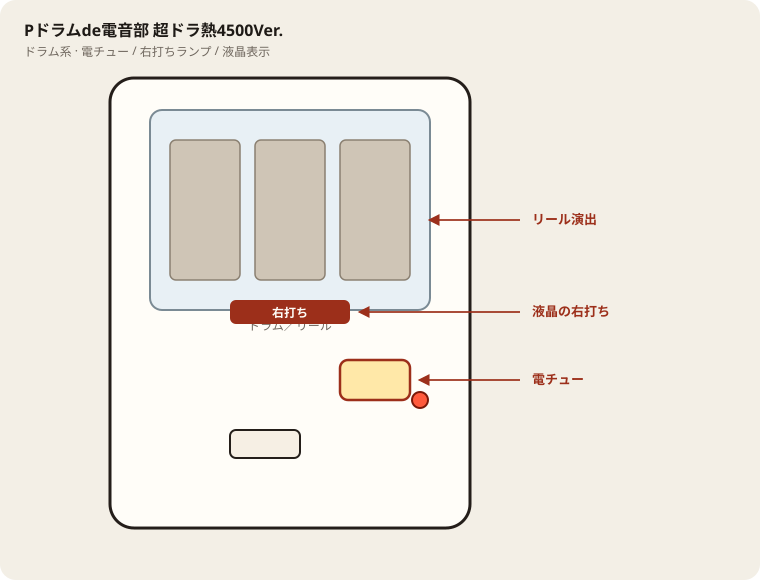

# Pドラムde電音部 超ドラ熱4500Ver.

## 基本情報

| 項目 | 内容 |
| --- | --- |
| メーカー | ミズホ |
| 型式名 | P電音部ZME |
| 商品名 | Pドラムde 電音部 超ドラ熱4500ver. |
| タイプ | ライトミドル / 1種2種混合 / ラッキートリガー / 遊タイム |
| 導入日 | 2026年10月5日 |
| 筐体 | BILLY ROLL |
| 楽曲 | 109曲 |

## スペック

| 項目 | 内容 |
| --- | --- |
| 大当り確率 | 通常時 1/259.0 |
| 大当り確率（右打ち中） | 1/2.0 |
| りむるしか勝たんチャレンジ | 時短1回 / 突入率 50%（遊タイム経由は51%） / 成功 50% |
| 超ドラ熱ATTACK | 時短1回 / 成功 50% / 成功時の出玉は4500個以上 |
| 電サポ | 0回 or 1回 or 100回 |
| 賞球 | 1&7&15 |
| カウント | 10カウント |
| 右打ち | 遊タイム、りむるしか勝たんチャレンジ、超ドラ熱ATTACK |

通常時は大きめのヘソ「アゲアゲSTART」で回す。右打ちはすべて1回転決着。4500個は1500個×3。出玉は払い出し。小当り経由の大当りはV入賞が条件。

| 状態 | 出玉 | 行き先 | 割合 |
| --- | --- | --- | --- |
| 通常時 | 4500個 | 超ドラ熱ATTACK | 1% |
| 通常時 | 300個 | りむるしか勝たんチャレンジ | 50% |
| 通常時 | 300個 | 通常 | 49% |
| 遊タイム | 1500個 | りむるしか勝たんチャレンジ | 51% |
| 遊タイム | 1500個 | 通常 | 49% |
| チャレンジ中 | 1500個 | 超ドラ熱ATTACK | 100%（当たったとき） |
| 超ドラ熱ATTACK | 4500個×2 | 超ドラ熱ATTACK継続 | 2% |
| 超ドラ熱ATTACK | 4500個 | 超ドラ熱ATTACK継続 | 98% |

チャレンジもATTACKも、当たる確率自体は約1/2。上の100%は「当たったときの行き先」であり、1回転で必ず当たるという意味ではない。

## 天井・遊タイム・LT

| 項目 | 内容 |
| --- | --- |
| 天井 | 遊タイムが天井を兼ねる |
| 遊タイム | 低確率状態を550回転消化 |
| 恩恵 | 時短100回。大当り期待度は約99.9%で、ほぼ大当り濃厚。出玉は1500個 |
| 遊タイム後の分岐 | 51%でりむるしか勝たんチャレンジ、49%で1500個のまま通常 |
| ラッキートリガー | 超ドラ熱ATTACK。1回転ごとに4500個以上を取りにいく |
| リセット | 低確率の回転数で数える。大当りや電サポに入るとカウントは止まる |

## ボーダー

終日・現金の目安。1000円あたり。

| 交換 | ボーダー |
| --- | --- |
| 4.00円（等価） | 29.9 |
| 3.57円（28玉） | 31.1 |
| 3.33円（30玉） | 32.0 |

ヘソが大きく、同じ釘でも他機種よりスタートは出やすい。その分、ボーダーの数字も高い。16〜20回転は「回っている」のではなく不足。

## 狙い目

- 17回転前後なら、残り200（スタート350）から。
- 20回転出るなら、残り250（スタート300）から。
- 15回転しか出ない店は、残り175（スタート375）まで待つ。残り150（スタート400）ならはっきりプラス。

スタート0からの550回転消化は、上の表だとどの列も数千個のマイナス。朝イチで浅い台に座らない。

遊タイムに入る直前は、ヘソ保留を残したまま突入しない。最後の1回転を自分で消化してから右へ行く。

## やめ時

ATTACKとりむるが終わって通常に戻ったとき。その時点のスタートが上の線より浅ければやめる。深いときだけ天井まで打つ。

## 朝イチ

見る数字は前日閉店のスタートだけ。350未満は原則見送り。回転率は朝の1000円で確認し、15回転を下回るなら線をさらに残りの少ない側へずらす。

履歴の「遊タイム」行と、その直後の大当りは、すでに恩恵を消化した印。閉店スタートが0や1なら、その日の遊タイムは終わっている。

## 遊タイムの期待値

公開されている期待差玉（残り回転×回転率）の抜粋。プラスになる残りだけ見る。

| 残り | 15回転/千円 | 17回転 | 20回転 |
| --- | --- | --- | --- |
| 250 | −600個 | −285個 | +69個 |
| 200 | −169個 | +105個 | +413個 |
| 175 | +81個 | +330個 | +611個 |
| 150 | +355個 | +579個 | +830個 |
| 100 | +990個 | +1,153個 | +1,337個 |
| 50 | +1,761個 | +1,851個 | +1,951個 |

28玉交換では、この差玉×3.57円から現金の交換差を引いた額が手元の期待値。残りが少ないほど交換差の影響は小さい。

## 盤面の場所

ドラム筐体。リール演出に気を取られやすいが、右打ち切替は液晶と電チュー。

系列: **ドラム系**（機種ごとの目安。個体差あり）

| 項目 | 場所 | 見方 |
| --- | --- | --- |
| 液晶／リール | 盤面中央（ドラム部） | 演出本体。右打ち表示もここを見る |
| ヘソ（始動口） | 盤面中央下寄り | 通常時の始動 |
| 電チュー | 盤面右下〜中央右 | 遊タイム／RUSH中の始動口 |
| 右打ちランプ | 電チュー横〜盤面下 | 点灯＋液晶表示をセットで |
| アタッカー | 盤面下部中央寄り | ラウンド消化 |
| 電サポ | （状態）RUSH・遊タイム中など | 部品ではない。液晶の右打ち表示中 |
| 遊タイム残表示 | 液晶内（機種による） | 残り回転の確認。盤面ランプと取り違えない |

- ドラムの停止出目だけで打ち分けを変えない。
- 遊タイム機は残り表示を座前に確認し、線以外で長居しない。

## おすすめカスタム

- カスタムは演出の出方だけが変わる。抽選は変わらない。
- 先読みエリア示唆をONにしておく。シブヤは大当り濃厚寄り、アザブ無音は高期待。
- 楽曲カスタムは好み。抽選には影響しない。

## 主なモード・演出の見方

- ドラムが出現する「ドラ熱」は期待度約50%、という作り。勝負どころの確率と演出の熱さを揃えている。
- 先読みのエリア示唆は、シブヤが大当り濃厚。アザブの無音はりむるしか勝たんチャレンジ寄り（目安約75%）。アキバはドラ熱以上が濃厚（目安約50%）。カブキはメンバー登場でチャレンジ（目安約35%）。
- 金7揃いは通常時の4500個で、消化後は超ドラ熱ATTACK直行。
- 7揃いは300個からチャレンジ。エリア揃いは300個で、成功ならチャレンジ、失敗なら通常。
- 専用プレミアムは、出た時点で4500個かつ超ドラ熱ATTACKが濃厚。

## 打ち方

- 通常時は左打ち。初当りの約半分は300個のあと1回転のチャレンジ、約49%は300個で終了、1%だけ4500個からATTACK直行。
- チャレンジは右打ち1回転。約50%で1500個を取り、超ドラ熱ATTACKへ進む。外れたら通常に戻る。
- 超ドラ熱ATTACKも1回転勝負で約50%。当たるたびに4500個が付き、98%で次の1回転に残る。2%は4500個がもう1セット乗ってから継続する。1回転ごとに結果が出るので、画面がATTACKのままなら打ち続ける。
- 遊タイムは550回転。時短100回の大当りがほぼ濃厚で、1500個は付く。その先のチャレンジは51%なので、天井到達イコール4500個ループではない。
- 残り回転が見える台は、550回転まで打ち切る価値が出てから席に着く。等価で回転単価を見る目安は、解析により1000円あたりおよそ30回転前後と高い。ヘソが1個で確率も1/259のため、通常時のボーダーは重め。
- やめ時は、初当り後にチャレンジへ進まず通常に戻ったあと、チャレンジ失敗後、ATTACKが継続せず通常に戻ったあと。遊タイムの100回は最後まで打つ。

## 総評

ライトミドルの数字より、中身は「1/2を何回続けられるか」の台。通常の51%で1回転勝負に進み、その50%で4500個ループの入口に立つ。ATTACKに残れば1回転ごとに4500個が約半分で付くので、残った回の火力は大きい。逆に、300個で戻る49%と、チャレンジ外しの50%が重なると、1/259の投資だけが残る。

遊タイム550回は深い。到達すれば1500個はほぼ確定だが、4500個ループへ進むのはその先の51%。天井狙いは残りが短い台に限ったほうがよい。楽曲数が多く、1回転ごとに曲と結果が変わるので、長時間の通常消化より、勝負所だけを集中して見る打ち方に合う。

出典: P-WORLD、なな徹、パチ&スロ必勝本、ユニバーサルエンターテインメント

## 設置店舗

台入れ替えがあるため、各店の**全台データ取得時点**の設置。取得日時は Asia/Tokyo。

| 店舗 | 台数 | データ取得日時 |
| --- | --- | --- |
| 楽園町田店 | 2 | 2026-11-13 14:37（Asia/Tokyo） |

## 注意

コンプリート機能あり。4500個は1500個×3の合計で、データ上は連チャンに見える。連チャン数だけで「まだ続きそう」と判断しない。
