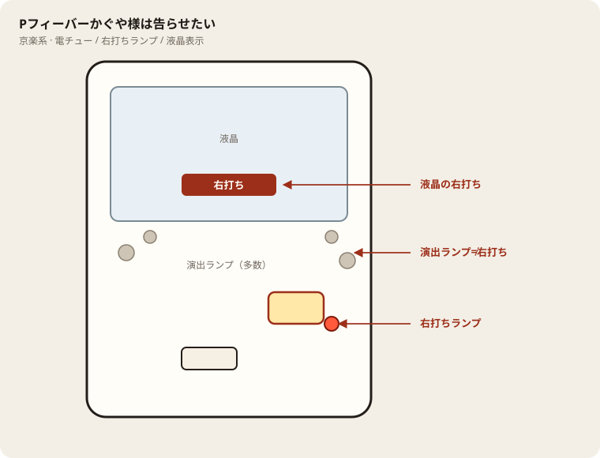

# Pフィーバーかぐや様は告らせたい

## 基本情報

| 項目 | 内容 |
| --- | --- |
| メーカー | SANKYO |
| 型式名 | Pフィーバーかぐや様は告らせたいR |
| タイプ | P機 / ミドル / V-ST |
| 導入日 | 2023年10月2日 |

## スペック

| 項目 | 内容 |
| --- | --- |
| 大当り確率 | 通常 1/319.7、ST中 1/98.3 |
| RUSH | 直行 約64% / トータル突入 約74% / ST160 / 継続 約81% |
| 時短 | 非RUSH時 100回転（引き戻し約27%） |
| 賞球 | 1&5&15 |
| 出玉 | 2R約300 / 10R約1500個（RUSH中ALL1500） |

かぐや様ミドル。RUSH中はALL1500個。

## 天井・遊タイム・LT

| 項目 | 内容 |
| --- | --- |
| 天井 | 非搭載 |
| 遊タイム | 非搭載 |
| カウントのリセット | 天井・遊タイムがないため、ハマり回転数は次の抽選に影響しない |

## ボーダー

現金・削りなし。1000円あたり。

| 交換 | ボーダー |
| --- | --- |
| 4.00円（等価） | 17.3 |
| 3.57円（28玉） | 18.3 |
| 3.33円（30玉） | 18.8 |
| 3.03円（33玉） | 19.7 |

持玉で回している間は等価側に寄る。朝イチの現金区間は28玉側で見る。

## 狙い目

18.3回転以上。遊タイムはないのでハマりでは狙わない。通常時の回転率だけを見る。

## やめ時

電サポ・RUSHが終わって通常に戻ったとき。回転率が18.3未満なら即やめ。以上なら続けてよい。

## 朝イチ

閉店スタートは使わない。1000円を通常時だけで数え、18.3回転に届かなければやめる。電サポ中の回転は測定に入れない。

## 盤面の場所

京楽系は盤面ランプが多く、演出ランプと右打ちランプを取り違えやすい。

系列: **京楽系**（機種ごとの目安。個体差あり）

| 項目 | 場所 | 見方 |
| --- | --- | --- |
| 液晶（右打ち表示） | 盤面中央の液晶 | 切替の最終判断。演出色より表示文字を見る |
| ヘソ（始動口） | 盤面中央下寄り（デカヘソ機は特大） | 通常時の始動 |
| 電チュー | 盤面右下寄り | 右打ち時の始動口 |
| 右打ちランプ | 電チュー付近〜盤面下のランプ群 | 赤点灯が右打ちのことが多いが、機種差あり。液晶と併用 |
| 演出ランプ | 盤面左右・上部 | 信頼度演出用。右打ち判断に使わない |
| アタッカー | 盤面下部中央寄り | ラウンド消化 |
| 電サポ | （状態）時短・ST・RUSH中 | 部品ではない |

- カラフルな点灯だけで右打ちに切り替えない。
- デカヘソ機は通常時の拾いが回転率に直結する。

## おすすめカスタム

- カスタムは演出の出方だけが変わる。抽選は変わらない。
- 先バレ／先読みがあればON。ない場合はデフォルト。

## 打ち方

- 通常時は左打ち（右打ち指示が出たら従う）。
- 電サポ中・RUSH中は打ち切る。通常に戻ったら回転率を見て継続かやめを決める。

- 遊タイムがないため、深くハマった履歴だけでは拾わない。等価の目安は1000円あたり約17.3回転。

## 総評

トータルRUSH突入約74%。ST160継続約81%。遊タイムなし。

出典: ぱちタウン、なな徹、パチセブン

## 設置店舗

台入れ替えがあるため、各店の**全台データ取得時点**の設置。取得日時は Asia/Tokyo。

直近の全台CSVにこの機種の設置は見当たらない（最終確認日: 2026-11-13）。

## 注意

コンプリート機能あり。公開値の幅あり・現地確認。釘と取りこぼしで前後する。
