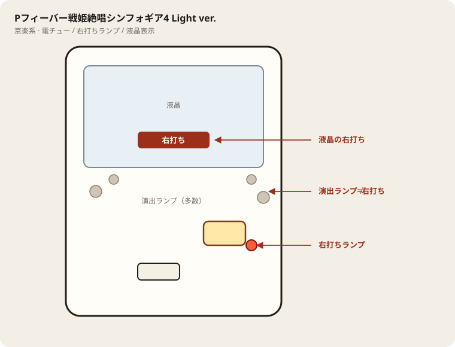

# Pフィーバー戦姫絶唱シンフォギア4 Light ver.

## 基本情報

| 項目 | 内容 |
| --- | --- |
| メーカー | SANKYO |
| 型式の目安 | PAフィーバー戦姫絶唱シンフォギア4AR（P表記のLight ver.と同一スペック帯） |
| タイプ | 甘デジ / 1種2種混合 / ヘソ3個賞球 |
| 導入日 | 2025年8月4日 |
| 兄弟機 | LT-Light ver.は別スペック。本機はヘソ3個・最終決戦突破約50%のLight ver. |

## スペック

| 項目 | 内容 |
| --- | --- |
| 大当り確率 | 通常時 約1/99.9 |
| 最終決戦 | 時短1回 / 図柄揃い 約1/2.0 / 突破率 約50% |
| 絶唱RUSH・超絶唱RUSH | 図柄揃い 約1/38 |
| 絶唱RUSH | ST45回 / 継続率 約70% |
| 超絶唱RUSH | ST70回 / 継続率 約85% |
| RUSHトータル突入率 | 約50% |
| 賞球 | 3&1&4&10 |
| ラウンド / カウント | 3R or 5R / 10カウント（右上・右下アタッカーとも10カウント、賞球10個） |
| 右打ち | 最終決戦、絶唱RUSH、超絶唱RUSH |

右打ち中の確率は特図2に限る。普図のロング開放に当たると、特図2が実質約1/1で大当りになる、という経由を含む。大当りはV入賞が条件。

| 状態 | 出玉 | 行き先 | 割合 |
| --- | --- | --- | --- |
| 通常時 | 1500個（500個×3） | 超絶唱RUSH（70回） | 約0.2% |
| 通常時 | 300個 | 最終決戦（1回） | 約99.8% |
| 最終決戦 | 500個 | 絶唱RUSH（45回） | 突破できたとき |
| 絶唱RUSH | 1500個 | 超絶唱RUSH（70回） | 約10% |
| 絶唱RUSH | 500個 | 絶唱RUSH継続 | 約90% |
| 超絶唱RUSH | 3000個（500個×6） | 超絶唱RUSH継続 | 約1% |
| 超絶唱RUSH | 1500個 | 超絶唱RUSH継続 | 約8% |
| 超絶唱RUSH | 1000個（500個×2） | 超絶唱RUSH継続 | 約8% |
| 超絶唱RUSH | 500個 | V-STOCK | 約4% |
| 超絶唱RUSH | 500個 | 超絶唱RUSH継続 | 約79% |

## 天井・遊タイム・LT

| 項目 | 内容 |
| --- | --- |
| 天井 | 非搭載 |
| 遊タイム | 非搭載 |
| ラッキートリガー | 非搭載。上位の超絶唱RUSHはST70回・継続率約85%の高継続帯であり、LT-Light ver.のLTとは別 |
| カウントのリセット | 天井・遊タイムがないため、通常時の回転数は救済に使えない |

SANKYO公式はLT-Light ver.とLight ver.を分けて掲載している。Light ver.は突破率を約50%に上げ、ヘソ賞球を3個にした代わりに、超絶唱RUSHの3000個比率は約1%まで下がっている。

## ボーダー

電サポ中の増減なし。1000円あたり。

| 交換 | ボーダー |
| --- | --- |
| 4.00円（等価） | 19.0 |
| 3.57円（28玉） | 19.7 |
| 3.33円（30玉） | 20.2 |
| 3.03円（33玉） | 20.8 |

ヘソ3個なので、ヘソ1個の機種よりスタートは出やすい。19.7を「甘い」と誤読しない。

## 狙い目

28玉なら20回転以上を目安に、19.7を実測で超える台。18回転以下は甘デジに見えても現金では足りない。

天井も潜伏もない。スタートが100を超えても狙わない。

最終決戦の突破は約50%。初当り＝RUSH確定ではない。

## やめ時

絶唱RUSH、超絶唱RUSHが終わって通常に戻ったとき。回転率がボーダー以上なら通常継続、未満なら即やめ。

最終決戦で落ちたあとも同じ。取り返すために通常を延ばさない。

## 朝イチ

閉店スタートは使わない。1000円を通常時だけで数え、20回転に届かなければ次へ行く。

最終決戦の1回転やRUSH中の45、70回転を、通常の回転率に足さない。

## 盤面の場所

京楽系は盤面ランプが多く、演出ランプと右打ちランプを取り違えやすい。

系列: **京楽系**（機種ごとの目安。個体差あり）

| 項目 | 場所 | 見方 |
| --- | --- | --- |
| 液晶（右打ち表示） | 盤面中央の液晶 | 切替の最終判断。演出色より表示文字を見る |
| ヘソ（始動口） | 盤面中央下寄り（デカヘソ機は特大） | 通常時の始動 |
| 電チュー | 盤面右下寄り | 右打ち時の始動口 |
| 右打ちランプ | 電チュー付近〜盤面下のランプ群 | 赤点灯が右打ちのことが多いが、機種差あり。液晶と併用 |
| 演出ランプ | 盤面左右・上部 | 信頼度演出用。右打ち判断に使わない |
| アタッカー | 盤面下部中央寄り | ラウンド消化 |
| 電サポ | （状態）時短・ST・RUSH中 | 部品ではない |

- カラフルな点灯だけで右打ちに切り替えない。
- デカヘソ機は通常時の拾いが回転率に直結する。

## おすすめカスタム

- カスタムは演出の出方だけが変わる。抽選は変わらない。
- 通常時は先てがみON＋先読み「熱」。レバブルアップONも推奨。Vフラッシュは好み。
- ラッシュ中も先てがみON。発生で大当り濃厚寄り。

## 主なモード・演出の見方

- 最終決戦は時短1回転。右打ちでパネルを貯め、3回の攻撃でシェム・ハに勝てば大当り濃厚。パネルの熱さはクリス、翼、響、絶唱の順。
- 絶唱RUSHと超絶唱RUSHは演出を8種類から選べる。オールスター、響、翼、クリス、マリア、調&切歌、キャロル、隠しの未来。
- 絶唱ゾーンは突入時点で期待が高い。聖詠、絶唱演出はリーチ後の熱い予告。裏ボタンの色も見る。
- ギアVアタックはVを掴む演出で、出れば1000個以上が期待できる、という位置づけ（兄弟機と演出が共通する部分がある）。
- V-STOCKは500個大当りの一部から入る上乗せ経路。

## 打ち方

- 通常時は左打ち。ヘソが3個戻るので、1個賞球の甘デジより玉の減りが遅い。
- 初当りのほとんどは300個のあと、最終決戦の1回転。スルーに玉を通し、画面の右打ち指示に従う。突破は約50%で、抜けたら500個と絶唱RUSH。
- 絶唱RUSHは45回・約70%。1500個（約10%）が出るまでが上位への道。途中でやめない。
- 超絶唱RUSHは70回・約85%。出玉の約79%は500個なので、継続はしても1回の塊は小さい。3000個は約1%。1000個以上を足してもおおむね十数%。
- 天井がないのでハマり回転数では拾わない。等価の理論値目安は12時間稼働で約19.1回転（250玉あたり、P-WORLD）。
- やめ時は、最終決戦を突破できず通常に戻ったあと、または超絶唱RUSHが継続せず通常に戻ったあと。1回転勝負の指示が出ているあいだは打ち切る。

## 総評

シンフォギア4の甘デジで、LTなし・ヘソ3個・最終決戦1/2、という遊びやすさに振った版。初当りは1/99.9で近く、右打ちの入口も約半分残る。絶唱RUSHの継続率約70%は十分で、上位の約85%も数字のうえでは強い。

ただし上位に入っても500個が大半で、3000個は約1%。LT-Light ver.のような「上位に入れば塊が出る」構造ではない。ヘソ3個で通常時の消耗を抑え、歌と最終決戦の1回転を繰り返す台。万発を取りにいくなら、1500個から超絶唱に上がったあとも500個連チャンを長く引く必要がある。短時間で歌を聞きたい人には合い、一撃の火力を最優先する人にはLT版のほうが役割が違う。

出典: SANKYO機種情報サイト、パチ&スロ必勝本、P-WORLD、遊技日本

## 注意

コンプリート機能あり。ボーダーは必勝本のシミュレート（3000回転×10万、電サポ増減なし）に合わせた。1Rの実出玉が設計より削れる台は、さらに回転が要る。
