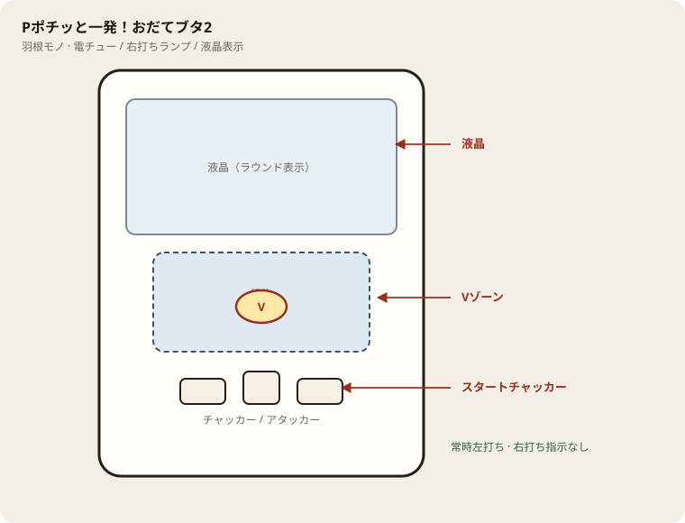

# Pポチッと一発！おだてブタ2

## 基本情報

| 項目 | 内容 |
| --- | --- |
| メーカー | アムテックス |
| 型式名 | Pポチッと一発おだてブタ2V1 |
| タイプ | 羽根モノ / 役物機 |
| 導入日 | 2024年1月9日 |

## スペック

| 項目 | 内容 |
| --- | --- |
| 賞球 | 5&14 |
| カウント | 9カウント |
| ラウンド | 3R/5R/10R（各約1/3） |
| 出玉 | 約252 / 504 / 1134個（払い出し、初回羽根入賞が1R目） |
| 役物確率 | 実測目安 約1/11前後（台差大） |

ノーマルルート・スペシャルルート・逆転おだてルートからV入賞を狙う。

## 天井・遊タイム・LT

| 項目 | 内容 |
| --- | --- |
| 天井 | 非搭載 |
| 遊タイム | 非搭載 |
| 電サポ・確変 | 非搭載 |
| カウントのリセット | 天井・遊タイムがないため、ハマりは次の抽選に影響しない |

## ボーダー

現金・削りなし。1000円あたりの鳴き（スタート）目安。役物・拾い次第で大きく動く。

| 交換 | ボーダー |
| --- | --- |
| 4.00円（等価） | 11.0 |
| 3.57円（28玉） | 12.0 |
| 3.33円（30玉） | 12.5 |
| 3.03円（33玉） | 13.5 |

持玉で回している間は等価側に寄る。朝イチの現金区間は28玉側で見る。

## 狙い目

12.0鳴き以上を目安。羽根の拾いと役物抜けが良い台だけ。ハマり履歴では狙わない。

## やめ時

大当り消化後に通常へ戻ったら、鳴き・拾いが落ちていればやめる。電サポはない。

## 朝イチ

閉店スタートは使わない。1000円の鳴きだけ数える。拾いが悪ければ即やめ。

## 盤面の場所

常時左打ち。羽根開放と役物内のV入賞が本体。右打ち指示はない。

系列: **羽根モノ**（機種ごとの目安。個体差あり）

| 項目 | 場所 | 見方 |
| --- | --- | --- |
| スタートチャッカー | 盤面下部（左右／中央） | 入賞で羽根が開く。中央入賞は開放回数が増える機種あり |
| 羽根 | 役物の上部〜入り口 | 開放中に玉を役物内へ送る |
| Vゾーン | 役物内（回転体・穴・ホームランVなど） | 入賞で大当り。抜けやすい台は即やめ材料 |
| アタッカー | 盤面下部中央寄り | ラウンド消化。開放を見て打ち出しを合わせる |
| 液晶 | 盤面中央 | ラウンド表示・止め打ち目安。打ち分け指示は出ない |

- 右打ちランプは使わない。常に左打ち。
- 拾いと役物抜けの台差が大きい。1000円の鳴きとV到達を見て切る。

## おすすめカスタム

- ラウンド告知は通常／ステップアップ／まる見えから選択可。抽選は変わらない。
- 先バレがない機種。演出好みで選ぶ。

## 打ち方

- 常時左打ち。スタート入賞→羽根開放→役物でVを狙う。
- 電サポがないため、大当り後も通常と同じ立ち回り。
- 遊タイムがないため、深くハマった履歴だけでは拾わない。等価の鳴き目安は1000円あたり約11.0（調査中・台差大）。

## 総評

復刻系の羽根モノ。3R/5R/10R均等振り分け。役物・拾いの台差が大きく、デジタル機と同じ感覚では測れない。遊タイムなし。

出典: P-WORLD、なな徹、ぱちタウン、パチンコスペック解析

## 注意

調査中。羽根モノのためデジタル機と同じ回転率比較はできない。役物・拾いの台差が大きく、公開ボーダーは概数。釘と取りこぼしで前後する。
