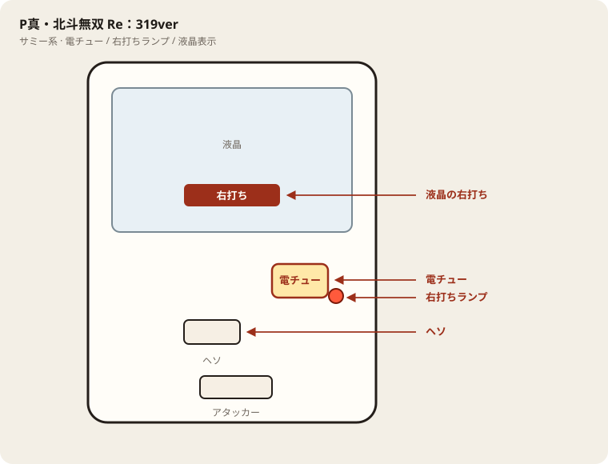

# P真北斗無双FWQG

## 基本情報

| 項目 | 内容 |
| --- | --- |
| メーカー | サミー |
| 型式名 | P真北斗無双FWQG |
| タイプ | P機 / ミドル / V-ST |
| 導入日 | 2022年1月24日 |
| 商品名 | P真・北斗無双 Re：319ver. |

## スペック

| 項目 | 内容 |
| --- | --- |
| 大当り確率 | 通常 約1/319.7、ST中 約1/71.1 |
| 確変（ST） | ヘソ 50% / 電チュー 100%（ST130回） |
| ST継続 | 約84%（残保留込み） |
| 電サポ | 100回 or 130回 |
| 賞球 | 1&1&2&5&15 |
| 出玉 | 3R約450 / 6R約900 / 10R約1500個（払い出し） |

ヘソは6R確変50% / 6R通常+時短100 50%。電チューは10R 70% / 3R 30%（いずれもST130）。

## 天井・遊タイム・LT

| 項目 | 内容 |
| --- | --- |
| 天井 | 非搭載 |
| 遊タイム | 非搭載 |
| カウントのリセット | 天井・遊タイムがないため、ハマり回転数は次の抽選に影響しない |

## ボーダー

現金・削りなし。1000円あたり。

| 交換 | ボーダー |
| --- | --- |
| 4.00円（等価） | 17.0 |
| 3.57円（28玉） | 19.0 |
| 3.33円（30玉） | 20.4 |
| 3.03円（33玉） | 22.4 |

持玉で回している間は等価側に寄る。朝イチの現金区間は28玉側で見る。

## 狙い目

19.0回転以上。遊タイムはないのでハマりでは狙わない。通常時の回転率だけを見る。

## やめ時

電サポ・RUSHが終わって通常に戻ったとき。回転率が19.0未満なら即やめ。以上なら続けてよい。

## 朝イチ

閉店スタートは使わない。1000円を通常時だけで数え、19.0回転に届かなければやめる。電サポ中の回転は測定に入れない。

## 盤面の場所

サミー系。液晶の右打ち表示を本命に、電チューの開放を目視する。

系列: **サミー系**（機種ごとの目安。個体差あり）

| 項目 | 場所 | 見方 |
| --- | --- | --- |
| 液晶（右打ち表示） | 盤面中央の液晶 | 「右打ち」表示中が電サポ中。切替の最終判断 |
| ヘソ（始動口） | 盤面中央下寄り | 通常時の始動口 |
| 電チュー | 盤面右下〜中央右 | 右打ちの始動口 |
| 右打ちランプ | 電チュー付近 | 点灯＋液晶をセットで確認 |
| アタッカー | 盤面下部中央寄り | 大当りラウンドの入賞口 |
| 電サポ | （状態）時短・ST・RUSH中 | 液晶の右打ち表示中 |
| 保留ランプ | 液晶下または盤面下部 | 残保留に注意 |

- 迷ったら液晶の指示を優先。

## おすすめカスタム

- カスタムは演出の出方だけが変わる。抽選は変わらない。

## 打ち方

- 通常時は左打ち（右打ち指示が出たら従う）。
- 電サポ中・RUSH中は打ち切る。通常に戻ったら回転率を見て継続かやめを決める。
- 遊タイムがないため、深くハマった履歴だけでは拾わない。等価の目安は1000円あたり約17.0回転。

## 総評

ホール表記・型式名は P真北斗無双FWQG（商品名 Re：319ver.）。V-ST・遊タイムなし。

出典: P-WORLD、パチンコスペック解析、DMMぱちタウン

## 設置店舗

台入れ替えがあるため、各店の**全台データ取得時点**の設置。取得日時は Asia/Tokyo。

| 店舗 | 台数 | データ取得日時 |
| --- | --- | --- |
| エスパス日拓西武新宿駅前店 | 4 | 2026-11-12 09:57（Asia/Tokyo） |

## 注意

コンプリート機能あり。公開解析の概数で、釘と取りこぼしで前後する。
