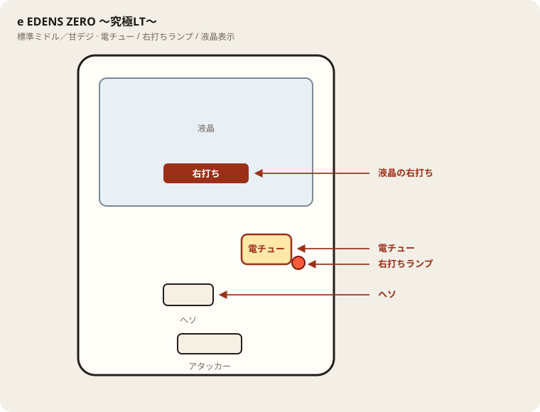

# e EDENS ZERO ～究極LT～

## 基本情報

| 項目 | 内容 |
| --- | --- |
| メーカー | 七匠 |
| 型式名 | eエデンズゼロAIN |
| タイプ | スマパチ / ミドル / LT（二段構え） |
| 導入日 | 2026年8月3日 |

## スペック

| 項目 | 内容 |
| --- | --- |
| 図柄揃い | 約1/399.9 |
| チャージ | 約1/2799.9 |
| 絆バトルRUSH（LT） | 図柄揃い時 50%突入 / 継続約77%（転落式） |
| 究極臨界JUDGEMENT | RUSH中大当りの約33%。成功で3000〜7500個＋究極LT |
| ULTRA OVER DRIVE（究極LT） | 継続約77%。大当りの約85.5%が3000個以上 |
| 賞球 | 1&1&5&1&15 |

出玉の本丸は二段目の究極LT。一段目RUSHは通過点。

## 天井・遊タイム・LT

| 項目 | 内容 |
| --- | --- |
| 天井 | 非搭載 |
| 遊タイム | 非搭載 |
| ラッキートリガー | 搭載（絆バトルRUSH / ULTRA OVER DRIVE） |
| カウントのリセット | 天井・遊タイムがないため、ハマり回転数は次の抽選に影響しない |

## ボーダー

現金・削りなし。1000円あたり。

| 交換 | ボーダー |
| --- | --- |
| 4.00円（等価） | 16.6 |
| 3.57円（28玉） | 17.7 |
| 3.33円（30玉） | 18.4 |
| 3.03円（33玉） | 19.5 |

持玉で回している間は等価側に寄る。朝イチの現金区間は店の交換側で見る。

## 狙い目

等価なら16.6回転以上。遊タイムはないのでハマりでは狙わない。通常時の回転率だけを見る。

## やめ時

RUSH／究極LTが終わって通常に戻ったとき。回転率がボーダー未満なら即やめ。

## 朝イチ

閉店スタートは深さの根拠にしない。1000円を通常時だけで数え、ボーダーに届かなければやめる。電サポ中の回転は測定に入れない。差玉上位の結果台は追わない。

## 盤面の場所

電サポは部品ではなく状態。目印は液晶の「右打ち」と右打ちランプ。

系列: **標準ミドル／甘デジ**（機種ごとの目安。個体差あり）

| 項目 | 場所 | 見方 |
| --- | --- | --- |
| 液晶（右打ち表示） | 盤面中央の液晶 | 「右打ち」表示中が電サポ中。切替の最終判断 |
| ヘソ（始動口） | 盤面中央下寄り | 通常時の始動口 |
| 電チュー | 盤面右下〜中央右（液晶の右下寄り） | 羽根が開く入賞口。右打ちの始動口 |
| 右打ちランプ | 電チュー付近、または盤面下部のランプ群 | 点灯中は右打ち。位置は機種差あり。液晶と併用 |
| アタッカー | 盤面下部中央寄り | 大当りラウンドの入賞口 |
| 電サポ | （状態）時短・ST・RUSH・遊タイム中 | 部品ではない。液晶の右打ち表示中 |
| 保留ランプ | 液晶下または盤面下部 | 保留の目安。右打ち終了直後の残保留に注意 |

- ヘソは中央下寄り、アタッカーは下部中央寄りが多い。
- 迷ったら液晶の指示を優先。ランプだけ見て打ち方を決めない。
- 遊タイム残は液晶表示で確認。深さだけで座らない。

## 設置店舗

台入れ替えがあるため、各店の**全台データ取得時点**の設置。取得日時は Asia/Tokyo。

直近の全台CSVにこの機種の設置は見当たらない（最終確認日: 2026-11-14）。
