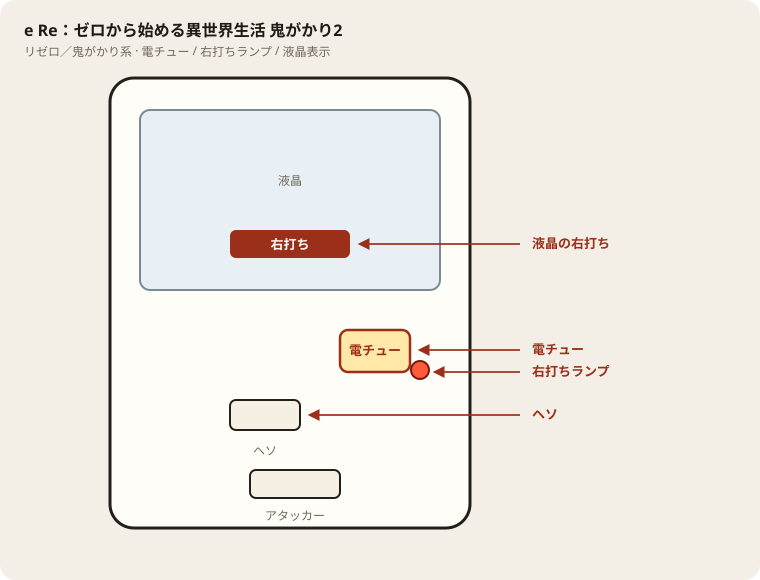

# e Re：ゼロから始める異世界生活 鬼がかり2

## 基本情報

| 項目 | 内容 |
| --- | --- |
| メーカー | 大都技研 |
| 型式名 | e／Re:ゼロから始める異世界生活 鬼がかり2／M24 |
| タイプ | スマパチ / ハイミドル / ラッキートリガー / c時短 |
| 導入日 | 2026年10月5日 |
| 筐体 | グラフィカ |

## スペック

| 項目 | 内容 |
| --- | --- |
| 大当り確率 | 通常時 1/349.9 |
| 大当り確率（RUSH中） | 1/99.9 |
| 鬼がかりRUSH | ST144回 / 突入率 55% / 継続率 約77% |
| 電サポ | 0回 or 144回 |
| 賞球 | 1&4&15 |
| カウント | 10カウント（右アタッカー賞球15個） |
| 右打ち | 鬼がかりRUSH |

出玉は払い出し。V入賞が条件。

| 状態 | 出玉 | 行き先 | 割合 |
| --- | --- | --- | --- |
| 通常時 | 3000個（10R×2） | RUSH（144回） | 10% |
| 通常時 | 1500個 | RUSH（144回） | 45% |
| 通常時 | 1500個 | 通常 | 45% |
| RUSH中 | 6000個（10R×4） | RUSH継続 | 25% |
| RUSH中 | 1500個 | RUSH継続 | 55% |
| RUSH中 | 300個 | RUSH継続 | 6% |
| RUSH中 | 0個 | STを振り直して継続 | 14% |

0個の14%は、RUSH中のc時短（解析上の発生は約1/7.14）がST144回をやり直す経路と一致する。図柄が揃ったときの出玉割合だけを見ると、6000個約29%、1500個約64%、300個約7%で、ここに出玉なしの振り直しが混ざる。

## 天井・遊タイム・LT

| 項目 | 内容 |
| --- | --- |
| 天井 | 非搭載 |
| 遊タイム | 非搭載 |
| ラッキートリガー | 搭載。RUSH中の大当りのうち25%が6000個 |
| c時短 | 搭載。RUSH中に出玉なしでST回数を戻す |
| カウントのリセット | 天井・遊タイムがないため、通常時の回転数は救済に使えない |

## ボーダー

現金・削りなし。1000円あたりの回転数。

| 交換 | ボーダー |
| --- | --- |
| 4.00円（等価） | 16.1 |
| 3.57円（28玉） | 18.0 |
| 3.33円（30玉） | 19.3 |
| 3.03円（33玉） | 21.2 |

持玉で回している間は等価側に寄る。朝イチの現金区間は18.0で見る。

## 狙い目

ハマり回転数では狙わない。349分の1は、何回転消化しても次の1回転の確率が変わらない。

見るのは通常時の回転率だけ。28玉交換なら18回転以上。19回転以上あれば継続の候補。17回転を切る台は、RUSHの6000個があっても長く打たない。

## やめ時

RUSHが終わって通常に戻ったとき。その台が18回転以上を維持しているなら、通常のまま続けてよい。維持していなければ、そこでやめる。

「ここまで回したから」で通常時を延長しない。

## 朝イチ

閉店スタートは翌朝に持ち越しても価値がない。並びの中では、前日までの通常時速度が18回転に近い台から1000円だけ測る。電サポ中の回転は測定に入れない。

履歴で71や144付近が細かく連なる区間はRUSH側。ボーダー比べに使わない。

## 盤面の場所

リゼロ系。右打ち指示が液晶に大きく出る。先バレ／落ちブル演出と打ち分けを混同しない。

系列: **リゼロ／鬼がかり系**（機種ごとの目安。個体差あり）

| 項目 | 場所 | 見方 |
| --- | --- | --- |
| 液晶（右打ち表示） | 盤面中央の液晶 | ラッシュ／時短中の「右打ち」。切替の本命 |
| ヘソ（始動口） | 盤面中央下寄り | 通常時の始動 |
| 電チュー | 盤面右下（ボタン下〜右玉道の終点付近） | ラッシュ・時短中の始動口 |
| 右打ちランプ | 電チュー横〜盤面下 | 点灯中は右打ち。液晶と併用 |
| プッシュボタン | 盤面手前中央 | 演出用。打ち分けとは無関係 |
| アタッカー | 盤面下部中央寄り | ラウンド消化。6000個級もここで確認 |
| 電サポ | （状態）ラッシュ／時短中 | 部品ではない |

- 先バレや落ちブルに気を取られても、右打ち切替は液晶優先。
- RUSH中に出玉が止まってもST再開なら右打ち継続。終了表示まで席を立たない。

## おすすめカスタム

- カスタムは演出の出方だけが変わる。抽選は変わらない。
- 通常時は先バレモードが本命。虹発光なら3000個＋ラッシュ濃厚。落ちブルもONで最大出玉を判別。
- 演出を楽しみたいなら先読みチャンスやメリハリでもよい。先読み無しは基本おすすめしない。
- ラッシュ中は先バレ＋落ちブルアップ。6000個判別を優先するならボタン落ちブルも可。

## 主なモード・演出の見方

- RUSHの演出は複数から選べる。初代鬼がかりの高速進行を引き継ぎつつ、鬼がかり2ではモードを増やしている。
- 初当りの見せ方は1500個が9割、3000個直行が1割。3000個は最初からRUSHが付く。
- 右打ち中に6000個が付けば、その回の山はそこが中心になる。0個のリセットは出玉が増えないだけで、144回の数え直しなので継続側の演出として扱う。
- カスタムでリーチや告知の出方を変えられる。信頼度の細かい百分率は演出ごとに公開差があるため、画面の「濃厚」「激アツ」表示を優先する。

## 打ち方

- 通常時は左打ち。1/349.9で、初当りの55%がRUSH。45%は1500個で通常に戻る。
- 3000個の初当りは10%しかないが、出た時点でRUSH確定かつ初当りだけでまとまった出玉がある。
- RUSHは144回を打ち切る。継続率約77%には、6000個・1500個・300個の継続と、0個で回数を戻すc時短が含まれる。出玉が動かなくても、STが再開していたら右打ちを続ける。
- 6000個はRUSH中の25%。ここを引いたあともSTは続き得るので、RUSH終了表示まで席を立たない。
- 遊タイムがない。深いハマり履歴だけでは次の1回転の確率は変わらない。等価の目安は1000円あたり約16.0〜16.1回転。
- やめ時は、初当り後にRUSHへ入らず通常に戻ったあと、またはRUSHが継続せず通常画面に戻ったあと。リセットで回数が戻った直後はやめない。

## 総評

初代鬼がかりと同じく、突入55%・継続約77%・ST144回のミドルを、初当りを重くして右打ちの上限を上げた形。通常時の大当りは1500個が90%で、3000個直行は10%まで減っている。その代わりRUSH中の25%が6000個になり、付いた回の山は初代より高い。

45%は1500個で通常に戻るので、1/349.9の投資に対して初当りだけではトントンに届かない回が多い。c時短の0個リセットは継続率を支えているだけで出玉は増えない。見るべきはRUSHに残ったあとの6000個と、144回を何周できるか。天井がないので、台選びは回転率だけにする。

出典: ぱちんこキュレーション、パチンコスペック解析、スロパチキュインDX、パチスロ.win

## 設置店舗

台入れ替えがあるため、各店の**全台データ取得時点**の設置。取得日時は Asia/Tokyo。

| 店舗 | 台数 | データ取得日時 |
| --- | --- | --- |
| エスパス日拓渋谷駅前新館 | 30 | 2026-11-12 09:57（Asia/Tokyo） |
| エスパス日拓西武新宿駅前店 | 13 | 2026-11-12 09:57（Asia/Tokyo） |
| 中山UNO | 8 | 2026-11-12 09:57（Asia/Tokyo） |
| 中山ZoRoN | 4 | 2026-11-12 09:57（Asia/Tokyo） |
| 楽園渋谷道玄坂店 | 8 | 2026-11-12 09:57（Asia/Tokyo） |
| 楽園渋谷駅前店 | 10 | 2026-11-12 09:57（Asia/Tokyo） |
| 楽園町田店 | 24 | 2026-11-13 07:43（Asia/Tokyo） |

## 注意

コンプリート機能あり。1日の差玉が規定に達すると打ち止めになる。公開解析の概数で、釘とV入賞の取りこぼしで前後する。
