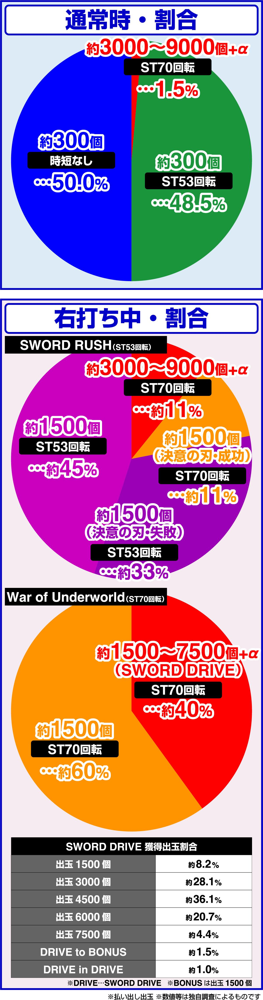
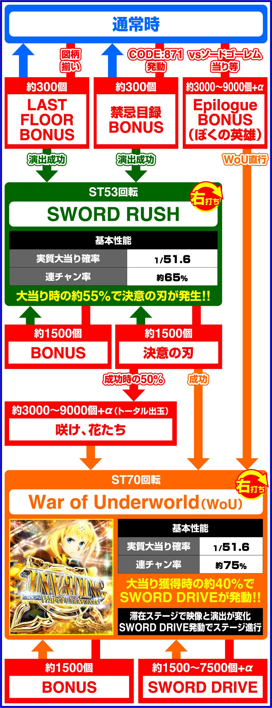
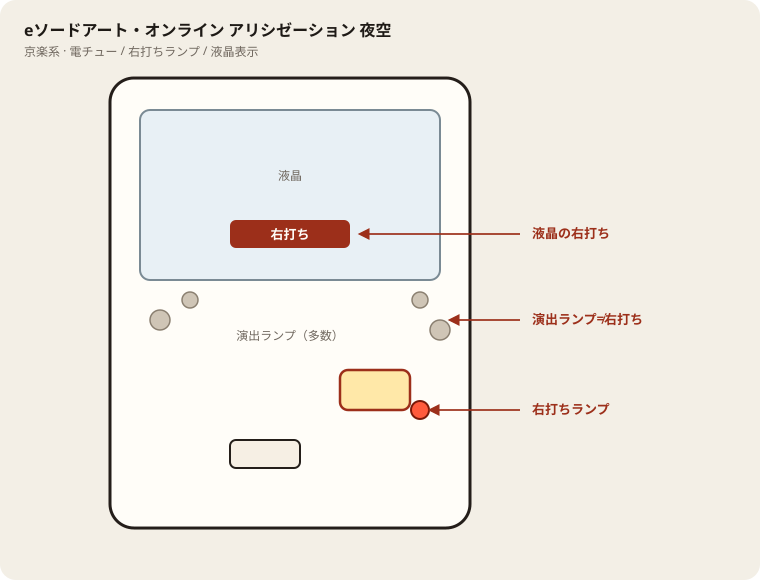

# e ソードアート・オンライン アリシゼーション 夜空

## 基本情報

| 項目 | 内容 |
| --- | --- |
| メーカー | 京楽 |
| 型式名 | eソードアート・オンラインアリシゼーションYK1 |
| タイプ | スマパチ / ライトミドル / LT |
| 導入日 | 2026年8月3日 |

## スペック

| 項目 | 内容 |
| --- | --- |
| 大当り確率 | 通常 約1/199.9、右打ち中 約1/51.6 |
| SWORD RUSH | 突入 約50%（LT直行含む） / ST53 / 継続 約65% |
| War of Underworld | ST70 / 継続 約75% |
| 賞球 | 1&6&15 |
| 出玉 | 通常約300個、RUSH中約1500個、LT中は1500〜7500+αあり |

RUSH/LT終了後は通常に戻ったら回転率で判断。

## 大当り詳細

振り分け・出玉の拡大図（DMM P-town の大当り詳細画像）。公開解析の概数。

出典: [DMM P-town e ソードアート・オンライン アリシゼーション 夜空](https://p-town.dmm.com/machines/5034)

- 大当り出玉: 電サポ回転数
- 通常時はFAIR STARTとPLUS STARTでスタート入賞
- 通常時の5玉に1玉がFAIR STARTに向かう
- FAIR STARTは約1/3でスタートに入る回転体
- 通常時の大当り後は50%でST突入
- ST53回転は継続率約65%
- ST53回転中大当りの約22%で上位ST突入
- 上位STは70回転＆継続率約75%
- LTはBONUS型
- ぼくの英雄or咲け、花たちor神器解放SWORD DRIVE獲得でLT発動
- ぼくの英雄or咲け、花たちは出玉3000〜9000個+α

### ゲームフロー

## 出玉確率／期待出玉

初当り1回あたりの目安（スペックからの**近似**）。連チャン数は継続率の幾何分布、総出玉は「連チャン数×RUSH中の代表出玉」で概算。取りこぼし・モード分岐・上乗せループは粗く丸めている。

| 項目 | 値 |
| --- | --- |
| ラッシュ突入率 | 約50.0% |
| 3万発出る確率 | 約5.80% |
| 5万発出る確率 | 約1.04% |

- 前提: 突入率 約50.0% / 継続率 約65.0% / 代表出玉 約5250個/当り
- 状態: 近似算出。近似（幾何・代表出玉）。

## 天井・遊タイム・LT

| 項目 | 内容 |
| --- | --- |
| 天井 | 非搭載 |
| 遊タイム | 非搭載 |
| カウントのリセット | 天井・遊タイムがないため、ハマり回転数は次の抽選に影響しない |

## ボーダー

現金・削りなし。1000円あたり。

| 交換 | ボーダー |
| --- | --- |
| 4.00円（等価） | 19.9 |
| 3.57円（28玉） | 22.3 |
| 3.33円（30玉） | 23.9 |
| 3.03円（33玉） | 26.3 |

持玉で回している間は等価側に寄る。朝イチの現金区間は28玉側で見る。

## 狙い目

22.3回転以上。遊タイムはないのでハマりでは狙わない。通常時の回転率だけを見る。

## やめ時

電サポ・RUSHが終わって通常に戻ったとき。回転率が22.3未満なら即やめ。以上なら続けてよい。

## 朝イチ

閉店スタートは使わない。1000円を通常時だけで数え、22.3回転に届かなければやめる。電サポ中の回転は測定に入れない。

## 盤面の場所

京楽系は盤面ランプが多く、演出ランプと右打ちランプを取り違えやすい。

系列: **京楽系**（機種ごとの目安。個体差あり）

| 項目 | 場所 | 見方 |
| --- | --- | --- |
| 液晶（右打ち表示） | 盤面中央の液晶 | 切替の最終判断。演出色より表示文字を見る |
| ヘソ（始動口） | 盤面中央下寄り（デカヘソ機は特大） | 通常時の始動 |
| 電チュー | 盤面右下寄り | 右打ち時の始動口 |
| 右打ちランプ | 電チュー付近〜盤面下のランプ群 | 赤点灯が右打ちのことが多いが、機種差あり。液晶と併用 |
| 演出ランプ | 盤面左右・上部 | 信頼度演出用。右打ち判断に使わない |
| アタッカー | 盤面下部中央寄り | ラウンド消化 |
| 電サポ | （状態）時短・ST・RUSH中 | 部品ではない |

- カラフルな点灯だけで右打ちに切り替えない。
- デカヘソ機は通常時の拾いが回転率に直結する。

## おすすめカスタム

- カスタムは演出の出方だけが変わる。抽選は変わらない。
- 先バレ／先読みがあればON。RUSH中は一発告知寄り。

## 打ち方

- 通常時は左打ち（右打ち指示が出たら従う）。
- 電サポ中・RUSH中は打ち切る。通常に戻ったら回転率を見て継続かやめを決める。
- 遊タイムがないため、深くハマった履歴だけでは拾わない。等価の目安は1000円あたり約19.9回転。

## 総評

SAO夜空。ライトミドルLT。等価ボーダー約20回転とやや重い。遊タイムなし。

出典: P-WORLD、なな徹、ぱちタウン、パチンコスペック解析

## 設置店舗

台入れ替えがあるため、各店の**全台データ取得時点**の設置。取得日時は Asia/Tokyo。

| 店舗 | 台数 | データ取得日時 |
| --- | --- | --- |
| エスパス日拓渋谷駅前新館 | 12 | 2026-11-13 09:57〜09:59（Asia/Tokyo） |
| エスパス日拓西武新宿駅前店 | 6 | 2026-11-15 13:32（Asia/Tokyo） |
| 中山UNO | 4 | 2026-11-17 17:31（Asia/Tokyo） |
| 中山ZoRoN | 4 | 2026-11-14 12:31（Asia/Tokyo） |
| 楽園渋谷道玄坂店 | 9 | 2026-11-13 16:35（Asia/Tokyo） |
| 楽園渋谷駅前店 | 16 | 2026-11-13 09:57〜09:59（Asia/Tokyo） |
| 楽園町田店 | 10 | 2026-11-22 13:09（Asia/Tokyo） |

## 注意

コンプリート機能あり。公開解析の概数で、釘と取りこぼしで前後する。
