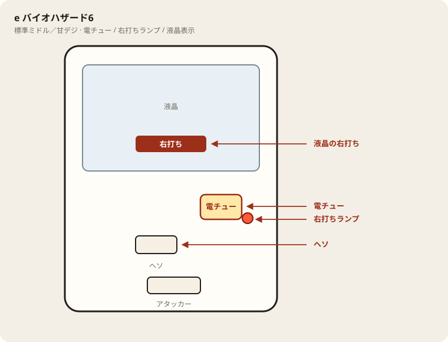

# e バイオハザード6

## 基本情報

| 項目 | 内容 |
| --- | --- |
| メーカー | 七匠（開発フィールズ） |
| 型式名 | eバイオハザード6 |
| タイプ | スマパチ / 1種2種混合 / スペック変異 |
| 導入日 | 2026年5月11日 |

## スペック

プレイヤーが通常時に右打ちゲート通過でモードを変える（ノーマル→エリート→プロ）。

| モード | 大当り確率 | RUSH突入率 |
| --- | --- | --- |
| ノーマル | 約1/159 | 約27% |
| エリート | 約1/299 | 約50% |
| プロフェッショナル | 約1/600 | 約99% |

| 項目 | 内容 |
| --- | --- |
| HAZARD RUSH | ST140 / 継続約80%（全モード共通） / 平均約2400個 |
| 賞球 | 1&5&10（アタッカー15/10C） |

ボーダーはモード共通。モード選択は分散（初当りの重さ）の違い。

## 天井・遊タイム・LT

| 項目 | 内容 |
| --- | --- |
| 天井 | 非搭載 |
| 遊タイム | 非搭載 |
| カウントのリセット | 天井・遊タイムがないため、ハマり回転数は次の抽選に影響しない |

## ボーダー

現金・削りなし。1000円あたり（媒体により等価17.0〜17.4）。

| 交換 | ボーダー |
| --- | --- |
| 4.00円（等価） | 17.1 |
| 3.57円（28玉） | 18.5 |
| 3.33円（30玉） | 19.4 |
| 3.03円（33玉） | 20.6 |

持玉で回している間は等価側に寄る。朝イチの現金区間は28玉側で見る。

## 狙い目

28玉なら18.5回転以上。遊タイムはないのでハマりでは狙わない。通常時の回転率だけを見る。

## やめ時

RUSHが終わって通常に戻ったとき。回転率がボーダー未満なら即やめ。

## 朝イチ

閉店スタートは深さの根拠にしない。座ったらモードを決めてから1000円測り。ボーダー未満ならやめる。差玉上位の結果台は追わない。

## 盤面の場所

電サポは部品ではなく状態。目印は液晶の「右打ち」と右打ちランプ。

系列: **標準ミドル／甘デジ**（機種ごとの目安。個体差あり）

| 項目 | 場所 | 見方 |
| --- | --- | --- |
| 液晶（右打ち表示） | 盤面中央の液晶 | 「右打ち」表示中が電サポ中。切替の最終判断 |
| ヘソ（始動口） | 盤面中央下寄り | 通常時の始動口 |
| 電チュー | 盤面右下〜中央右（液晶の右下寄り） | 羽根が開く入賞口。右打ちの始動口 |
| 右打ちランプ | 電チュー付近、または盤面下部のランプ群 | 点灯中は右打ち。位置は機種差あり。液晶と併用 |
| アタッカー | 盤面下部中央寄り | 大当りラウンドの入賞口 |
| 電サポ | （状態）時短・ST・RUSH・遊タイム中 | 部品ではない。液晶の右打ち表示中 |
| 保留ランプ | 液晶下または盤面下部 | 保留の目安。右打ち終了直後の残保留に注意 |

- ヘソは中央下寄り、アタッカーは下部中央寄りが多い。
- 迷ったら液晶の指示を優先。ランプだけ見て打ち方を決めない。
- 遊タイム残は液晶表示で確認。深さだけで座らない。

## 設置店舗

台入れ替えがあるため、各店の**全台データ取得時点**の設置。取得日時は Asia/Tokyo。

| 店舗 | 台数 | データ取得日時 |
| --- | --- | --- |
| 中山UNO | 4 | 2026-11-14 12:26〜12:29（Asia/Tokyo） |
