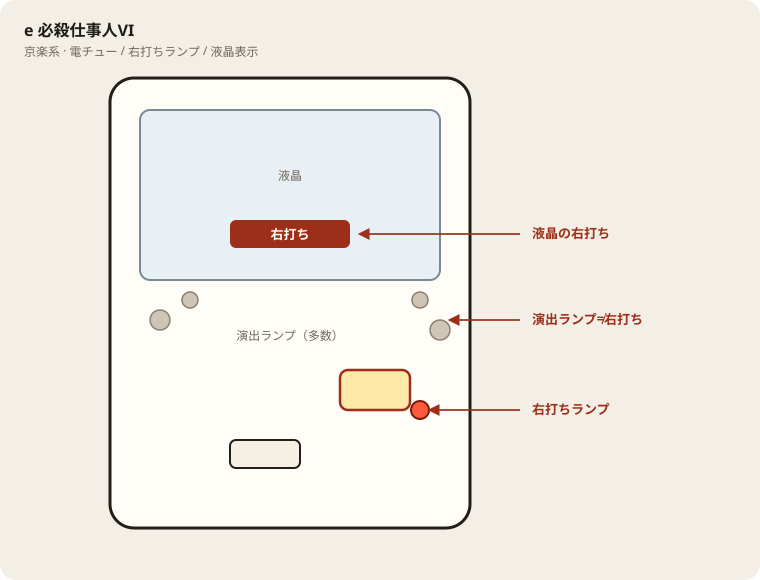

# e 必殺仕事人VI

## 基本情報

| 項目 | 内容 |
| --- | --- |
| メーカー | 京楽産業. |
| 型式名 | 調査中（スマパチ必殺仕事人VI） |
| タイプ | スマパチ / ミドル / 1種2種 / LT |
| 導入日 | 2026年7月6日 |

## スペック

| 項目 | 内容 |
| --- | --- |
| 大当り確率 | 通常 約1/319.9（C時短込み）、チャンスタイム 約1/399.9、RUSH 約1/88.3 |
| 必殺RUSH | トータル突入 約64.2% / ST120回 / 継続 約75% |
| 時短 | 100回。引き戻し 約22.2% |
| LT | 中村主水出陣（出玉 3000 or 6000個） |
| 賞球 | 1&4&5&15 |
| ラウンド | 3R or 10R / 10カウント |
| 出玉 | 3R約450個、10R約1500個。LT中は3000/6000個 |

## 天井・遊タイム・LT

| 項目 | 内容 |
| --- | --- |
| 天井 | 非搭載 |
| 遊タイム | 非搭載 |
| カウントのリセット | 天井・遊タイムがないため、ハマり回転数は次の抽選に影響しない |

## ボーダー

現金・削りなし。1000円あたり。

| 交換 | ボーダー |
| --- | --- |
| 4.00円（等価） | 16.9 |
| 3.57円（28玉） | 18.7 |
| 3.33円（30玉） | 20.0 |
| 3.03円（33玉） | 22.0 |

持玉で回している間は等価側に寄る。朝イチの現金区間は28玉側で見る。

## 狙い目

18.7回転以上。遊タイムはないのでハマりでは狙わない。通常時の回転率だけを見る。

## やめ時

電サポ・RUSHが終わって通常に戻ったとき。回転率が18.7未満なら即やめ。以上なら続けてよい。

## 朝イチ

閉店スタートは使わない。1000円を通常時だけで数え、18.7回転に届かなければやめる。電サポ中の回転は測定に入れない。

## 盤面の場所

京楽系は盤面ランプが多く、演出ランプと右打ちランプを取り違えやすい。

系列: **京楽系**（機種ごとの目安。個体差あり）

| 項目 | 場所 | 見方 |
| --- | --- | --- |
| 液晶（右打ち表示） | 盤面中央の液晶 | 切替の最終判断。演出色より表示文字を見る |
| ヘソ（始動口） | 盤面中央下寄り（デカヘソ機は特大） | 通常時の始動 |
| 電チュー | 盤面右下寄り | 右打ち時の始動口 |
| 右打ちランプ | 電チュー付近〜盤面下のランプ群 | 赤点灯が右打ちのことが多いが、機種差あり。液晶と併用 |
| 演出ランプ | 盤面左右・上部 | 信頼度演出用。右打ち判断に使わない |
| アタッカー | 盤面下部中央寄り | ラウンド消化 |
| 電サポ | （状態）時短・ST・RUSH中 | 部品ではない |

- カラフルな点灯だけで右打ちに切り替えない。
- デカヘソ機は通常時の拾いが回転率に直結する。

## おすすめカスタム

- カスタムは演出の出方だけが変わる。抽選は変わらない。
- 通常時は豪剣フラッシュONが本命。当り察知がしやすい。
- 頼み人予告やその他の告知系は好みで足す。フルカスにすると捨て変動が増える点だけ注意。

## 打ち方

- 通常時は左打ち（右打ち指示が出たら従う）。
- 電サポ中・RUSH中は打ち切る。通常に戻ったら回転率を見て継続かやめを決める。
- 遊タイムがないため、深くハマった履歴だけでは拾わない。等価の目安は1000円あたり約16.9回転。

## 総評

必殺本編のスマパチ。主水出陣の6000個が勝負所。遊タイムなし。

出典: p-gabu、パチスロ.win、必勝本

## 注意

コンプリート機能あり。公開解析の概数で、釘と取りこぼしで前後する。
