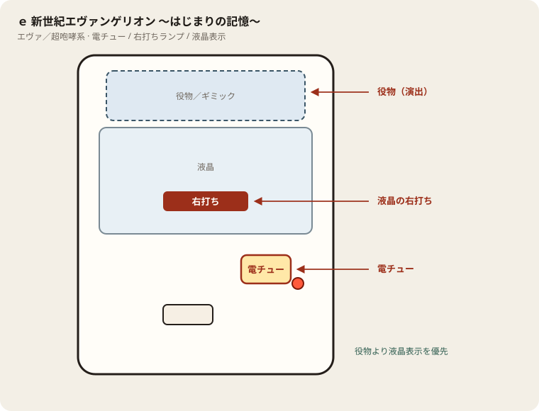

# e 新世紀エヴァンゲリオン ～はじまりの記憶～

## 基本情報

| 項目 | 内容 |
| --- | --- |
| メーカー | ビスティ |
| 型式名 | e新世紀エヴァンゲリオン17 はじまりの記憶R |
| タイプ | スマパチ / ハイミドル / 1種2種混合 / ラッキートリガー（LT3.0+） |
| 導入日 | 2025年12月22日 |
| 筐体 | 超咆哮（専用） |

## スペック

| 項目 | 内容 |
| --- | --- |
| 図柄揃い確率 | 通常時・チャンスタイム中 約1/399.9 |
| 大当り確率（チャージ込み） | 約1/349.9 |
| 図柄揃い確率（ST中） | 約1/99.6 |
| インパクトモード（RUSH） | ST157回 / トータル突入率 約61.4% / 継続率 約80% |
| チャンスタイム | 時短100回（引き戻し 約22%） |
| 賞球 | 1&5&15 |
| ラウンド / カウント | 2R or 8R or 10R / 10カウント |
| 右打ち | チャンスタイム、インパクトモード（暴走モード含む）の消化中 |

払い出しの目安は、2R約300個、8R約1200個、10R約1500個。V入賞が条件。

通常時（ヘソ・特図1）の振り分けは次のとおり。

| 出玉 | 行き先 | 割合 |
| --- | --- | --- |
| 約1500個（10R） | インパクトモード（ST157回） | 約0.5% |
| 約300個（2R） | インパクトモード（ST157回） | 約50.0% |
| 約300個（2R） | チャンスタイム（時短100回） | 約49.5% |

直撃でRUSHに入るのは約50.5%。残り約49.5%は時短100回へ行き、そこで約22%引き戻せばRUSH。合わせてトータル突入率約61.4%。

RUSH中（電チュー・特図2）は次のとおり。

| 出玉 | 行き先 | 割合 |
| --- | --- | --- |
| 約4800個（8R×4） | インパクトモード継続 | 約0.5% |
| 約2400個（8R×2） | インパクトモード継続 | 約99.5% |

右打ち中の出玉はほぼ2400個。稀に4800個。当たれば次のST157回が付く。

## 天井・遊タイム・LT

| 項目 | 内容 |
| --- | --- |
| 天井 | 非搭載 |
| 遊タイム | 非搭載 |
| ラッキートリガー | 搭載。インパクトモード（ST157・継続約80%）がLT本体 |
| LT中の出玉 | 特図2は2400個以上（ほぼすべて） |
| カウントのリセット | 天井・遊タイムがないため、ハマり回転数は次の抽選に影響しない |

## ボーダー

現金・削りなし。1000円あたり。

| 交換 | ボーダー |
| --- | --- |
| 4.00円（等価） | 17.1 |
| 3.57円（28玉） | 19.1 |
| 3.33円（30玉） | 20.5 |
| 3.03円（33玉） | 22.6 |

持玉で回している間は等価側に寄る（目安16.8前後）。朝イチの現金区間は19.1で見る。中山ZoRoNの500円/115玉は玉単価が違うので、等価表をそのまま使わない。

## 狙い目

19.1回転以上。20回転以上ならRUSH完走を待てる。

天井はない。600回転ハマっていても次の確率は同じ。朝イチの拾い対象にしない。

時短100回転は引き戻し約22%。時短に入ったこと自体はRUSH確定ではない。外れたら通常。

## やめ時

インパクトモードが終わって通常に戻ったとき。

STの途中ではやめない。157回転の途中で降りると、まだ続く可能性がある分を捨てる。

通常に戻ったあと、回転率が19.1未満なら即やめ。以上なら続けてよい。

## 朝イチ

閉店スタートは使わない。1000円を通常時だけで数え、19回転に届かなければやめる。

履歴に157前後のスタートが連続する区間は、ST157回転の電サポ。回転率の計算に入れない。時短100回転も同様。

スタートがちょうど157や100付近で止まっている台は、電サポ終了直後の線が濃い。画面がまだ右なら残し、通常なら翌朝の恩恵はない。

## 盤面の場所

エヴァ系（超咆哮筐体含む）。役物が大きくても、右打ち切替の本命は液晶表示。

系列: **エヴァ／超咆哮系**（機種ごとの目安。個体差あり）

| 項目 | 場所 | 見方 |
| --- | --- | --- |
| 液晶（右打ち表示） | 盤面中央の液晶 | チャンスタイム／インパクト／RUSH中の「右打ち」 |
| ヘソ（始動口） | 盤面中央下寄り | 通常時の始動 |
| 電チュー | 盤面右下寄り | 右打ち中の始動口。役物の陰になりやすいので位置を先に把握 |
| 右打ちランプ | 盤面下部〜電チュー付近 | 点灯中は右打ち。液晶と矛盾したら液晶優先 |
| 役物／ギミック | 液晶上〜中央 | 演出用。打ち分けの判断材料にはしない |
| アタッカー | 盤面下部中央寄り | ラウンド消化 |
| 電サポ | （状態）チャンスタイム／インパクト／RUSH中 | 部品ではない |

- 役物動作中も右打ち指示が続いていないか液晶を見る。
- 筐体が大きいので、隣台からでも電チュー位置を座前に確認する。

## おすすめカスタム

- カスタムは演出の出方だけが変わる。抽選は変わらない。
- 通常時の本命は先告知「咆哮」か「次回予告」。発生で期待度約50%。濃厚だけ欲しければ「カヲルレイ背景」。
- 先告知と先読みは併用できない。先読みにするなら「チャンス」が無難。「熱」は外れが残る。
- レバブルアップ・エアーは好みでON。ST中は先告知とレバブルをONにして当り察知を優先。
- インパクトモードのキャラはシンジ（バランス）が無難。一発告知寄りならアスカ、先読み寄りならレイ。

## 主なモード・演出の見方

- インパクトモードと暴走モードはレバー長引きで随時切替できる。どちらもST157回。
- インパクトモードはカスタムを選べる。シンジ（バランス）、アスカ（一発告知寄り）、レイ（先読み寄り）、カヲル、ペンペン（フル）、シークレット。
- 残り100回転から背景が変わる。STの終盤サインとして使う。
- 偶数図柄はチャンスタイム側。昇格すればRUSH。奇数・全回転・チャージ成功はRUSH寄り。
- エヴァチャージは図柄揃い以外の突入経路。チャージ込みの大当り確率が約1/349.9。

## 打ち方

- 通常時は左打ち。図柄揃い約1/399.9。初当りの約半分がそのままRUSH、残りは時短100回。
- チャンスタイムは100回を打ち切る。ここで当たればRUSH確定。外れれば通常へ戻る。
- インパクトモードは157回を完走する。途中の大当りはほぼ2400個で、当たれば再び157回。継続率約80%。
- 遊タイムがないため、深くハマった履歴だけでは拾わない。等価の目安は1000円あたり約17.0〜17.1回転。非等価の店では目安が上がる。
- やめ時は、チャンスタイム終了後に通常へ戻ったとき、インパクトモードが継続せず通常へ戻ったとき。ST中・時短中は打ち切る。

## 総評

ハイミドルの1/399.9に、ST157回・継続約80%のロングRUSHを重ねた台。初当りそのものの出玉は2Rが大半で薄い。出玉の本体はRUSHに入ったあとの2400個ループ側にある。

トータル突入約61.4%は時短引き戻し込み。初当りだけで見ると直撃は約半分なので、時短100回を打ち切れない立ち回りだと体感の突入は下がる。遊タイムがないので、台選びは回転率だけにする。中山UNO・中山ZoRoNでは本機の無料出玉が取れる一方、個別履歴は有料のことがある。

出典: ビスティ／P-WORLD、パチンコビスタ、ぱちんこキュレーション系解析、パチスロ.win

## 設置店舗

台入れ替えがあるため、各店の**全台データ取得時点**の設置。取得日時は Asia/Tokyo。

| 店舗 | 台数 | データ取得日時 |
| --- | --- | --- |
| エスパス日拓渋谷駅前新館 | 23 | 2026-11-13 09:57〜09:59（Asia/Tokyo） |
| エスパス日拓西武新宿駅前店 | 5 | 2026-11-12 09:57（Asia/Tokyo） |
| 中山UNO | 12 | 2026-11-14 12:26〜12:29（Asia/Tokyo） |
| 中山ZoRoN | 6 | 2026-11-14 12:31（Asia/Tokyo） |
| 楽園渋谷道玄坂店 | 4 | 2026-11-13 16:35（Asia/Tokyo） |
| 楽園渋谷駅前店 | 27 | 2026-11-13 09:57〜09:59（Asia/Tokyo） |
| 楽園町田店 | 7 | 2026-11-14 08:38〜08:40（Asia/Tokyo） |

## 注意

コンプリート機能あり。差玉の底を基点に1日で約95,000発まで。2400個は1200個×2、4800個は1200個×4。連チャンの多さを、内部が良いまま翌朝も続く、とは読まない。

中山UNO・中山ZoRoNでは本機だけ無料で出玉が取れることがあるが、個別履歴は有料のことがある。無料の現在スタートと、画面の左右だけで残しを判断する。
