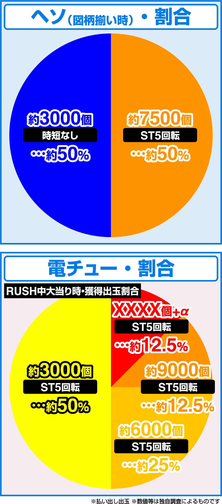
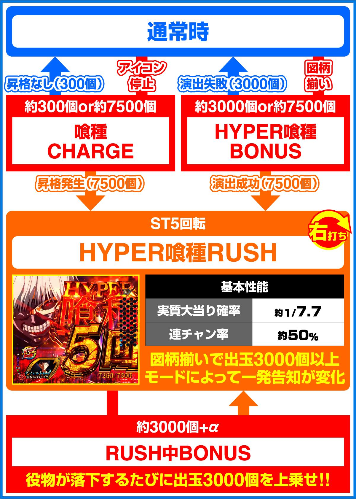
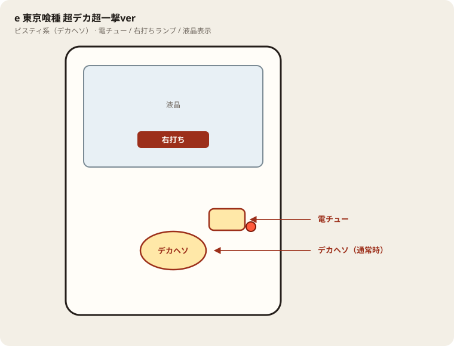

# e 東京喰種 超デカ超一撃ver

## 基本情報

| 項目 | 内容 |
| --- | --- |
| メーカー | ビスティ |
| 型式名 | 調査中（超デカ超一撃） |
| タイプ | スマパチ / ミドル / LT / 超デカSTART |
| 導入日 | 2026年6月8日 |

## スペック

| 項目 | 内容 |
| --- | --- |
| 大当り（チャージ込み） | 約1/349.9 |
| 図柄揃い | 約1/999.9、チャージ 約1/538.8 |
| HYPER喰種RUSH | 図柄揃い時 約50% / ST5回 / 継続 約50% / 右打ち 約1/7.7 |
| 賞球 | 1&1&3&1&15 |
| 出玉 | LT時約7500個。非LTでも約3000個。RUSH中は3000個+喰MAXループ |

超デカSTART＋スマートスタート。ボーダーは通常ミドルの約2倍。

## 大当り詳細

振り分け・出玉の拡大図（DMM P-town の大当り詳細画像）。公開解析の概数。

出典: [DMM P-town e 東京喰種 超デカ超一撃ver.](https://p-town.dmm.com/machines/5024)

- 大当り出玉: 約300or3000or6000or7500or9000個+α（払い出し・実質獲得出玉）
- 通常時は大きいヘソで消化
- ステージに安定して向かうスマートスタート搭載
- 通常時の図柄揃い後は約50%でRUSH突入
- RUSH突入＝ラッキートリガー発動
- RUSHはST5回転＆継続率約50%
- RUSH中大当り出玉はオール3000個+α

### ゲームフロー

## 出玉確率／期待出玉

初当り1回あたりの目安（スペックからの**近似**）。連チャン数は継続率の幾何分布、総出玉は「連チャン数×RUSH中の代表出玉」で概算。取りこぼし・モード分岐・上乗せループは粗く丸めている。

| 項目 | 値 |
| --- | --- |
| ラッシュ突入率 | 約50.0% |
| 3万発出る確率 | 約3.12% |
| 5万発出る確率 | 約0.39% |

- 前提: 突入率 約50.0% / 継続率 約50.0% / 代表出玉 約6375個/当り
- 状態: 近似算出。近似（幾何・代表出玉）。

## 天井・遊タイム・LT

| 項目 | 内容 |
| --- | --- |
| 天井 | 非搭載 |
| 遊タイム | 非搭載 |
| カウントのリセット | 天井・遊タイムがないため、ハマり回転数は次の抽選に影響しない |

## ボーダー

現金・削りなし。1000円あたり。

| 交換 | ボーダー |
| --- | --- |
| 4.00円（等価） | 30.3 |
| 3.57円（28玉） | 34.1 |
| 3.33円（30玉） | 35.1 |
| 3.03円（33玉） | 36.5 |

持玉で回している間は等価側に寄る。朝イチの現金区間は28玉側で見る。

## 狙い目

34.1回転以上。遊タイムはないのでハマりでは狙わない。通常時の回転率だけを見る。

## やめ時

電サポ・RUSHが終わって通常に戻ったとき。回転率が34.1未満なら即やめ。以上なら続けてよい。

## 朝イチ

閉店スタートは使わない。1000円を通常時だけで数え、34.1回転に届かなければやめる。電サポ中の回転は測定に入れない。

## 盤面の場所

ビスティ系。液晶表示と電チュー開放をセットで見る。

系列: **ビスティ系（デカヘソ）**（機種ごとの目安。個体差あり）

| 項目 | 場所 | 見方 |
| --- | --- | --- |
| 液晶（右打ち表示） | 盤面中央の液晶 | 「右打ち」表示中が電サポ中。切替の最終判断 |
| ヘソ（始動口） | 盤面中央下寄り（デカヘソ） | 通常時の始動口 |
| 電チュー | 盤面右下〜中央右（液晶の右下寄り） | 羽根が開く入賞口。右打ちの始動口 |
| 右打ちランプ | 電チュー付近、または盤面下部のランプ群 | 点灯中は右打ち。位置は機種差あり。液晶と併用 |
| アタッカー | 盤面下部中央寄り | 大当りラウンドの入賞口 |
| 電サポ | （状態）時短・ST・RUSH・遊タイム中 | 部品ではない。液晶の右打ち表示中 |
| 保留ランプ | 液晶下または盤面下部 | 保留の目安。右打ち終了直後の残保留に注意 |

- デカヘソは通常時の拾いが命。座ったらまずヘソへの入りを見る。
- ヘソは中央下寄り、アタッカーは下部中央寄りが多い。
- 迷ったら液晶の指示を優先。ランプだけ見て打ち方を決めない。
- 遊タイム残は液晶表示で確認。深さだけで座らない。

## おすすめカスタム

- カスタムは演出の出方だけが変わる。抽選は変わらない。
- 通常時は先役モノ落下「90%」＋レバブルON。先読みは「チャンス」か「熱」。
- EXはRUSH濃厚寄りだが占有が落ちる。RUSH中モードは突激かリゼ襲来が分かりやすい。

## 打ち方

- 通常時は左打ち（右打ち指示が出たら従う）。
- 電サポ中・RUSH中は打ち切る。通常に戻ったら回転率を見て継続かやめを決める。
- 遊タイムがないため、深くハマった履歴だけでは拾わない。等価の目安は1000円あたり約30.3回転。

## 総評

デカヘソ版。等価でも約30回転必要。LT版（e東京喰種）と混同しない。

出典: P-WORLD、p-gabu、スロベース

## 設置店舗

台入れ替えがあるため、各店の**全台データ取得時点**の設置。取得日時は Asia/Tokyo。

| 店舗 | 台数 | データ取得日時 |
| --- | --- | --- |
| エスパス日拓渋谷駅前新館 | 48 | 2026-11-13 09:57〜09:59（Asia/Tokyo） |
| エスパス日拓西武新宿駅前店 | 18 | 2026-11-15 13:32（Asia/Tokyo） |
| 中山UNO | 16 | 2026-11-22 16:22〜2026-11-22 16:22（Asia/Tokyo） |
| 中山ZoRoN | 6 | 2026-11-14 12:31（Asia/Tokyo） |
| 楽園渋谷道玄坂店 | 28 | 2026-11-13 16:35（Asia/Tokyo） |
| 楽園渋谷駅前店 | 33 | 2026-11-13 09:57〜09:59（Asia/Tokyo） |
| 楽園町田店 | 27 | 2026-11-22 16:06〜2026-11-22 16:06（Asia/Tokyo） |

## 注意

コンプリート機能あり。公開解析の概数で、釘と取りこぼしで前後する。
