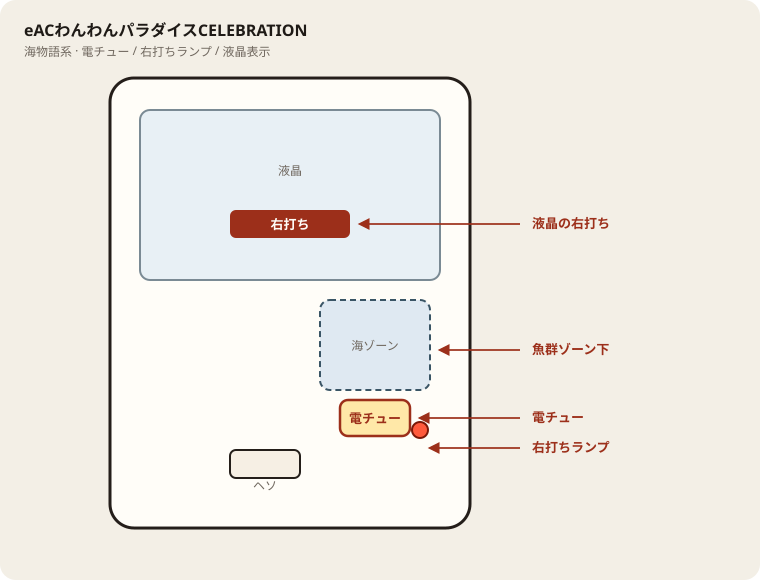

# eACわんわんパラダイスCELEBRATION

## 基本情報

| 項目 | 内容 |
| --- | --- |
| メーカー | 三洋物産 |
| 型式名 | eACわんわんセレブレーションGA |
| タイプ | スマパチ / 甘デジ / 2in1 / ST・時短 / 遊タイム |
| 導入日 | 2026年10月5日 |

## スペック

| 項目 | 内容 |
| --- | --- |
| 大当り確率 | 77ver. 約1/77.7（高確約1/39.9）、49ver. 約1/49.9（高確約1/25.7） |
| わんわんRUSH | 突入 約52%／約51%、継続 約66%／約67% |
| わんわんCELEBRATION | 電サポ120回、継続 約85%／約91% |
| 賞球 | 1&1&5&7 |
| 出玉 | 10R約700個、6R約420個、4R約280個など（払い出し） |
| 遊タイム | 低確149回転消化後、電サポ10000回 |

電サポ終了後は通常に戻ったら回転率で判断。座る前に稼働ver.を確認する。

## 天井・遊タイム・LT

| 項目 | 内容 |
| --- | --- |
| 天井 | 非搭載（遊タイムで救済） |
| 遊タイム | 低確149回転消化後、電サポ10000回 |
| ラッキートリガー | 非搭載（上位はわんわんCELEBRATION） |
| カウントのリセット | 大当り・電サポで低確消化カウントはリセットされる想定。台表示を優先 |

## ボーダー

現金・削りなし。1000円あたり（遊パチ77ver.・通常条件）。

| 交換 | ボーダー |
| --- | --- |
| 4.00円（等価） | 15.2 |
| 3.57円（28玉） | 17.0 |
| 3.33円（30玉） | 18.2 |
| 3.03円（33玉） | 20.0 |

持玉で回している間は等価側に寄る。朝イチの現金区間は28玉側で見る。49ver.は等価側で約0.7回転ほど重い。

## 狙い目

17.0回転以上（77ver.）。遊タイム残りが近い台は例外的に拾える。通常時の回転率を主に見る。

## やめ時

電サポ・RUSHが終わって通常に戻ったとき。回転率が17.0未満で遊タイムも遠ければ即やめ。以上なら続けてよい。

## 朝イチ

閉店スタートは使わない。1000円を通常時だけで数え、17.0回転に届かなければやめる。電サポ中の回転は測定に入れない。低確消化の遊タイム残も確認する。

## 盤面の場所

海物語系。魚群・ボタン演出より、液晶の「右打ち」表示と電チュー開放を優先して見る。

系列: **海物語系**（機種ごとの目安。個体差あり）

| 項目 | 場所 | 見方 |
| --- | --- | --- |
| 液晶（右打ち表示） | 盤面中央の液晶 | 「右打ち」が出ているあいだが電サポ中。切替の最終判断 |
| ヘソ（始動口） | 盤面中央下寄り | 通常時の始動。左打ちの玉が落ちる位置 |
| 電チュー | 盤面右側・海／魚群ゾーン下寄り | 右打ち時の始動口。羽根の開閉を目視 |
| 右打ちランプ | 盤面右下〜電チュー周辺 | 点灯＋液晶表示をセットで確認。ランプ単独では決めない |
| アタッカー | 盤面下部中央寄り | 大当りラウンドの入賞口 |
| 電サポ | （状態）時短・ST・RUSH中 | 部品ではない。液晶の右打ち表示中 |
| 保留ランプ | 液晶下または盤面下部 | 保留消化の目安。右打ち中も残保留に注意 |

- 魚群やボタン演出に目が行っても、打ち分けは液晶優先。
- 海系は右打ち中の取りこぼしが回転率を崩しやすい。電チューの拾いを見る。

## おすすめカスタム

- カスタムは演出の出方だけが変わる。抽選は変わらない。
- わんわんCELEBRATION中の専用モードは好みで選択。

## 打ち方

- 通常時は左打ち（右打ち指示が出たら従う）。
- 電サポ中・RUSH中は打ち切る。通常に戻ったら回転率を見て継続かやめを決める。
- 遊タイムがあるため、低確消化が近い台は別判断。等価の目安（77ver.）は1000円あたり約15.2回転。

## 総評

わんわんCELEBRATION。甘デジ2in1。遊タイムあり。

出典: P-WORLD、なな徹、ぱちタウン、パチンコスペック解析

## 注意

コンプリート機能あり。公開解析の概数で、釘と取りこぼしで前後する。公開値の幅あり・現地確認。ver.違いでボーダーが変わる。
