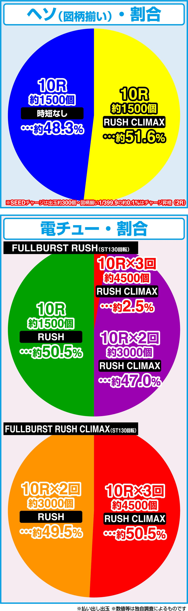
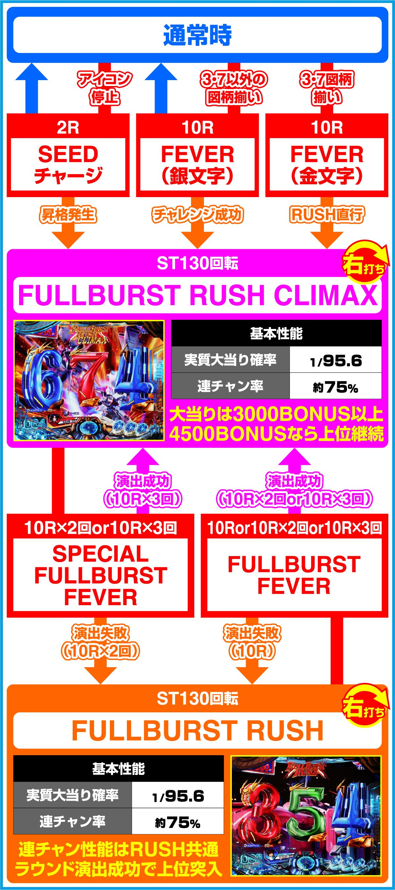
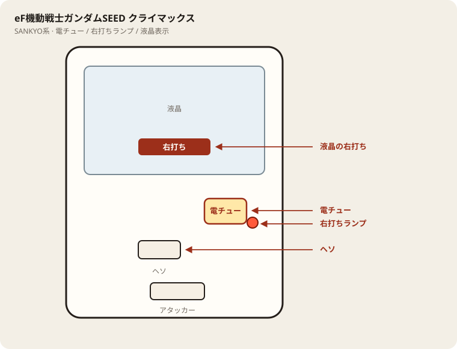

# eF機動戦士ガンダムSEED クライマックス

## 基本情報

| 項目 | 内容 |
| --- | --- |
| メーカー | SANKYO |
| 型式名 | eフィーバー機動戦士ガンダムSEED クライマックス（調査中） |
| タイプ | スマパチ / ミドル / LT |
| 導入日 | 2026年8月3日 |

## スペック

| 項目 | 内容 |
| --- | --- |
| 図柄揃い | 約1/399.9（合算大当り 約1/349.9） |
| 右打ち中 | 約1/95.6 |
| FULLBURST RUSH CLIMAX | 突入 約52% / ST130 / 継続 約75% |
| 賞球 | 1&5&15 |
| 出玉 | 通常約1500個、右打ち中約1500/3000/4500個 |

RUSH終了後は通常に戻ったら回転率で判断。深いハマりは拾わない。

## 大当り詳細

振り分け・出玉の拡大図（DMM P-town の大当り詳細画像）。公開解析の概数。

出典: [DMM P-town eF機動戦士ガンダムSEED クライマックス](https://p-town.dmm.com/machines/5045)

- 大当り出玉: 約300or1500or3000or4500個（払い出し・実質獲得出玉）
- 通常時の図柄揃い後は約51.7%で上位RUSH突入
- RUSH突入＝ラッキートリガー発動
- RUSHはST130回転＆内部状態が2つ
- RUSH継続率約75%
- RUSHの状態によって大当り時の出玉が変化
- 大当りを契機にRUSHの状態が移行or継続
- 上位RUSHは大当り出玉3000個or4500個

## ゲームフロー

## 出玉確率

## 期待出玉

初当り1回あたりの目安（スペックからの**近似**）。連チャン数は継続率の幾何分布、総出玉は「連チャン数×RUSH中の代表出玉」で概算。取りこぼし・モード分岐・上乗せループは粗く丸めている。

| 項目 | 値 |
| --- | --- |
| ラッシュ突入率 | 約52.0% |
| 3万発出る確率 | 約3.90% |
| 5万発出る確率 | 約0.52% |

- 前提: 突入率 約52.0% / 継続率 約75.0% / 代表出玉 約3000個/当り
- 状態: 近似算出。近似（幾何・代表出玉）。

## 天井・遊タイム・LT

| 項目 | 内容 |
| --- | --- |
| 天井 | 非搭載 |
| 遊タイム | 非搭載 |
| カウントのリセット | 天井・遊タイムがないため、ハマり回転数は次の抽選に影響しない |

## ボーダー

現金・削りなし。1000円あたり。

| 交換 | ボーダー |
| --- | --- |
| 4.00円（等価） | 16.6 |
| 3.57円（28玉） | 17.9 |
| 3.33円（30玉） | 18.8 |
| 3.03円（33玉） | 19.6 |

持玉で回している間は等価側に寄る。朝イチの現金区間は28玉側で見る。

## 狙い目

17.9回転以上。遊タイムはないのでハマりでは狙わない。通常時の回転率だけを見る。

## やめ時

電サポ・RUSHが終わって通常に戻ったとき。回転率が17.9未満なら即やめ。以上なら続けてよい。

## 朝イチ

閉店スタートは使わない。1000円を通常時だけで数え、17.9回転に届かなければやめる。電サポ中の回転は測定に入れない。

## 盤面の場所

SANKYO／関連。フィーバー系も打ち分けは液晶優先。

系列: **SANKYO系**（機種ごとの目安。個体差あり）

| 項目 | 場所 | 見方 |
| --- | --- | --- |
| 液晶（右打ち表示） | 盤面中央の液晶 | 「右打ち」表示中が電サポ中。切替の最終判断 |
| ヘソ（始動口） | 盤面中央下寄り | 通常時の始動口 |
| 電チュー | 盤面右下（液晶右下〜右レール終点） | 羽根が開く入賞口。右打ちの始動口 |
| 右打ちランプ | 電チュー付近、または盤面下部のランプ群 | 点灯中は右打ち。位置は機種差あり。液晶と併用 |
| アタッカー | 盤面下部中央寄り | 大当りラウンドの入賞口 |
| 電サポ | （状態）時短・ST・RUSH・遊タイム中 | 部品ではない。液晶の右打ち表示中 |
| 保留ランプ | 液晶下または盤面下部 | 保留の目安。右打ち終了直後の残保留に注意 |

- ヘソは中央下寄り、アタッカーは下部中央寄りが多い。
- 迷ったら液晶の指示を優先。ランプだけ見て打ち方を決めない。
- 遊タイム残は液晶表示で確認。深さだけで座らない。

## おすすめカスタム

- カスタムは演出の出方だけが変わる。抽選は変わらない。
- 先バレ／先読みがあればON。ない場合はデフォルト。

## 打ち方

- 通常時は左打ち（右打ち指示が出たら従う）。
- 電サポ中・RUSH中は打ち切る。通常に戻ったら回転率を見て継続かやめを決める。
- 遊タイムがないため、深くハマった履歴だけでは拾わない。等価の目安は1000円あたり約16.6回転。

## 総評

SEEDクライマックス。直LTでCLIMAXスタート。遊タイムなし。

出典: P-WORLD、なな徹、ぱちタウン、パチンコスペック解析

## 設置店舗

台入れ替えがあるため、各店の**全台データ取得時点**の設置。取得日時は Asia/Tokyo。

直近の全台CSVにこの機種の設置は見当たらない（最終確認日: 2026-11-28）。

## 注意

コンプリート機能あり。公開解析の概数で、釘と取りこぼしで前後する。
