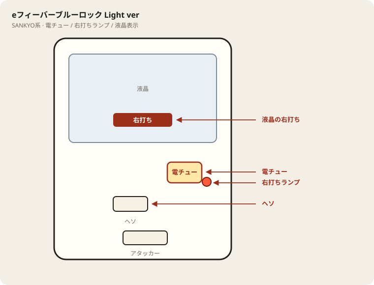

# eフィーバーブルーロック Light ver

## 基本情報

| 項目 | 内容 |
| --- | --- |
| メーカー | JB / SANKYO |
| 型式名 | eフィーバーブルーロックY |
| タイプ | スマパチ / 甘デジ / 1種2種混合 / LT |
| 導入日 | 2026年7月6日 |
| 兄弟機 | ミドル版（eフィーバーブルーロック）は別スペック |

## スペック

| 項目 | 内容 |
| --- | --- |
| 図柄揃い | 通常 約1/120.1（大当り合算 約1/99.9） |
| 頂上決戦 | 図柄揃い時100% / 突破 約57% |
| エゴイストバトル | トータル突入 約60% / 継続 約72%（転落 約1/100） |
| 賞球 | 1&5&7 |
| 出玉 | 通常 約140/210/700個、RUSH中 約560個〜 |

RUSH中は転落まで継続。エゴイストアタックで出玉塊を伸ばす。

## 天井・遊タイム・LT

| 項目 | 内容 |
| --- | --- |
| 天井 | 非搭載 |
| 遊タイム | 非搭載 |
| カウントのリセット | 天井・遊タイムがないため、ハマり回転数は次の抽選に影響しない |

## ボーダー

現金・削りなし。1000円あたり。

| 交換 | ボーダー |
| --- | --- |
| 4.00円（等価） | 16.5 |
| 3.57円（28玉） | 18.5 |
| 3.33円（30玉） | 19.8 |
| 3.03円（33玉） | 21.8 |

持玉で回している間は等価側に寄る。朝イチの現金区間は28玉側で見る。

## 狙い目

18.5回転以上。遊タイムはないのでハマりでは狙わない。通常時の回転率だけを見る。

## やめ時

電サポ・RUSHが終わって通常に戻ったとき。回転率が18.5未満なら即やめ。以上なら続けてよい。

## 朝イチ

閉店スタートは使わない。1000円を通常時だけで数え、18.5回転に届かなければやめる。電サポ中の回転は測定に入れない。

## 盤面の場所

SANKYO／関連。フィーバー系も打ち分けは液晶優先。

系列: **SANKYO系**（機種ごとの目安。個体差あり）

| 項目 | 場所 | 見方 |
| --- | --- | --- |
| 液晶（右打ち表示） | 盤面中央の液晶 | 「右打ち」表示中が電サポ中。切替の最終判断 |
| ヘソ（始動口） | 盤面中央下寄り | 通常時の始動口 |
| 電チュー | 盤面右下（液晶右下〜右レール終点） | 羽根が開く入賞口。右打ちの始動口 |
| 右打ちランプ | 電チュー付近、または盤面下部のランプ群 | 点灯中は右打ち。位置は機種差あり。液晶と併用 |
| アタッカー | 盤面下部中央寄り | 大当りラウンドの入賞口 |
| 電サポ | （状態）時短・ST・RUSH・遊タイム中 | 部品ではない。液晶の右打ち表示中 |
| 保留ランプ | 液晶下または盤面下部 | 保留の目安。右打ち終了直後の残保留に注意 |

- ヘソは中央下寄り、アタッカーは下部中央寄りが多い。
- 迷ったら液晶の指示を優先。ランプだけ見て打ち方を決めない。
- 遊タイム残は液晶表示で確認。深さだけで座らない。

## おすすめカスタム

- カスタムは演出の出方だけが変わる。抽選は変わらない。
- 先エゴイスト＋先読み「オススメ」＋レバブルONが無難。

## 打ち方

- 通常時は左打ち（右打ち指示が出たら従う）。
- 電サポ中・RUSH中は打ち切る。通常に戻ったら回転率を見て継続かやめを決める。
- 遊タイムがないため、深くハマった履歴だけでは拾わない。等価の目安は1000円あたり約16.5回転。

## 総評

ブルーロックの甘デジLT。頂上決戦突破約57%、エゴイストバトル継続約72%。遊タイムなし。

出典: P-WORLD、パチンコスペック解析、ぱちガブ、パチ&スロ必勝本

## 注意

コンプリート機能あり。公開解析の概数で、釘と取りこぼしで前後する。
