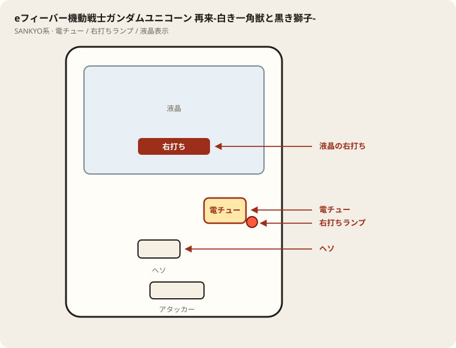

# eフィーバー機動戦士ガンダムユニコーン 再来-白き一角獣と黒き獅子-

## 基本情報

| 項目 | 内容 |
| --- | --- |
| メーカー | SANKYO |
| 型式名 | eフィーバー機動戦士ガンダムユニコーン 再来 |
| タイプ | スマパチ / ミドル / LT |
| 導入日 | 2025年頃 |

## スペック

| 項目 | 内容 |
| --- | --- |
| 大当り確率 | 通常 約1/319前後（公開値の幅あり） |
| RUSH | 突入・継続は公開解析の概数 |
| 賞球 | 公開値の幅あり |
| 出玉 | ミドル帯（現地確認） |

ユニコーン再来。兄弟の99verとは別スペック扱い。

## 天井・遊タイム・LT

| 項目 | 内容 |
| --- | --- |
| 天井 | 非搭載 |
| 遊タイム | 非搭載 |
| カウントのリセット | 天井・遊タイムがないため、ハマり回転数は次の抽選に影響しない |

## ボーダー

現金・削りなし。1000円あたり。

| 交換 | ボーダー |
| --- | --- |
| 4.00円（等価） | 17.0 |
| 3.57円（28玉） | 18.5 |
| 3.33円（30玉） | 19.5 |
| 3.03円（33玉） | 21.0 |

持玉で回している間は等価側に寄る。朝イチの現金区間は28玉側で見る。

## 狙い目

18.5回転以上。遊タイムはないのでハマりでは狙わない。通常時の回転率だけを見る。

## やめ時

電サポ・RUSHが終わって通常に戻ったとき。回転率が18.5未満なら即やめ。以上なら続けてよい。

## 朝イチ

閉店スタートは使わない。1000円を通常時だけで数え、18.5回転に届かなければやめる。電サポ中の回転は測定に入れない。

## 盤面の場所

SANKYO／関連。フィーバー系も打ち分けは液晶優先。

系列: **SANKYO系**（機種ごとの目安。個体差あり）

| 項目 | 場所 | 見方 |
| --- | --- | --- |
| 液晶（右打ち表示） | 盤面中央の液晶 | 「右打ち」表示中が電サポ中。切替の最終判断 |
| ヘソ（始動口） | 盤面中央下寄り | 通常時の始動口 |
| 電チュー | 盤面右下（液晶右下〜右レール終点） | 羽根が開く入賞口。右打ちの始動口 |
| 右打ちランプ | 電チュー付近、または盤面下部のランプ群 | 点灯中は右打ち。位置は機種差あり。液晶と併用 |
| アタッカー | 盤面下部中央寄り | 大当りラウンドの入賞口 |
| 電サポ | （状態）時短・ST・RUSH・遊タイム中 | 部品ではない。液晶の右打ち表示中 |
| 保留ランプ | 液晶下または盤面下部 | 保留の目安。右打ち終了直後の残保留に注意 |

- ヘソは中央下寄り、アタッカーは下部中央寄りが多い。
- 迷ったら液晶の指示を優先。ランプだけ見て打ち方を決めない。
- 遊タイム残は液晶表示で確認。深さだけで座らない。

## おすすめカスタム

- カスタムは演出の出方だけが変わる。抽選は変わらない。
- 先バレ／先読みがあればON。ない場合はデフォルト。

## 打ち方

- 通常時は左打ち（右打ち指示が出たら従う）。
- 電サポ中・RUSH中は打ち切る。通常に戻ったら回転率を見て継続かやめを決める。
- 等価の目安は1000円あたり約17.0回転。28玉側は約18.5回転。

## 総評

ガンダムユニコーン再来。遊タイムは非確認・現地確認。公開値の幅あり・現地確認。

出典: P-WORLD、なな徹、ぱちタウン、パチンコスペック解析、パチ&スロ必勝本

## 設置店舗

台入れ替えがあるため、各店の**全台データ取得時点**の設置。取得日時は Asia/Tokyo。

直近の全台CSVにこの機種の設置は見当たらない（最終確認日: 2026-11-13）。

## 注意

コンプリート機能あり。公開値の幅あり・現地確認。
