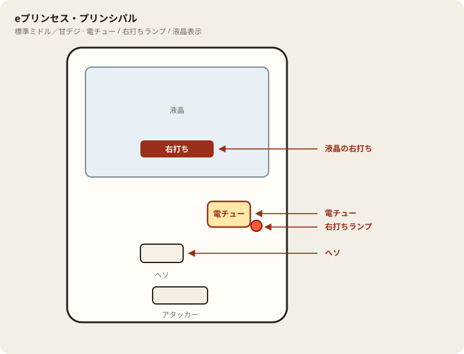

# eプリンセス・プリンシパル

## 基本情報

| 項目 | 内容 |
| --- | --- |
| メーカー | 平和 |
| 型式名 | eプリンセス・プリンシパルHAH7 |
| タイプ | スマパチ / ミドル / 1種2種混合 / ラッキートリガー（LT3.0+） |
| 導入日 | 2026年11月2日 |

## スペック

| 項目 | 内容 |
| --- | --- |
| 図柄揃い確率 | 通常時 1/319.6 |
| SPY RUSH中の実質確率 | 1/10.6 |
| SPY RUSH | ST14回 / 突入率 50% / 継続率 75% |
| 賞球 | 1&2&6&15 |
| カウント | 10カウント |
| 右打ち | SPY RUSH |

通常時の初当りはどちらも1500個。半分がSPY RUSH、半分が通常戻り。

SPY RUSHは前半と後半で出玉テーブルが分かれる。前半は1〜10回転、後半は11〜14回転。

| 区間 | 出玉 | 割合 | そのあと |
| --- | --- | --- | --- |
| 通常時 | 1500個 | 50% | SPY RUSH（14回） |
| 通常時 | 1500個 | 50% | 通常 |
| 1〜10回転 | 10500個（1500個×7） | 25% | SPY RUSH継続 |
| 1〜10回転 | 6000個（1500個×4） | 25% | SPY RUSH継続 |
| 1〜10回転 | 1500個 | 50% | SPY RUSH継続 |
| 11〜14回転 | 1500個 | 約34% | SPY RUSH継続 |
| 11〜14回転 | 0個（RESET） | 約66% | 回転数を戻してSPY RUSH継続 |

V入賞が条件。10500個と6000個は1500個を複数回払う合計。

## 天井・遊タイム・LT

| 項目 | 内容 |
| --- | --- |
| 天井 | 非搭載 |
| 遊タイム | 非搭載 |
| ラッキートリガー | SPY RUSHそのものがLT。時短10回に残保留を足して14回 |
| 前半の意味 | 1〜10回転の大当りは半数が6000個以上。25%が10500個 |
| 後半の意味 | 11〜14回転は出玉を取りにいく区間というより、約66%で回数をリセットしてRUSHに戻す区間 |
| カウントのリセット | 天井・遊タイムがないため、通常時の回転数は救済に使えない |

## ボーダー

1000円あたり。

| 交換 | ボーダー |
| --- | --- |
| 4.00円（等価） | 16.7 |
| 3.57円（28玉） | 17.5 |
| 3.33円（30玉） | 18.0 |
| 3.03円（33玉） | 18.8 |

## 狙い目

17.5回転以上。19回転以上なら、前半の10500個を取りにいける速度。

319分の1で遊タイムがない。500回転、700回転のハマりを朝イチの理由にしない。確率は最初の1回転と同じ。

RUSH突入は50%。初当りの1500個だけでは回収しない前提で、回転率だけを基準にする。

## やめ時

SPY RUSHが終わって通常に戻ったとき。ボーダー以上の台なら通常継続、未満なら即やめ。

後半11〜14回転のリセットはRUSH継続なので、そこでやめない。通常画面に戻ってから判断する。

## 朝イチ

スタートの深さは無視。1000円で17.5、できれば18回転あるかを見る。ST14回転は短いので、測定中にRUSHへ入ったら、その区間の回転は別に数える。

導入から日が浅い台は、サンプルが少なく前日速度の信頼が薄い。朝の1000円を優先する。

## 盤面の場所

電サポは部品ではなく状態。目印は液晶の「右打ち」と右打ちランプ。

系列: **標準ミドル／甘デジ**（機種ごとの目安。個体差あり）

| 項目 | 場所 | 見方 |
| --- | --- | --- |
| 液晶（右打ち表示） | 盤面中央の液晶 | 「右打ち」表示中が電サポ中。切替の最終判断 |
| ヘソ（始動口） | 盤面中央下寄り | 通常時の始動口 |
| 電チュー | 盤面右下〜中央右（液晶の右下寄り） | 羽根が開く入賞口。右打ちの始動口 |
| 右打ちランプ | 電チュー付近、または盤面下部のランプ群 | 点灯中は右打ち。位置は機種差あり。液晶と併用 |
| アタッカー | 盤面下部中央寄り | 大当りラウンドの入賞口 |
| 電サポ | （状態）時短・ST・RUSH・遊タイム中 | 部品ではない。液晶の右打ち表示中 |
| 保留ランプ | 液晶下または盤面下部 | 保留の目安。右打ち終了直後の残保留に注意 |

- ヘソは中央下寄り、アタッカーは下部中央寄りが多い。
- 迷ったら液晶の指示を優先。ランプだけ見て打ち方を決めない。
- 遊タイム残は液晶表示で確認。深さだけで座らない。

## おすすめカスタム

- カスタムは演出の出方だけが変わる。抽選は変わらない。
- 先バレ／先読み系があれば通常は先バレ寄り。RUSH中は一発告知寄り。
- 詳細名が分からない項目は「発生で濃厚」と書かれたものからON。

## 主なモード・演出の見方

- SPY RUSHの演出は3種類。予告とリーチを見るチーム白鳩、フリーズで大当り濃厚のフリーズ、違和感で大当りになるAfternoon Tea。
- プリンセスの決意は、出たあとに熱いリーチへ進みやすい。トータル期待度の目安は約70%。
- アンジェの決意、嘘偽り無し予告は期待度の目安が約90%。
- Princess Principal ZONE、SPYボタン予告は目安約80%。
- 二人の決意は大当り濃厚。
- 後半のWチャレンジは、10Rの出玉か、出玉なしの回数リセットかを分ける演出。リセットでもRUSHは続く。

## 打ち方

- 通常時は左打ち。1/319.6のミドルで、初当りは1500個から始まる。その場の50%でSPY RUSHに残る。
- SPY RUSHに入ったら14回を見届ける。価値があるのは前半10回で、ここに当たると25%で10500個、25%で6000個。
- 11回転以降は出玉が小さく、約66%は0個で回数を戻す。リセットは負けではなく、もう一度前半の10500個を引きにいく継続。画面がRUSHのままなら右打ちを続ける。
- 継続率75%は、前半の大当りと後半のリセットを合わせた数字。1500個で終わったように見えても、リセットで戻っていることがある。
- 天井がないのでハマり台は拾わない。回転率が店の交換率に対して足りているかで席を選ぶ。
- やめ時は、初当り後にRUSHへ入らず通常に戻ったあと、またはSPY RUSHが継続せず通常画面に戻ったあと。後半のリセット直後はやめない。

## 総評

1/319.6のミドルを、14回の短いSTに圧縮した台。初当り1500個の時点で元が取りやすく、RUSHの前半に当たれば6000個か10500個が一度に見える。継続率75%の中身は「当たって出玉」と「出玉なしで回数を戻す」の混合物なので、連チャン数だけを見ると実際の獲得出玉とずれる。

ハマりに天井はない。付くときは前半10回の塊、付かないときは1500個の50%戻りを繰り返す。短時間で大きな山を見たい人向きで、長いSTをじっくり回したい人には回転数が少なく感じる。

出典: G-net、P-WORLD、Amusement Japan、パチまとめ

## 設置店舗

台入れ替えがあるため、各店の**全台データ取得時点**の設置。取得日時は Asia/Tokyo。

| 店舗 | 台数 | データ取得日時 |
| --- | --- | --- |
| エスパス日拓渋谷駅前新館 | 4 | 2026-11-13 09:57〜09:59（Asia/Tokyo） |
| 楽園町田店 | 4 | 2026-11-13 07:43（Asia/Tokyo） |

## 注意

コンプリート機能あり。10500個は1500個の連続に分かれてデータに出る。連チャン回数が多い＝モードが良い、とは限らない。前半で当たったかのほうが重要。
