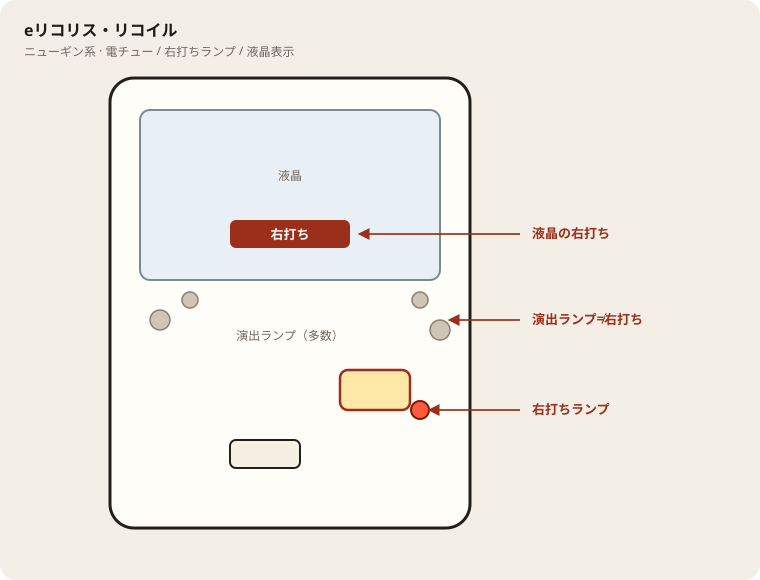

# eリコリス・リコイル

## 基本情報

| 項目 | 内容 |
| --- | --- |
| メーカー | ニューギン |
| 型式名 | eリコリス・リコイルM3 |
| タイプ | スマパチ / ライトミドル / 1種2種混合 / ラッキートリガー（LT3.0+） |
| 導入日 | 2026年4月6日 |
| 枠 | LEUKOS |

## スペック

| 項目 | 内容 |
| --- | --- |
| 大当り確率 | 通常時 1/259.7 |
| 大当り確率（RUSH中） | 1/97.1（電チューのロング開放確率） |
| SPECIAL LycoReco RUSH HYPER DELUXE | 132回 / 突入率 50% / 継続率 約75% |
| ULTIMATE DRIVE | 3000個の上乗せが50%でループ |
| 賞球 | 1 or 6 or 8 or 15 / 10カウント |
| 右打ち | RUSH（モードA・モードB）、ULTIMATE DRIVE |

RUSH突入を初当り回数で割ると約1/519.4。図柄揃い時のLT突入率は約60%、チンアナゴBONUS時は20%、合算で50%。

| 状態 | 出玉 | 行き先 | 割合 |
| --- | --- | --- | --- |
| 通常時 | 1500個 | RUSH | 0.1% |
| 通常時 | 600個 | RUSH | 44.9% |
| 通常時 | 310個 | チンアナゴBONUS成功でRUSH | 5.0% |
| 通常時 | 600個 | 通常 | 30.0% |
| 通常時 | 310個 | 通常 | 20.0% |
| モードA | 750個 | RUSH継続。この大当りの50%でモードBへ | 100% |
| モードB | 6000個（750個×8）+ ULTIMATE DRIVE | RUSH継続 | 50% |
| モードB | 3000個（750個×4） | RUSH継続 | 50% |

突入時の約30%はモードBから始まる。モードBの大当り後は、一部を除きモードAに戻る。6000個と3000個は750個を複数回払う合計なので、データカウンター上は連チャン数が膨らんで見える。

ULTIMATE DRIVEの獲得出玉の目安は、6000個が50%、9000個が25%、9001個以上が25%。

## 天井・遊タイム・LT

| 項目 | 内容 |
| --- | --- |
| 天井 | 非搭載 |
| 遊タイム | 非搭載 |
| ラッキートリガー | SPECIAL LycoReco RUSH HYPER DELUXE。電サポ132回 |
| 内部モード | モードAは750個固定。モードBは3000個か、6000個と上乗せループ |
| 潜伏確変 | 非搭載 |
| カウントのリセット | 天井・遊タイムがないため、通常時の回転数は救済に使えない |

## ボーダー

削りなし・持玉0。1000円あたり。

| 交換 | ボーダー |
| --- | --- |
| 4.00円（等価） | 16.6 |
| 3.57円（28玉） | 18.6 |
| 3.33円（30玉） | 19.9 |
| 3.03円（33玉） | 21.9 |

持玉で回す割合が高いと、必要な回転数は等価の16.6側に下がる。朝の現金は18.6で見る。

## 狙い目

18.6回転以上。20回転以上ならモードBを待つ時間を取ってよい。

ボーダーちょうどは、750個のモードAが続いたときにほぼ伸びない。19回転以上を残す線にする。

259分の1で遊タイムがない。400回転、500回転のハマりは朝の理由にならない。

## やめ時

RUSH終了で通常に戻ったらやめる。引き戻しゾーンはない。

回転率が19以上を実測できている台だけ、通常のまま続けてよい。

モードBやULTIMATE DRIVEの途中では降りない。750個の連打が続いている最中は、合計が3000個、6000個に届く途中のことがある。

## 朝イチ

閉店スタートは無視。1000円で19回転あるかを見る。132回転のRUSH中は測定から除く。

履歴の連チャンが長い台は、モードBを引いた痕跡ではある。翌朝の内部状態は通常に戻っている。連チャンの翌日を狙わない。

## 盤面の場所

ニューギン系。演出ボタン周辺のランプと右打ちランプを取り違えない。

系列: **ニューギン系**（機種ごとの目安。個体差あり）

| 項目 | 場所 | 見方 |
| --- | --- | --- |
| 液晶（右打ち表示） | 盤面中央の液晶 | 「右打ち」表示中が電サポ中。切替の最終判断 |
| ヘソ（始動口） | 盤面中央下寄り | 通常時の始動口 |
| 電チュー | 盤面右下〜中央右（液晶の右下寄り） | 羽根が開く入賞口。右打ちの始動口 |
| 右打ちランプ | 電チュー付近、または盤面下部のランプ群 | 点灯中は右打ち。位置は機種差あり。液晶と併用 |
| アタッカー | 盤面下部中央寄り | 大当りラウンドの入賞口 |
| 電サポ | （状態）時短・ST・RUSH・遊タイム中 | 部品ではない。液晶の右打ち表示中 |
| 保留ランプ | 液晶下または盤面下部 | 保留の目安。右打ち終了直後の残保留に注意 |

- ヘソは中央下寄り、アタッカーは下部中央寄りが多い。
- 迷ったら液晶の指示を優先。ランプだけ見て打ち方を決めない。
- 遊タイム残は液晶表示で確認。深さだけで座らない。

## おすすめカスタム

- カスタムは演出の出方だけが変わる。抽選は変わらない。
- 通常時は先バレ「千束」＋バイブアップ。演出を最後まで見つつ当りを拾いやすい。
- LT判別を優先するなら先バレ「クルミ」＋先読み／バイブ／プレミア／エアーをフルでON。

## 主なモード・演出の見方

- 出玉の分岐は演出の信頼度より、内部がモードAかモードBかで決まる。モードAの大当りは750個で、その50%がモードBへの移動。
- モードBにいるときの大当りが本機の山。半分は3000個、半分は6000個からULTIMATE DRIVEに入り、3000個上乗せがさらに50%で続く。
- チンアナゴBONUSは通常時の310個帯の一部。成功すればRUSHに進むが、成功率は図柄揃いより低い。
- 残り回転数や裏ボタンのモード示唆は、続行するかどうかではなく、いま厚いモードに近いかを見るための表示。RUSH中はやめ時の判断に使わない。

## 打ち方

- 通常時は左打ち。初当りの半分は600個か310個で通常に戻り、半分がRUSH。1500個からRUSHに入るのは0.1%で、通常時の山は小さい。
- RUSHに入ったら132回を打ち切る。継続率約75%でも、モードAが続けば750個の繰り返しになる。モードBに何回入れるかで収支が変わる。
- 6000個やULTIMATE DRIVEが始まったら、上乗せが止まるまで右打ちを続ける。終了後にモードAへ戻っても、RUSH表示が残っているあいだは打つ。
- 遊タイムも潜伏もない。深いハマり台を拾う理由はない。等価の目安は1000円あたり約16.5〜16.7回転。
- やめ時は、初当り後にRUSHへ入らず通常に戻ったあと、またはRUSHが継続せず通常画面に戻ったあと。

## 総評

1/259.7のライトミドルに、132回・約75%のLTを載せた台。継続率の数字より、モードBに何回立てたかが結果を分ける。モードAは750個固定なので、RUSHに残っても出玉が伸びない時間がある。モードBの半分は6000個と、50%ループの3000個上乗せなので、そこに入った回だけ1万個近くまで伸びうる。

初当りの半数は600個以下で通常に戻る。天井がないため、回転率がボーダーを下回る台を深く追う意味は薄い。連チャン数の表示は750個単位の払い出しで増えるので、履歴の連チャン数だけで「荒れている」とは判断しない。

出典: P-WORLD、ラクパチ、G-net、パチンコスペック解析

## 設置店舗

台入れ替えがあるため、各店の**全台データ取得時点**の設置。取得日時は Asia/Tokyo。

| 店舗 | 台数 | データ取得日時 |
| --- | --- | --- |
| エスパス日拓渋谷駅前新館 | 10 | 2026-11-13 09:57〜09:59（Asia/Tokyo） |
| エスパス日拓西武新宿駅前店 | 5 | 2026-11-12 09:57（Asia/Tokyo） |
| 中山ZoRoN | 2 | 2026-11-13 14:37（Asia/Tokyo） |
| 楽園渋谷道玄坂店 | 6 | 2026-11-13 09:57〜09:59（Asia/Tokyo） |
| 楽園渋谷駅前店 | 9 | 2026-11-13 09:57〜09:59（Asia/Tokyo） |
| 楽園町田店 | 8 | 2026-11-13 14:37（Asia/Tokyo） |

## 注意

コンプリート機能あり。6000個、9000個は750個の回数で数える。連チャンが多い台を「荒れている」とそのまま朝イチに使わない。
