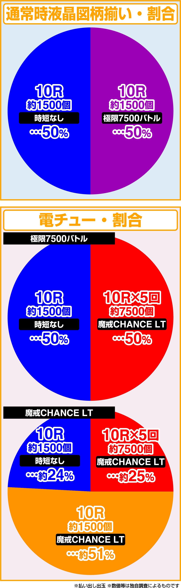
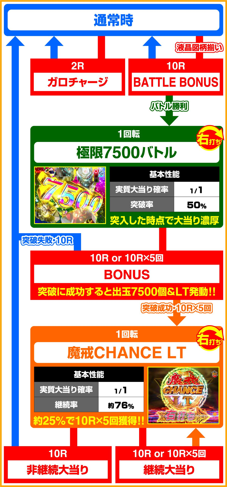
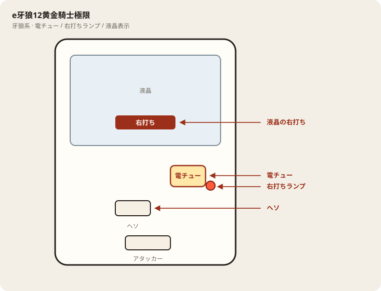

# e牙狼12黄金騎士極限

## 基本情報

| 項目 | 内容 |
| --- | --- |
| メーカー | サンセイR&D |
| 型式名 | e牙狼12黄金騎士極限（調査中） |
| タイプ | スマパチ / ミドル / LT3.0+ |
| 導入日 | 2025年8月4日 |

## スペック

| 項目 | 内容 |
| --- | --- |
| 合算大当り | 約1/349.9（液晶図柄揃い 約1/437.5、ガロチャージ 約1/1750） |
| 極限7500バトル | 図柄揃い時50%突入 / 突破50%（突破で魔戒CHANCE LT） |
| 魔戒CHANCE LT | 継続 約76%（7500継続25%＋1500継続51%／終了24%） |
| 賞球 | 1&5&15 |
| 出玉 | 10R約1500個、突破時10R×5約7500個（出玉は1500か7500のみ） |

LT終了後は即やめ。深いハマりは拾わない。

## 大当り詳細

振り分け・出玉の拡大図（DMM P-town の大当り詳細画像）。公開解析の概数。

出典: [DMM P-town e牙狼12黄金騎士極限](https://p-town.dmm.com/machines/4846)

### 通常時（液晶図柄揃い）

| 種類 | 割合 | 出玉 | その後 |
| --- | ---: | --- | --- |
| 10R | 約50% | 約1500個 | 極限7500バトル |
| 10R | 約50% | 約1500個 | 時短なし（通常戻り） |

### 電チュー（極限7500バトル）

| 種類 | 割合 | 出玉 | その後 |
| --- | ---: | --- | --- |
| 10R×5 | 約50% | 約7500個 | 魔戒CHANCE LT |
| 10R | 約50% | 約1500個 | 時短なし（通常戻り） |

### 電チュー（魔戒CHANCE LT）

| 種類 | 割合 | 出玉 | その後 |
| --- | ---: | --- | --- |
| 10R×5 | 約25% | 約7500個 | LT継続 |
| 10R | 約51% | 約1500個 | LT継続 |
| 10R | 約24% | 約1500個 | 時短なし（LT終了） |

- 継続率は約76%（25%+51%）。終了は約24%。

### ゲームフロー

## 出玉確率／期待出玉

初当り1回あたりの目安。大当り詳細の振り分けと LT継続約76% から**近似**。

| 項目 | 値 |
| --- | --- |
| ラッシュ突入率（極限7500バトル） | 約50% |
| 魔戒CHANCE LT到達 | 約25%（50%×50%） |
| 1万発出る確率 | 約25% |
| 3万発出る確率 | 約4.8% |
| 5万発出る確率 | 約0.93% |

- 前提: 図柄揃いの50%が極限7500バトル、その50%がLT（初当り時点で約1500+7500=9000個）。LT中は継続ヒットの期待出玉約3474個＋終了時1500個。継続回数は幾何分布（継続76%）。
- 非バトル／バトル失敗は最大約3000個で1万未達として扱う。取りこぼし・演出差は未反映の近似。

## 天井・遊タイム・LT

| 項目 | 内容 |
| --- | --- |
| 天井 | 非搭載 |
| 遊タイム | 非搭載 |
| ラッキートリガー | 魔戒CHANCE LT。極限7500バトル突破で発動。継続約76% |
| カウントのリセット | 天井・遊タイムがないため、ハマり回転数は次の抽選に影響しない |

## ボーダー

現金・削りなし。1000円あたり。

| 交換 | ボーダー |
| --- | --- |
| 4.00円（等価） | 17.0 |
| 3.57円（28玉） | 19.1 |
| 3.33円（30玉） | 20.4 |
| 3.03円（33玉） | 22.5 |

持玉で回している間は等価側に寄る。朝イチの現金区間は28玉側で見る。

## 狙い目

19.1回転以上。遊タイムはないのでハマりでは狙わない。通常時の回転率だけを見る。

## やめ時

電サポ・RUSHが終わって通常に戻ったとき。回転率が19.1未満なら即やめ。以上なら続けてよい。

## 朝イチ

閉店スタートは使わない。1000円を通常時だけで数え、19.1回転に届かなければやめる。電サポ中の回転は測定に入れない。

## 盤面の場所

牙狼系。金色演出や役物より、液晶の右打ち表示と電チューを見る。

系列: **牙狼系**（機種ごとの目安。個体差あり）

| 項目 | 場所 | 見方 |
| --- | --- | --- |
| 液晶（右打ち表示） | 盤面中央の液晶 | RUSH／時短中の右打ち指示 |
| ヘソ（始動口） | 盤面中央下寄り | 通常時の始動 |
| 電チュー | 盤面右下〜中央右 | 右打ち時の始動口 |
| 右打ちランプ | 電チュー付近 | 点灯＋液晶をセットで |
| 役物 | 液晶上部〜中央 | 演出用 |
| アタッカー | 盤面下部中央寄り | ラウンド消化 |
| 電サポ | （状態）RUSH・時短中 | 部品ではない |

- 大当り演出中も、終了後に通常へ戻ったかを液晶で確認する。

## おすすめカスタム

- カスタムは演出の出方だけが変わる。抽選は変わらない。
- 通常時は先示唆「アツ牙狼」＋先読み「大チャンス」＋剣ブルONが無難。
- 先祝は濃厚だが出現が重い。演出を味わうなら先読みだけでも可。

## 打ち方

- 通常時は左打ち（右打ち指示が出たら従う）。
- 極限7500バトルに入ったら右打ち。突破（7500個）か失敗（1500個で終了）かを打ち切って確認する。
- 魔戒CHANCE LT中も打ち切る。7500個継続（約25%）に何回乗るかが山。終了（約24%）で通常に戻ったら回転率を見直す。
- 遊タイムはないので、深くハマった履歴だけでは拾わない。

## 総評

一撃特化の牙狼12。出玉は **1500個か7500個だけ**。初当りの半分は1500個で終わり、半分が極限7500バトルへ。バトル突破も半分なので、**魔戒CHANCE LTまでの到達は初当りの約25%**。

LTに乗れば入口時点で約9000個前後まで伸びやすく、継続約76%のあいだに7500個帯（約25%）へ立てるかが収支を分ける。初当り1回あたりの目安では、1万発到達が約25%、3万発が約4.8%、5万発が約0.93%（振り分けと幾何近似）。

等価ボーダー約17.0回転、28玉なら約19.1回転。天井・遊タイムなし。通常時は回転率だけで切り、バトル／LT中は打ち切り、通常に戻ったら即測り直し。

出典: [DMM P-town](https://p-town.dmm.com/machines/4846)、P-WORLD、なな徹、ぱちタウン、パチンコスペック解析

## 設置店舗

台入れ替えがあるため、各店の**全台データ取得時点**の設置。取得日時は Asia/Tokyo。

| 店舗 | 台数 | データ取得日時 |
| --- | --- | --- |
| エスパス日拓渋谷駅前新館 | 41 | 2026-11-13 09:57〜09:59（Asia/Tokyo） |
| エスパス日拓西武新宿駅前店 | 12 | 2026-11-15 13:32（Asia/Tokyo） |
| 中山UNO | 3 | 2026-11-17 17:31（Asia/Tokyo） |
| 中山ZoRoN | 4 | 2026-11-14 12:31（Asia/Tokyo） |
| 楽園渋谷道玄坂店 | 6 | 2026-11-13 16:35（Asia/Tokyo） |
| 楽園渋谷駅前店 | 8 | 2026-11-13 09:57〜09:59（Asia/Tokyo） |
| 楽園町田店 | 10 | 2026-11-22 13:09（Asia/Tokyo） |

## 注意

コンプリート機能あり。公開解析の概数で、釘と取りこぼしで前後する。出玉確率は幾何近似であり、実機の到達率とは一致しない。
