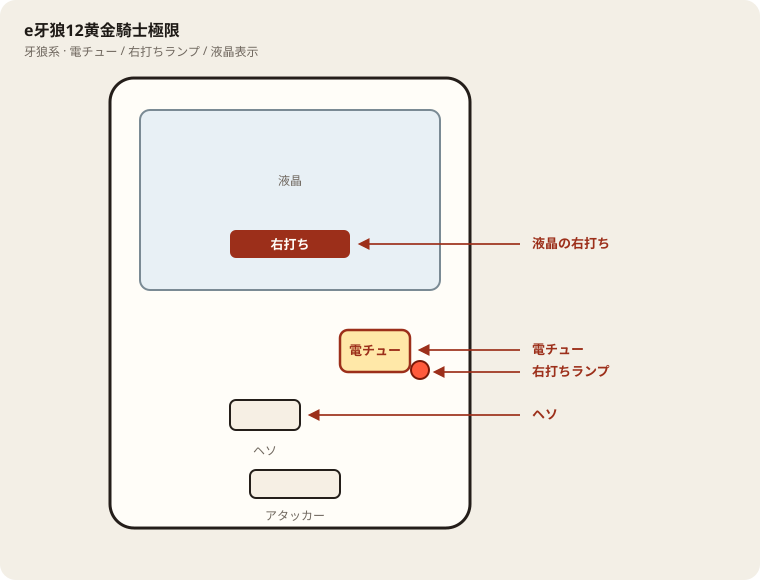

# e牙狼12黄金騎士極限

## 基本情報

| 項目 | 内容 |
| --- | --- |
| メーカー | サンセイR&D |
| 型式名 | e牙狼12黄金騎士極限（調査中） |
| タイプ | スマパチ / ミドル / LT3.0+ |
| 導入日 | 2025年8月4日 |

## スペック

| 項目 | 内容 |
| --- | --- |
| 合算大当り | 約1/349.9（液晶図柄揃い 約1/437.5、ガロチャージ 約1/1750） |
| 極限7500バトル | 図柄揃い時50% / 突破50% |
| 魔戒CHANCE LT | 突破時50% / 継続 約76% |
| 賞球 | 1&5&15 |
| 出玉 | 2R約300個、10R約1500個（突破時約7500個） |

LT終了後は即やめ。深いハマりは拾わない。

## 天井・遊タイム・LT

| 項目 | 内容 |
| --- | --- |
| 天井 | 非搭載 |
| 遊タイム | 非搭載 |
| カウントのリセット | 天井・遊タイムがないため、ハマり回転数は次の抽選に影響しない |

## ボーダー

現金・削りなし。1000円あたり。

| 交換 | ボーダー |
| --- | --- |
| 4.00円（等価） | 17.0 |
| 3.57円（28玉） | 19.1 |
| 3.33円（30玉） | 20.4 |
| 3.03円（33玉） | 22.5 |

持玉で回している間は等価側に寄る。朝イチの現金区間は28玉側で見る。

## 狙い目

19.1回転以上。遊タイムはないのでハマりでは狙わない。通常時の回転率だけを見る。

## やめ時

電サポ・RUSHが終わって通常に戻ったとき。回転率が19.1未満なら即やめ。以上なら続けてよい。

## 朝イチ

閉店スタートは使わない。1000円を通常時だけで数え、19.1回転に届かなければやめる。電サポ中の回転は測定に入れない。

## 盤面の場所

牙狼系。金色演出や役物より、液晶の右打ち表示と電チューを見る。

系列: **牙狼系**（機種ごとの目安。個体差あり）

| 項目 | 場所 | 見方 |
| --- | --- | --- |
| 液晶（右打ち表示） | 盤面中央の液晶 | RUSH／時短中の右打ち指示 |
| ヘソ（始動口） | 盤面中央下寄り | 通常時の始動 |
| 電チュー | 盤面右下〜中央右 | 右打ち時の始動口 |
| 右打ちランプ | 電チュー付近 | 点灯＋液晶をセットで |
| 役物 | 液晶上部〜中央 | 演出用 |
| アタッカー | 盤面下部中央寄り | ラウンド消化 |
| 電サポ | （状態）RUSH・時短中 | 部品ではない |

- 大当り演出中も、終了後に通常へ戻ったかを液晶で確認する。

## おすすめカスタム

- カスタムは演出の出方だけが変わる。抽選は変わらない。
- 通常時は先示唆「アツ牙狼」＋先読み「大チャンス」＋剣ブルONが無難。
- 先祝は濃厚だが出現が重い。演出を味わうなら先読みだけでも可。

## 打ち方

- 通常時は左打ち（右打ち指示が出たら従う）。
- 電サポ中・RUSH中は打ち切る。通常に戻ったら回転率を見て継続かやめを決める。
- 遊タイムがないため、深くハマった履歴だけでは拾わない。等価の目安は1000円あたり約17.0回転。

## 総評

LT到達が重い一撃特化。出玉は1500か7500のみ。遊タイムなし。

出典: P-WORLD、なな徹、ぱちタウン、パチンコスペック解析

## 設置店舗

台入れ替えがあるため、各店の**全台データ取得時点**の設置。取得日時は Asia/Tokyo。

| 店舗 | 台数 | データ取得日時 |
| --- | --- | --- |
| エスパス日拓渋谷駅前新館 | 41 | 2026-11-13 09:57〜09:59（Asia/Tokyo） |
| エスパス日拓西武新宿駅前店 | 12 | 2026-11-12 09:57（Asia/Tokyo） |
| 中山UNO | 3 | 2026-11-14 12:26〜12:29（Asia/Tokyo） |
| 中山ZoRoN | 4 | 2026-11-13 14:37（Asia/Tokyo） |
| 楽園渋谷道玄坂店 | 6 | 2026-11-13 16:35（Asia/Tokyo） |
| 楽園渋谷駅前店 | 8 | 2026-11-13 09:57〜09:59（Asia/Tokyo） |
| 楽園町田店 | 10 | 2026-11-14 08:38〜08:40（Asia/Tokyo） |

## 注意

コンプリート機能あり。公開解析の概数で、釘と取りこぼしで前後する。
