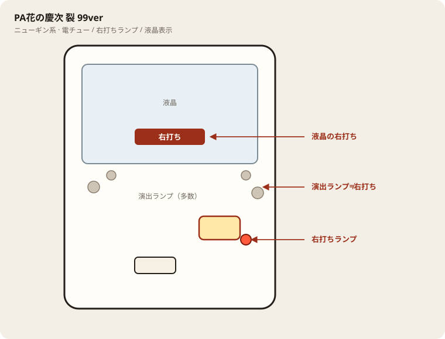

# e花の慶次～黄金の一撃

## 基本情報

| 項目 | 内容 |
| --- | --- |
| メーカー | ニューギン |
| 型式名 | e花の慶次～黄金の一撃H4 |
| タイプ | スマパチ / ミドル / 1種2種混合 / LT |
| 導入日 | 2025年11月4日 |

## スペック

| 項目 | 内容 |
| --- | --- |
| 大当り確率 | 通常（図柄揃い）約1/399.8、RUSH中 約1/99.1、殿MODE 約1/520 |
| 天下無双RUSH | トータル突入 約59%（直行約50.1%） / ST143 / 継続 約77% |
| 殿MODE | 時短100回 |
| 賞球 | 1&4&5&15 |
| 出玉 | 10R約1500 / 2R約200個。超天下無双で6000個+αあり |

## 天井・遊タイム・LT

| 項目 | 内容 |
| --- | --- |
| 天井 | 非搭載 |
| 遊タイム | 非搭載 |
| ラッキートリガー | 搭載（LT3.0プラス） |
| カウントのリセット | 遊タイムがないため、ハマり深さだけでは拾わない |

## ボーダー

現金・削りなし。1000円あたり。

| 交換 | ボーダー |
| --- | --- |
| 4.00円（等価） | 16.5 |
| 3.57円（28玉） | 18.4 |
| 3.33円（30玉） | 19.8 |
| 3.03円（33玉） | 21.7 |

持玉で回している間は等価側に寄る。朝イチの現金区間は28玉側で見る。

## 狙い目

18.4回転以上。遊タイムはないのでハマりでは狙わない。通常時の回転率だけを見る。

## やめ時

RUSH・殿MODEが終わって通常に戻ったとき。回転率が18.4未満なら即やめ。以上なら続けてよい。

## 朝イチ

閉店スタートは使わない。1000円を通常時だけで数え、18.4回転に届かなければやめる。

## 盤面の場所

ニューギン系。液晶の右打ち表示を優先。

系列: **ニューギン系**（機種ごとの目安。個体差あり）

| 項目 | 場所 | 見方 |
| --- | --- | --- |
| 液晶（右打ち表示） | 盤面中央 | 右打ち指示の最終判断 |
| ヘソ | 盤面中央下寄り | 通常時の始動 |
| 電チュー | 盤面右側 | 右打ち時の始動 |
| 右打ちランプ | 電チュー周辺 | 液晶と併用 |
| アタッカー | 盤面下部中央寄り | ラウンド入賞 |
| 電サポ | （状態）RUSH・殿MODE中 | 液晶表示中 |
| 保留ランプ | 液晶下または盤面下部 | 残保留に注意 |

## おすすめカスタム

- カスタムは演出の出方だけが変わる。抽選は変わらない。

## 打ち方

- 通常時は左打ち。右打ち指示に従う。
- RUSH・殿MODE中は打ち切る。通常に戻ったら回転率で判断。
- 遊タイムなし。等価目安は約16.5回転/1000円。

## 総評

図柄揃い1/399帯＋LT。一撃6000個帯あり。ハマり救済なし。

出典: なな徹、パチンコスペック解析、P-WORLD

## 設置店舗

台入れ替えがあるため、各店の**全台データ取得時点**の設置。取得日時は Asia/Tokyo。

| 店舗 | 台数 | データ取得日時 |
| --- | --- | --- |
| エスパス日拓渋谷駅前新館 | 4 | 2026-11-12 09:57（Asia/Tokyo） |

## 注意

コンプリート機能あり。公開解析の概数で、釘と取りこぼしで前後する。
