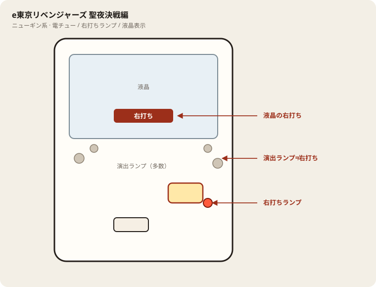

# e虚構推理

## 基本情報

| 項目 | 内容 |
| --- | --- |
| メーカー | D-light（大一商会） |
| 型式名 | e虚構推理 |
| タイプ | スマパチ / ミドル / 2種 / LT |
| 導入日 | 2026年7月6日 |

## スペック

| 項目 | 内容 |
| --- | --- |
| 図柄揃い | 通常 約1/319、右打ち中 約1/44 |
| 鋼人攻略戦 | 突入 約50.5% / ST36+残保留 / 継続 約60% |
| 裏モード | 約49.5% / 時短20回 |
| 琴子のご褒美RUSH（LT） | 平均継続 約77% |
| 裏・琴子のご褒美RUSH | 平均継続 約75% |
| 賞球 | アタッカー15 |
| 出玉 | 10R約1500 / 2R約300個（払い出し） |

## 天井・遊タイム・LT

| 項目 | 内容 |
| --- | --- |
| 天井 | 非搭載 |
| 遊タイム | 非搭載 |
| ラッキートリガー | 搭載（琴子のご褒美RUSH） |
| カウントのリセット | 遊タイムがないため、ハマり深さだけでは拾わない |

## ボーダー

現金・削りなし。1000円あたり。

| 交換 | ボーダー |
| --- | --- |
| 4.00円（等価） | 31.5 |
| 3.57円（28玉） | 35.3 |
| 3.33円（30玉） | 37.8 |
| 3.03円（33玉） | 41.6 |

持玉で回している間は等価側に寄る。朝イチの現金区間は28玉側で見る。2種機のためボーダーは高め。

## 狙い目

35.3回転以上（28玉）。遊タイムはないのでハマりでは狙わない。通常時の回転率だけを見る。

## やめ時

鋼人攻略戦・LT・裏モードが終わって通常に戻ったとき。回転率がボーダー未満なら即やめ。

## 朝イチ

閉店スタートは使わない。1000円を通常時だけで数え、35.3回転に届かなければやめる。

## 盤面の場所

液晶の右打ち表示と電チューを優先。

系列: **スマパチ系**（機種ごとの目安。個体差あり）

| 項目 | 場所 | 見方 |
| --- | --- | --- |
| 液晶（右打ち表示） | 盤面中央 | 右打ち指示の最終判断 |
| ヘソ | 盤面中央下寄り | 通常時の始動 |
| 電チュー | 盤面右側 | 右打ち時の始動 |
| 右打ちランプ | 電チュー周辺 | 液晶と併用 |
| アタッカー | 盤面下部中央寄り | ラウンド入賞 |
| 電サポ | （状態）右打ち中 | 液晶表示中 |
| 保留ランプ | 液晶下または盤面下部 | 残保留に注意 |

## おすすめカスタム

- カスタムは演出の出方だけが変わる。抽選は変わらない。先バレ系があれば好みで。

## 打ち方

- 通常時は左打ち。右打ち指示に従う。
- 鋼人攻略戦・LT中は打ち切る。通常に戻ったら回転率で判断。
- 遊タイムなし。等価目安は約31.5回転/1000円（2種機）。

## 総評

LT搭載の2種ミドル。ボーダーが高めなので回転の良い台だけ。ハマり救済なし。

出典: P-WORLD、パチンコスペック解析、Ptools

## 設置店舗

台入れ替えがあるため、各店の**全台データ取得時点**の設置。取得日時は Asia/Tokyo。

| 店舗 | 台数 | データ取得日時 |
| --- | --- | --- |
| 中山ZoRoN | 2 | 2026-11-13 14:37（Asia/Tokyo） |

## 注意

コンプリート機能あり。公開解析の概数で、釘と取りこぼしで前後する。
