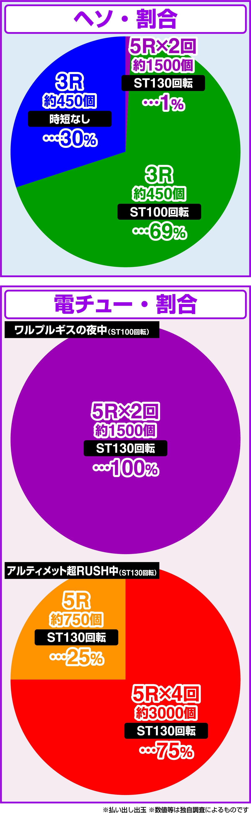
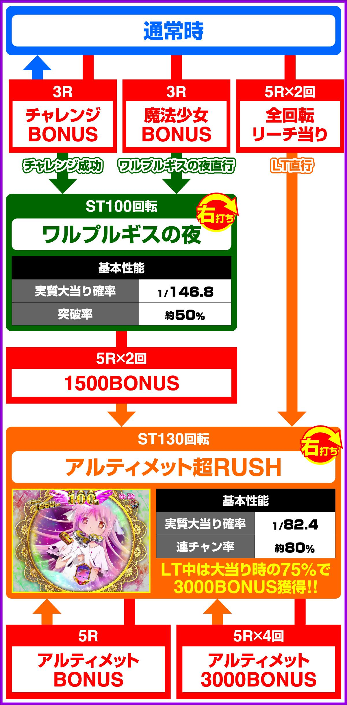
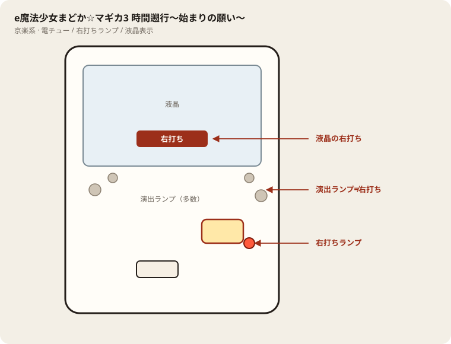

# e魔法少女まどか☆マギカ3 時間遡行〜始まりの願い〜

## 基本情報

| 項目 | 内容 |
| --- | --- |
| メーカー | 京楽 / オッケー. |
| 型式名 | e魔法少女まどか☆マギカ3LPM1 |
| タイプ | スマパチ / ハイミドル / LT |
| 導入日 | 2026年3月2日 |

## スペック

| 項目 | 内容 |
| --- | --- |
| 大当り確率 | 通常 約1/319.9、RUSH中 約1/146.8、LT中 約1/82.4 |
| RUSH突入 | 約70%（ST100へ69% + ST130直通1%） |
| ワルプルギスの夜（RUSH） | ST100 / 突破（LT昇格） 約50%。当りはALL約1500個→アルティメット超RUSH |
| アルティメット超RUSH（LT） | ST130 / 継続 約80%。当りは約3000個75% / 約750個25% |
| 賞球 | 1&4&5&15 |
| 出玉 | 通常時約450/1500個、RUSH中約1500個、LT中約750/3000個 |

RUSH中当りでLT。終了後は通常に戻ったら回転率で判断。

## 大当り詳細

振り分け・出玉の拡大図（DMM P-town の大当り詳細画像）。公開解析の概数。

出典: [DMM P-town e 魔法少女まどか☆マギカ3 時間遡行〜始まりの願い〜](https://p-town.dmm.com/machines/4966)

### ヘソ（通常時）

| 種類 | 割合 | 出玉 | その後 |
| --- | ---: | --- | --- |
| 5R×2 | 約1% | 約1500個 | アルティメット超RUSH（ST130）直通 |
| 3R | 約69% | 約450個 | ワルプルギスの夜（ST100） |
| 3R | 約30% | 約450個 | 時短なし（通常戻り） |

- 初当りの **約70%** でRUSH系（ST100またはST130）へ突入。

### 電チュー（ワルプルギスの夜中・ST100）

| 種類 | 割合 | 出玉 | その後 |
| --- | ---: | --- | --- |
| 5R×2 | 約100% | 約1500個 | アルティメット超RUSH（ST130） |

- ST100の突破率は約50%。当れば必ずLT（アルティメット超RUSH）へ。

### 電チュー（アルティメット超RUSH中・ST130）

| 種類 | 割合 | 出玉 | その後 |
| --- | ---: | --- | --- |
| 5R×4 | 約75% | 約3000個 | ST130継続 |
| 5R | 約25% | 約750個 | ST130継続 |

### ゲームフロー

## 出玉確率／期待出玉

初当り1回あたりの目安。大当り詳細の振り分けと、ST100突破約50%・LT継続約80%から**近似**。LT中の1当りあたり期待出玉は 0.75×3000+0.25×750=約2438個。連チャン数は継続率の幾何分布。

| 項目 | 値 |
| --- | --- |
| ラッシュ突入率 | 約70% |
| 1万発出る確率 | 約14.5% |
| 3万発出る確率 | 約2.4% |
| 5万発出る確率 | 約0.41% |

- 前提: 突入70%（ST100 69%＋ST130直通1%）／ST100突破50%でLTへ／LT継続80%／LT代表出玉約2438個。
- 非RUSH（30%・約450個）は1万未達として0扱い。モード分岐のゆらぎ・取りこぼしは未反映の近似。

## 天井・遊タイム・LT

| 項目 | 内容 |
| --- | --- |
| 天井 | 非搭載 |
| 遊タイム | 非搭載 |
| ラッキートリガー | アルティメット超RUSH（ST130・継続約80%）。ワルプルギスST100突破で発動 |
| カウントのリセット | 天井・遊タイムがないため、ハマり回転数は次の抽選に影響しない |

## ボーダー

現金・削りなし。1000円あたり。

| 交換 | ボーダー |
| --- | --- |
| 4.00円（等価） | 19.9 |
| 3.57円（28玉） | 22.3 |
| 3.33円（30玉） | 23.9 |
| 3.03円（33玉） | 26.3 |

持玉で回している間は等価側に寄る。朝イチの現金区間は28玉側で見る。

## 狙い目

22.3回転以上。遊タイムはないのでハマりでは狙わない。通常時の回転率だけを見る。

## やめ時

電サポ・RUSHが終わって通常に戻ったとき。回転率が22.3未満なら即やめ。以上なら続けてよい。

## 朝イチ

閉店スタートは使わない。1000円を通常時だけで数え、22.3回転に届かなければやめる。電サポ中の回転は測定に入れない。

## 盤面の場所

京楽系は盤面ランプが多く、演出ランプと右打ちランプを取り違えやすい。

系列: **京楽系**（機種ごとの目安。個体差あり）

| 項目 | 場所 | 見方 |
| --- | --- | --- |
| 液晶（右打ち表示） | 盤面中央の液晶 | 切替の最終判断。演出色より表示文字を見る |
| ヘソ（始動口） | 盤面中央下寄り（デカヘソ機は特大） | 通常時の始動 |
| 電チュー | 盤面右下寄り | 右打ち時の始動口 |
| 右打ちランプ | 電チュー付近〜盤面下のランプ群 | 赤点灯が右打ちのことが多いが、機種差あり。液晶と併用 |
| 演出ランプ | 盤面左右・上部 | 信頼度演出用。右打ち判断に使わない |
| アタッカー | 盤面下部中央寄り | ラウンド消化 |
| 電サポ | （状態）時短・ST・RUSH中 | 部品ではない |

- カラフルな点灯だけで右打ちに切り替えない。
- デカヘソ機は通常時の拾いが回転率に直結する。

## おすすめカスタム

- カスタムは演出の出方だけが変わる。抽選は変わらない。
- 通常時はキュゥべえ先告知。無駄玉を減らすなら金設定。Pスキップ多用なら未来予知も可。
- ワルプルギスの夜はチャンス告知紫が無難。
- アルティメット超ラッシュはアルティメットまどか3000告知が本命。

## 打ち方

- 通常時は左打ち（右打ち指示が出たら従う）。ゲート通過のP-スキップで変動カット可。
- 電サポ中・RUSH中は打ち切る。ワルプルギス（ST100）は突破してLTに乗るかが分岐点。
- アルティメット超RUSHに入ったら、継続が切れるまで右打ち。3000個帯（75%）に何回乗るかで山が決まる。
- 通常に戻ったら回転率を見て継続かやめを決める。遊タイムはないので、ハマり履歴だけでは拾わない。

## 総評

ハイミドル（通常約1/319.9）のまどマギ3スマパチ。初当りの約70%がRUSH系に入り、うち大半はワルプルギスの夜（ST100）経由。ST100突破は約50%だが、突破すればアルティメット超RUSH（ST130・継続約80%）へ必ず昇格する二段構え。

勝負所はLT中。当りの75%が約3000個、25%が約750個なので、同じ継続率でも「3000個側に何回立てたか」で差が出る。初当り1回あたりの目安では、1万発到達が約14.5%、3万発が約2.4%、5万発が約0.41%（振り分けと継続の近似）。

等価ボーダーは約19.9回転、28玉なら約22.3回転とやや重い。天井・遊タイムなしなので、朝イチ・通常時は回転率だけで切る。RUSH／LT中は打ち切り、終わって通常に戻ったら即測り直し。

出典: [DMM P-town](https://p-town.dmm.com/machines/4966)、P-WORLD、なな徹、ぱちタウン、パチンコスペック解析

## 設置店舗

台入れ替えがあるため、各店の**全台データ取得時点**の設置。取得日時は Asia/Tokyo。

直近の全台CSVにこの機種の設置は見当たらない（最終確認日: 2026-11-28）。

## 注意

コンプリート機能あり。公開解析の概数で、釘と取りこぼしで前後する。出玉確率は幾何近似であり、実機の到達率とは一致しない。
