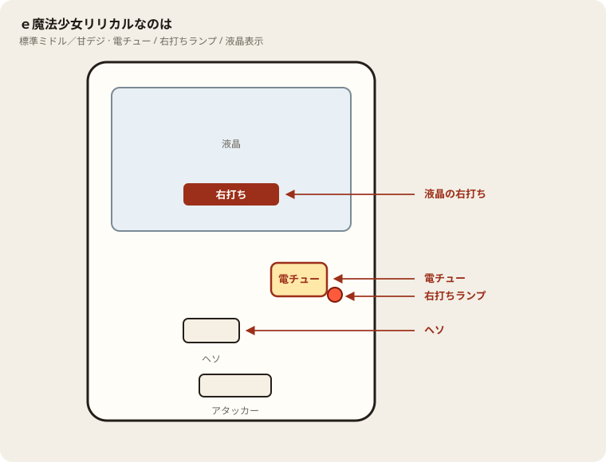

# e魔法少女リリカルなのは

## 基本情報

| 項目 | 内容 |
| --- | --- |
| メーカー | サンスリー |
| 型式名 | e魔法少女リリカルなのはHTEZ2 |
| タイプ | スマパチ / ミドル / 1種2種混合 / ラッキートリガー |
| 導入日 | 2026年7月6日 |
| 筐体 | マルチフレーム |

## スペック

| 項目 | 内容 |
| --- | --- |
| 大当り確率 | 通常時・チャレンジタイム中 約1/348.5 |
| 大当り確率（ST中） | 約1/51.6 |
| 図柄揃い時のST突入率 | 約63%（チャレンジタイム100回での引き戻しを含む） |
| フルドライブST | 70回 / 継続率 約75% |
| チャレンジタイム | 時短100回 |
| 賞球 | 1（ヘソ）&1（電チュー）&1&4&15 |
| ラウンド / カウント | 2R or 6R or 10R / 10カウント |
| 右打ち | チャレンジタイム、フルドライブST、アクセラレイターチャンスの消化中 |

払い出しの目安は、2R約300個、6R約900個、10R約1500個。V入賞が条件。

通常時（全体）の内訳は、図柄揃い約81%、アクセラレイターチャンス（2R・約300個）約19%。

図柄揃い時の行き先は次のとおり。

| 出玉 | 行き先 | 割合 |
| --- | --- | --- |
| 3000個 or 900個 | フルドライブST（70回） | 約51% |
| 900個 | チャレンジタイム（100回） | 約49% |

フルドライブSTは完走型。ST中に図柄が揃ってもSTは切れず、最大5回まで大当りをストックし、70回を消化したあと一気に解放する。ST中のSTOCK期待出玉は、1500個約47%、3000個約32%、4500個約14%、6000個約5%、7500個約2%。いずれも1500個の倍数。

## 天井・遊タイム・LT

| 項目 | 内容 |
| --- | --- |
| 天井 | 非搭載 |
| 遊タイム | 非搭載 |
| ラッキートリガー | 搭載。公式発表の突入確率は約1/646 |
| LT継続率 | 公式発表では未確認（攻略サイトでは約92%とされる） |
| カウントのリセット | 天井・遊タイムがないため、ハマり回転数は次の抽選に影響しない |

## ボーダー

現金・削りなし。1000円あたり。

| 交換 | ボーダー |
| --- | --- |
| 4.00円（等価） | 17.6 |
| 3.57円（28玉） | 19.7 |
| 3.33円（30玉） | 21.1 |
| 3.03円（33玉） | 23.2 |

初当りまでの平均はおおよそ4連、獲得出玉の目安は5000個前後。348分の1なので、回転率が19.7を下回ると現金の減りが速い。

## 狙い目

19.7回転以上。21回転以上なら完走後の放出を待てる。

天井はない。600回転ハマっていても次の確率は同じ。朝イチの拾い対象にしない。

時短100回転は引き戻し約25%。時短に入ったこと自体はRUSH確定ではない。外れたら通常。

## やめ時

フルドライブが完走して放出が終わり、通常に戻ったとき。

STの途中ではやめない。ストックは完走後に出るので、70回転の途中で降りると貯めた分の放出前になる。

通常に戻ったあと、回転率が19.7未満なら即やめ。以上なら続けてよい。

## 朝イチ

閉店スタートは使わない。1000円を通常時だけで数え、20回転に届かなければやめる。

履歴に71前後のスタートが連続する区間は、ST70回転の電サポ。回転率の計算に入れない。時短100回転も同様。

初当り0の日にスタートだけ600まで伸びていても、それは消化の記録で、翌朝の有利ではない。

## 盤面の場所

電サポは部品ではなく状態。目印は液晶の「右打ち」と右打ちランプ。

系列: **標準ミドル／甘デジ**（機種ごとの目安。個体差あり）

| 項目 | 場所 | 見方 |
| --- | --- | --- |
| 液晶（右打ち表示） | 盤面中央の液晶 | 「右打ち」表示中が電サポ中。切替の最終判断 |
| ヘソ（始動口） | 盤面中央下寄り | 通常時の始動口 |
| 電チュー | 盤面右下〜中央右（液晶の右下寄り） | 羽根が開く入賞口。右打ちの始動口 |
| 右打ちランプ | 電チュー付近、または盤面下部のランプ群 | 点灯中は右打ち。位置は機種差あり。液晶と併用 |
| アタッカー | 盤面下部中央寄り | 大当りラウンドの入賞口 |
| 電サポ | （状態）時短・ST・RUSH・遊タイム中 | 部品ではない。液晶の右打ち表示中 |
| 保留ランプ | 液晶下または盤面下部 | 保留の目安。右打ち終了直後の残保留に注意 |

- ヘソは中央下寄り、アタッカーは下部中央寄りが多い。
- 迷ったら液晶の指示を優先。ランプだけ見て打ち方を決めない。
- 遊タイム残は液晶表示で確認。深さだけで座らない。

## おすすめカスタム

- カスタムは演出の出方だけが変わる。抽選は変わらない。
- 通常時は全力全開先バレ「40%」＋プレミアム大幅UPが無難。EXTRAは占有が低く修行台化しやすい。
- ラッシュ中は先バレチャンスON＋違和感大幅UP。先読みはデフォかチャンス。

## 主なモード・演出の見方

- 全力全開3000BONUSは直撃フリーズから出る3000個（1500個×2）。消化後はフルドライブST。
- リリカルBONUSは900個。消化後のリリカルJUDGE成功でフルドライブST、失敗でチャレンジタイム。
- アクセラレイターチャンスは300個。演出成功率は1/6で、成功すればフルドライブST。
- チャレンジタイム中は選択キャラで演出の出方が変わる。なのははバランス型、フェイトは演出が出れば熱い、はやては演出頻度が高め。
- フルドライブSTは図柄が揃っても回り続ける。出玉は完走後のSTOCK解放でまとめて見える。

## 打ち方

- 通常時は左打ち。図柄揃いの約半分がそのままフルドライブST、残りは時短100回のチャレンジタイム。
- チャレンジタイムは100回を打ち切る。ここでの大当りは10R（約1500個）かつフルドライブST確定。
- フルドライブSTは70回を完走する。途中で図柄が揃ってもSTは終わらないので、完走とSTOCK解放まで右打ちを続ける。
- アクセラレイターチャンスは短いが、1/6でSTに届く。指示どおり消化する。
- 遊タイムがないため、深くハマった履歴だけでは拾わない。等価の目安は250玉あたり約17.7回転。非等価の店では目安が1〜3回転上がる。
- やめ時は、チャレンジタイム終了後に通常へ戻ったとき、アクセラレイターチャンス失敗後、フルドライブSTが継続せず通常へ戻ったとき。ST中・時短中は打ち切る。

## 総評

ミドル帯の1/348.5に、完走型STと上位のラッキートリガーを重ねた台。ST継続率約75%は標準的だが、70回のあいだに当たった分を最後にまとめて出すため、連チャンの途中経過が読みにくい。出玉の山は1500個前後が多く、3000個以上はSTが続いたときとLTに入ったときに寄る。

ハマりに天井がないので、回転率がボーダーを下回る台を深く追う理由は薄い。短時間で結果を見たい人より、時短100回とST70回をまとめて消化できる人向き。LTの突入は約1/646と、ミドルとしては届きやすい部類だが、継続率は公式数値が公開されていない。

出典: サンスリー／三洋販売 報道発表（2026年4月17日）、P-WORLD、パチンコビスタ

## 設置店舗

台入れ替えがあるため、各店の**全台データ取得時点**の設置。取得日時は Asia/Tokyo。

直近の全台CSVにこの機種の設置は見当たらない（最終確認日: 2026-11-14）。

## 注意

コンプリート機能あり。7500個はストックが最大近くまで乗ったときの合計。10Rの1500個が複数回に分かれてカウンターに出る。連チャンの多さを、内部モードが良いまま翌朝も続く、とは読まない。
