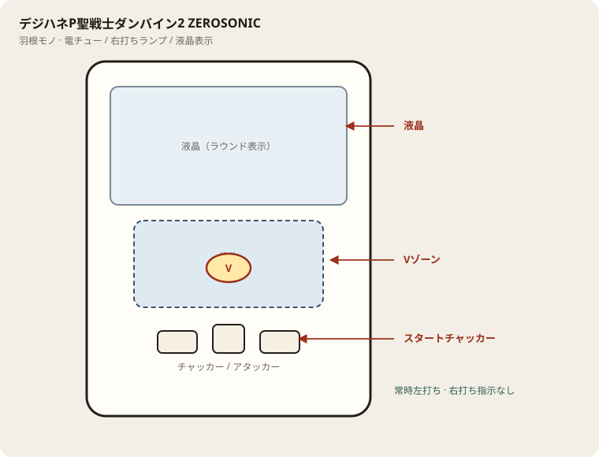

# デジハネP聖戦士ダンバイン2 ZEROSONIC

## 基本情報

| 項目 | 内容 |
| --- | --- |
| メーカー | サミー |
| 型式名 | Pデジハネ聖戦士ダンバイン2SSPB |
| タイプ | P機 / 甘デジ / 1種2種混合 |
| 導入日 | 2024年2月5日 |

## スペック

| 項目 | 内容 |
| --- | --- |
| 大当り確率 | 通常 約1/99.9、右打ち中 約1/32.1 |
| ダンバインRUSH | 突入 約59% / 時短70+残保4 / 継続 約90% |
| 賞球 | 1&3&4&5&8 |
| 出玉 | 3R約210個、6R約450個、9R約690個（払い出し） |

初当り後はダンバインRUSH／チャンスタイムHYPER／チャンスタイムへ分岐。

## 天井・遊タイム・LT

| 項目 | 内容 |
| --- | --- |
| 天井 | 非搭載 |
| 遊タイム | 非搭載 |
| カウントのリセット | 天井・遊タイムがないため、ハマり回転数は次の抽選に影響しない |

## ボーダー

現金・削りなし。1000円あたり。

| 交換 | ボーダー |
| --- | --- |
| 4.00円（等価） | 16.3 |
| 3.57円（28玉） | 18.3 |
| 3.33円（30玉） | 19.6 |
| 3.03円（33玉） | 21.5 |

持玉で回している間は等価側に寄る。朝イチの現金区間は28玉側で見る。

## 狙い目

18.3回転以上。遊タイムはないのでハマりでは狙わない。通常時の回転率だけを見る。

## やめ時

電サポ・RUSHが終わって通常に戻ったとき。回転率が18.3未満なら即やめ。以上なら続けてよい。

## 朝イチ

閉店スタートは使わない。1000円を通常時だけで数え、18.3回転に届かなければやめる。電サポ中の回転は測定に入れない。

## 盤面の場所

常時左打ち。羽根開放と役物内のV入賞が本体。右打ち指示はない。

系列: **羽根モノ**（機種ごとの目安。個体差あり）

| 項目 | 場所 | 見方 |
| --- | --- | --- |
| スタートチャッカー | 盤面下部（左右／中央） | 入賞で羽根が開く。中央入賞は開放回数が増える機種あり |
| 羽根 | 役物の上部〜入り口 | 開放中に玉を役物内へ送る |
| Vゾーン | 役物内（回転体・穴・ホームランVなど） | 入賞で大当り。抜けやすい台は即やめ材料 |
| アタッカー | 盤面下部中央寄り | ラウンド消化。開放を見て打ち出しを合わせる |
| 液晶 | 盤面中央 | ラウンド表示・止め打ち目安。打ち分け指示は出ない |

- 右打ちランプは使わない。常に左打ち。
- 拾いと役物抜けの台差が大きい。1000円の鳴きとV到達を見て切る。

## おすすめカスタム

- カスタムは演出の出方だけが変わる。抽選は変わらない。
- 先バレ／先読みがあればON。ない場合はデフォルト。

## 打ち方

- 通常時は左打ち（右打ち指示が出たら従う）。
- 電サポ中・RUSH中は打ち切る。通常に戻ったら回転率を見て継続かやめを決める。
- 等価の目安は1000円あたり約16.3回転。28玉側は約18.3回転。

## 総評

デジハネダンバイン2。RUSH継続約90%。遊タイムなし。

出典: P-WORLD、なな徹、ぱちタウン、パチンコスペック解析、パチ&スロ必勝本

## 注意

コンプリート機能あり。公開解析の概数で、釘と取りこぼしで前後する。
