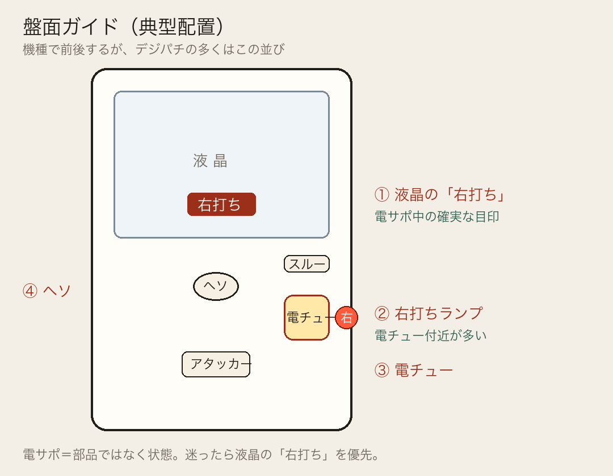
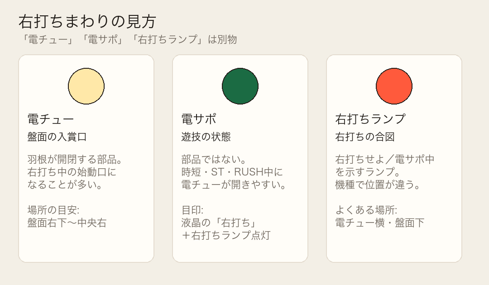

# パチンコ用語一覧

近い意味の用語を同じ見出しにまとめている。表の「意味」は、このフォルダの攻略（スペック込み）を読むときの共通語。

現場の言い伝え・画面確認の扱いは [オカルトパチンコ動作一覧](オカルトパチンコ動作一覧.md)。

DMMぱちタウンなどの機種ページに出る「甘デジ」「Lv.1」などの分類語もここにまとめる。

## スペック分類・機種カテゴリ

| 用語 | 意味 |
| --- | --- |
| 甘デジ | 大当り確率がおおよそ1/100前後と高い台の通称。当たりやすく、1回の出玉は少なめになりやすい |
| 遊パチ | 甘デジと同系統の愛称。手軽に遊べる台、という意味で使われる |
| デジハネ / ハネデジ / デジ羽 | 甘デジの別称。羽根物のように当たりやすいデジパチ、というニュアンス |
| ライトミドル | 甘デジとミドルの中間。大当り確率はおおよそ1/150〜1/250前後が多い |
| ミドル | 大当り確率がおおよそ1/319前後など、現行の下限に近い帯。出玉の山は甘デジより大きくなりやすい |
| MAX | 昔の下限（1/400前後）ギリギリの重い台を指した呼称。今はミドルと呼ばれる帯に近い |
| ヘビーミドル | ミドルよりさらに重い、または出玉比重が大きいミドル帯を指すことがある通称 |
| デジパチ | 液晶の図柄抽選が中心のパチンコ。羽根物と対比して使う |
| 羽根物 | 羽根（チューリップ）開放が主の古典的なタイプ。デジハネの語源になる |
| スマパチ | スマートパチンコ。遊技球の循環や枠の仕組みが従来機と違う現行の区分。型式名が `e` で始まることが多い |
| P機 | 型式名が `P` で始まる従来型のパチンコ。対になるのがスマパチ（`e`） |
| PA | 型式名の接頭。甘デジ寄りのスペックで使われることが多い（例: PA大海物語…） |
| e / eF | スマパチの型式接頭。`eF` はメーカー表記上の区分 |
| ST機 | 大当り後などにST（回数付きの確変＋電サポ）へ入るタイプ。機種ページのアイコンでも使われる |
| 設定付き | 店舗が設定（多くは1〜6）を選べる機種。設定で確率や振り分けが変わる |
| カテゴリ（Lv.1〜4） | 日工組の表示区分。Lv.1スーパーライト／Lv.2ライト／Lv.3ミドル／Lv.4ハイ。遊びやすさ〜出玉性能の目安 |
| スーパーライト | カテゴリLv.1。いちばん手軽寄り、という表示 |
| 8個保留 | 通常時の保留上限が8個の機種。一般的な4個保留より貯められる |
| 保留連 | 大当り中や直後に、残っている保留で続けて当たること。保留連濃厚の演出がある機種もある |

## 確率・抽選

| 用語 | 意味 |
| --- | --- |
| 大当り | アタッカーが開き、ラウンド数に応じて玉が増える当り。小当り経由の場合は、特定の領域（V）に玉が入って初めて大当りになる機種がある |
| 初当り | 通常状態から初めて当たること。RUSH中の2回目以降は初当りに数えない |
| 小当り | 大当りより短い開放。1種2種混合機では、小当りからVに入るとラウンドが付く |
| 確率変動（確変） | 大当り確率が高い状態。電サポとセットで右打ちになることが多い |
| 低確率 | 通常時の大当り確率。電サポが付いていない状態 |
| 高確率 | 確変中の大当り確率。分母が小さくなる |
| 実質確率 | 小当り、普図、V入賞などを合算した、プレイ上の当りやすさ |
| 突入率 | 初当りのうち、RUSHや確変に進む割合。機種ページではST突入率・時短突入率のように状態名付きで書かれる |
| 継続率 | RUSHや確変が、次も続く割合。出玉なしの回数リセットを含む機種がある。ST継続率も同系統 |
| 転落 | 確変やRUSHが、回数消化とは別に抽選で終わること |
| 振り分け | 同じ大当りの中で、出玉や行き先が何%ずつに分かれているか |
| 図柄揃い | 画面の図柄が揃って当りになること。揃った図柄で出玉と行き先が変わる |
| 潜伏確変 | 確変に入っているのに電サポが無く、見た目は通常のままの状態 |
| 電サポ | 電チューサポート。電チューが開きやすくなり、右打ちで回転が速くなる。**部品ではなく状態** |
| 電サポ回転数 | 時短やSTなど、電サポが付く回転数。機種ページの基本スペック表によく出る |
| V入賞 | アタッカー内の特定領域に玉が入ること。入らないと出玉やRUSHが付かない機種がある |
| 1種2種混合 | 図柄揃い（1種）と小当り経由のV入賞（2種）の両方で大当りを作るタイプ |

## 盤面の場所（共通）

電チュー・右打ちランプは機種で位置が前後する。電サポは場所ではなく状態。迷ったら液晶の「右打ち」表示を優先する。

| 項目 | 典型の場所 | 見方 |
| --- | --- | --- |
| ヘソ | 盤面中央下寄り | 通常時（左打ち）の始動口 |
| 電チュー | 盤面右下〜中央右 | 羽根が開く入賞口。右打ちの始動口 |
| スルー | 右側の玉道上 | 通過で普図抽選→電チュー開放 |
| アタッカー | 盤面下部中央寄り | 大当り中の大入賞口 |
| 右打ちランプ | 電チュー横・盤面下が多い | 点灯中は右打ち。機種差が大きい |
| 電サポ | （状態） | 時短・ST・RUSH中。液晶「右打ち」が目印 |

各攻略の「盤面の場所」に、その台の目安を書いている。

## 出玉

| 用語 | 意味 |
| --- | --- |
| ラウンド（R） | アタッカーが開く1セット。10Rなら最大10回開く |
| カウント | 1ラウンドでアタッカーに入る玉の上限。10カウントなら10個まで |
| 賞球 | 入賞1個に対して払い出される玉数。ヘソ1個、アタッカー15個、のように場所で違う |
| 出玉 | 大当りで増える玉。払い出し個数で書くことが多く、入賞に使った玉を引いた純増とは差がある |
| 払い出し | 台が実際に吐き出した玉数。1500個×3のように複数ラウンドの合計で4500個と書くことがある |
| 純増 | 払い出しから、当てるために使った玉を引いた増加分 |
| トータル確率 | 通常と確変を合わせた、大当り1回あたりの平均回転数の目安 |
| 最大出玉 | 1回の大当り、またはループ1セットで付く出玉の上限 |
| 期待出玉 | 振り分けを平均した、その当りでもらえる出玉の目安。必ずその個数出るわけではない |
| コンプリート機能 | 差玉が最も減った地点を起点に、1日の獲得が上限（多くの現行機は95000発）に達すると打ち止めになる機能。事前に報知される |

## 状態移行

| 用語 | 意味 |
| --- | --- |
| 通常 | 左打ちの低確率状態。電サポは無い |
| 時短 | 確率は通常のまま、電サポだけが付く状態。規定回転で終わる |
| ST | スペシャルタイム。確変と電サポが付いた回数制限付きの状態。回数を消化すると通常に戻る |
| RUSH | 右打ちで連チャンを狙う区間の通称。STや転落式確変をこう呼ぶ |
| 右打ち | 電チュー側に玉を流す打ち方。時短、ST、RUSH、遊タイムで指示が出る |
| 左打ち | ヘソ側に玉を流す通常時の打ち方 |
| 引き戻し | 時短やRUSHの途中で再び当たり、上位状態に戻ること |
| 駆け抜け | 電サポ回数を消化しても当たらず、通常に戻ること |
| 突破 | 時短や1回転勝負を当てて、次のRUSHへ進むこと |
| リセット（STの回数戻し） | 出玉が無い、または小さい当りで、STの残り回数を最初から数え直すこと。継続ではあるが玉は増えない |
| 残保留 | 電サポ終了時に残った保留。機種によっては、この消化中も右打ちの抽選が続く |
| 初回突破型 | 初当りのあと、短い勝負を当ててからRUSHに入るタイプ。外すと通常に戻る |

## 天井・時短突入系

| 用語 | 意味 |
| --- | --- |
| 天井 | 通常時を規定回転まで回すと、時短やRUSHなどの恩恵が付く仕様の通称。遊タイムがその役割を持つことが多い |
| 遊タイム | 低確率を規定回転消化すると始まる電サポ。大当り濃厚の短い時短から、次回まで続くRUSHまである |
| ラッキートリガー（LT） | 条件を満たすと、継続率や1回の出玉が大きく上がる上位状態。ST型、ループ型、1回転勝負型がある |
| LT3.0 / LT3.0+ | ラッキートリガーの世代名。出玉の付け方や内部モードの往復が、初期のLTより複雑になっている |
| Cタイム（c時短） | 通常やRUSHの途中で短く入る電サポや、出玉なしで状態を引き直す仕組み。遊タイムのような「何回転で必ず発動」ではない |
| b時短 | 遊タイムのこと。低確率の回転数で発動する時短を、解析上こう分類することがある |
| ループ | 同じ出玉や同じ状態が、一定確率で何度も続くこと。外れるまで出玉が積み上がる |
| ストック | 当たった分をすぐ出さず、ST完走後などにまとめて解放する仕組み |
| 完走型ST | ST中に当たっても回数が終わらず、規定回転を最後まで消化してから出玉や継続を処理するST |
| 転落式 | 回数で終わらせず、転落抽選に当たるまでRUSHが続く方式。転落が先だと出玉なしで終わる |
| リセット（天井カウント） | 天井や遊タイムの回転数は低確率中だけ進む。大当りや電サポに入るとカウントは止まり、通常に戻ると振り出しに戻る |
| 非搭載 | その機種に天井、遊タイム、LTなどが無いこと。ハマり回転数を追う理由がない |

## 台・操作

| 用語 | 意味 |
| --- | --- |
| スタート | 図柄が変動し始めること。データカウンタのスタート回数は、おおむねこの変動回数 |
| 回転 | スタート1回。1000円あたり何回転したか、を回転率という |
| ヘソ | 通常時に玉を入れる始動口。入ると保留が付き、図柄が変動する。場所は盤面中央下寄りが多い |
| 電チュー | 電動チューリップ。電サポ中に開き、右打ちの始動口になる。場所は盤面右下〜中央右が多い（左電チュー機もある） |
| スルー | 玉が通過するゲート。電チューを開く普図抽選に使う。右側の玉道上にあることが多い |
| アタッカー | 大当り中に開く大入賞口。ここに入った玉数×賞球が払い出しの基本。盤面下部中央寄りが多い |
| 右打ちランプ | 右打ち中・電サポ中を示すランプ。電チュー横や盤面下が多い。液晶の「右打ち」表示も必ず見る |
| 保留 | まだ変動していない始動入賞。上下段などに最大4個たまる機種が多い |
| 先読み | 保留に入った時点で、その保留が熱いかを先に知らせる演出 |
| 先バレ | 当りやリーチを、変動の早い段階で知らせること |
| 一発告知 | ランプやフリーズだけで当りが分かること |
| 疑似連 | 変動が一度止まって続き、回数を重ねるほど期待が上がる演出 |
| リーチ | あと1つで図柄が揃う状態。ここから当落を煽る |
| 信頼度 | その演出から大当りになる割合の目安。プレミアムは信頼度が非常に高い演出 |
| カスタム | 楽曲、告知の仕方、リーチの出方を打ち手が選ぶ機能 |
| 特図1 / 特図2 | 内部の抽選図柄。特図1はヘソ、特図2は電チュー、と分かれている機種が多く、振り分けが違う |
| 普図 | 電チューを開くかどうかの抽選。右打ち中の実質確率が普図側で決まる機種がある |

## 打ち方の判断

| 用語 | 意味 |
| --- | --- |
| ボーダー | 等価交換などで損得が釣り合う回転数の目安。これより多く回る台は期待値がプラス側に寄りやすい |
| 等価 | 貸し玉と交換玉の単価が同じ店。4円なら250玉で1000円 |
| 非等価 | 交換玉数が貸し玉より多く、持ち玉の価値が下がる店。ボーダーの必要回転数は上がる |
| 期待値 | 同じ条件で打ち続けたときの平均収支。1回の結果そのものではない |
| 回転率 | 使った金額あたりのスタート回数。台選びの基本指標 |
| やめ時 | 通常に戻った直後など、これ以上打っても状態の恩恵が残っていないタイミング |
| 狙い目 | 遊タイムまで残りが少なく、打ち出しから恩恵までの投資が見合う回転数 |
| ハマり | 初当りまで通常時が長く続くこと。天井が無い機種では、ハマりだけでは次が近くならない |
| 持ち玉 | まだ交換していない、台に残っている玉。再プレイに使うと現金投資は減る |
| 削り | 右打ち中に、電チュー以外へこぼれて減る玉。ボーダー計算で無視しないほうが実戦に近い |
| データカウンタ | スタート、大当り回数、出玉推移を店側が表示する装置。攻略に載る理論値とは別の、その台の実績 |
| 台番号 | 店内の各台に付いた番号。同じ機種でも台ごとに履歴は違う |
| 型式名 | 検定上の正式な機種名。スペック表や機種ページの「型式名」欄に出る |
| 導入開始日 | ホールへの出荷・稼働開始の目安日。機種ページの基本情報に出る |
