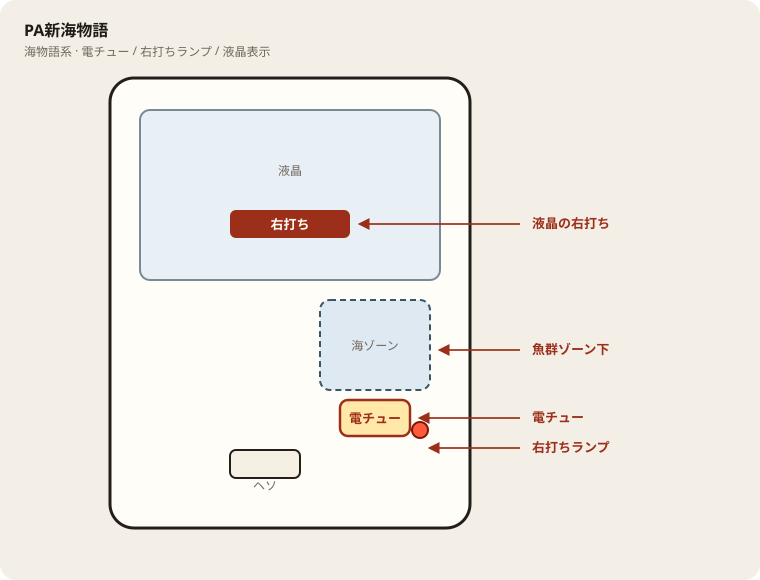

# PA新海物語

## 基本情報

| 項目 | 内容 |
| --- | --- |
| メーカー | 三洋物産 |
| 型式名 | PA新海物語ARBB |
| タイプ | P機 / 甘デジ / ST / 遊タイム / c時短 |
| 導入日 | 2022年8月22日 |

## スペック

| 項目 | 内容 |
| --- | --- |
| 大当り確率 | 通常 約1/99.9、ST中 約1/9.9 |
| サポートタイム | 通常時 約1/199.8（20/40/100/379回） |
| ST | 突入 100% / 5回 |
| 電サポ | 25 or 50 or 304 or 379回転など |
| 賞球 | 3&2&4&10 |
| 出玉 | 5R約500個、10R約1000個（払い出し） |

電サポ終了後は通常に戻ったら回転率か遊タイム残りで判断。

## 天井・遊タイム・LT

| 項目 | 内容 |
| --- | --- |
| 天井 | 非搭載 |
| 遊タイム | 低確率299回転 → 時短379回転 |
| カウントのリセット | 遊タイム到達で時短。サポートタイムと併用に注意 |

## 盤面の場所

海物語系。魚群・ボタン演出より、液晶の「右打ち」表示と電チュー開放を優先して見る。

系列: **海物語系**（機種ごとの目安。個体差あり）

| 項目 | 場所 | 見方 |
| --- | --- | --- |
| 液晶（右打ち表示） | 盤面中央の液晶 | 「右打ち」が出ているあいだが電サポ中。切替の最終判断 |
| ヘソ（始動口） | 盤面中央下寄り | 通常時の始動。左打ちの玉が落ちる位置 |
| 電チュー | 盤面右側・海／魚群ゾーン下寄り | 右打ち時の始動口。羽根の開閉を目視 |
| 右打ちランプ | 盤面右下〜電チュー周辺 | 点灯＋液晶表示をセットで確認。ランプ単独では決めない |
| アタッカー | 盤面下部中央寄り | 大当りラウンドの入賞口 |
| 電サポ | （状態）時短・ST・RUSH中 | 部品ではない。液晶の右打ち表示中 |
| 保留ランプ | 液晶下または盤面下部 | 保留消化の目安。右打ち中も残保留に注意 |

- 魚群やボタン演出に目が行っても、打ち分けは液晶優先。
- 海系は右打ち中の取りこぼしが回転率を崩しやすい。電チューの拾いを見る。

## おすすめカスタム

- カスタムは演出の出方だけが変わる。抽選は変わらない。
- 海物語系は魚群・ボタンオート・音量くらい。魚群はONのままでよい。
- 当たりやすさは変わらない。台選びと回転率を優先。

## 打ち方

- 通常時は左打ち（右打ち指示が出たら従う）。
- 電サポ中・RUSH中は打ち切る。通常に戻ったら回転率を見て継続かやめを決める。
- 遊タイムがある。等価の目安は1000円あたり約16.5回転。

## 総評

新海の甘デジ。ST5＋遊タイム＋突然時短。ボーダーは甘め。

出典: P-WORLD、なな徹、ぱちタウン、パチンコスペック解析
