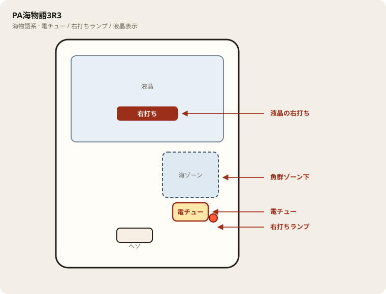

# PA海物語3R3

## 基本情報

| 項目 | 内容 |
| --- | --- |
| メーカー | 三洋物産 |
| 型式名 | PA海物語3R3LBA |
| タイプ | 甘デジ / 確変ループ |
| 導入日 | 2025年6月2日 |

## スペック

| 項目 | 内容 |
| --- | --- |
| 大当り確率 | 通常 約1/99.9、確変中 約1/16.9 |
| 確変 | 突入 51% / 次回まで |
| 時短 | 40回（チャンスタイム）。引き戻し 約33.1% |
| トータル継続 | 約68.5%（時短引き戻し込み） |
| 賞球 | 3&2&1&4&10 |
| ラウンド | 5R or 10R / 10カウント |
| 出玉 | 5R約500個、10R約1000個 |

| 出玉 | 行き先 | 割合 |
| --- | --- | --- |
| 約1000個（10R） | 確変 | 5% |
| 約500個（5R） | 確変 | 46% |
| 約500個（5R） | 時短40回 | 49% |

## 天井・遊タイム・LT

| 項目 | 内容 |
| --- | --- |
| 天井 | 非搭載 |
| 遊タイム | 非搭載 |
| カウントのリセット | 天井・遊タイムがないため、ハマり回転数は次の抽選に影響しない |

## 盤面の場所

海物語系。魚群・ボタン演出より、液晶の「右打ち」表示と電チュー開放を優先して見る。

系列: **海物語系**（機種ごとの目安。個体差あり）

| 項目 | 場所 | 見方 |
| --- | --- | --- |
| 液晶（右打ち表示） | 盤面中央の液晶 | 「右打ち」が出ているあいだが電サポ中。切替の最終判断 |
| ヘソ（始動口） | 盤面中央下寄り | 通常時の始動。左打ちの玉が落ちる位置 |
| 電チュー | 盤面右側・海／魚群ゾーン下寄り | 右打ち時の始動口。羽根の開閉を目視 |
| 右打ちランプ | 盤面右下〜電チュー周辺 | 点灯＋液晶表示をセットで確認。ランプ単独では決めない |
| アタッカー | 盤面下部中央寄り | 大当りラウンドの入賞口 |
| 電サポ | （状態）時短・ST・RUSH中 | 部品ではない。液晶の右打ち表示中 |
| 保留ランプ | 液晶下または盤面下部 | 保留消化の目安。右打ち中も残保留に注意 |

- 魚群やボタン演出に目が行っても、打ち分けは液晶優先。
- 海系は右打ち中の取りこぼしが回転率を崩しやすい。電チューの拾いを見る。

## おすすめカスタム

- カスタムは演出の出方だけが変わる。抽選は変わらない。
- 海物語系は魚群・ボタンオート・音量くらい。魚群はONのままでよい。
- 当たりやすさは変わらない。台選びと回転率を優先。

## 打ち方

- 通常時は左打ち（右打ち指示が出たら従う）。
- 電サポ中・RUSH中は打ち切る。通常に戻ったら回転率を見て継続かやめを決める。
- 遊タイムがないため、深くハマった履歴だけでは拾わない。等価の目安は1000円あたり約17.3回転。

## 総評

甘デジの確変ループ。通常大当り後は必ず時短40回。奇数は確変、偶数は昇格勝負。

出典: P-WORLD、なな徹、DMMぱちタウン
