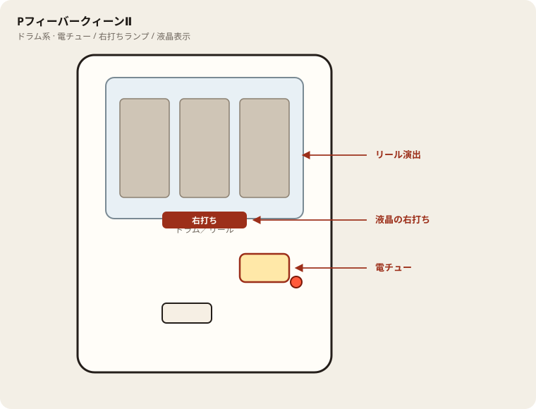

# PフィーバークィーンⅡ

## 基本情報

| 項目 | 内容 |
| --- | --- |
| メーカー | SANKYO |
| 型式名 | PAフィーバークィーンIIYS |
| タイプ | 甘デジ / ST＋時短（LT非搭載） |
| 導入日 | 2026年5月11日 |

## スペック

| 項目 | 内容 |
| --- | --- |
| 大当り確率 | 通常 約1/99.9、ST中 約1/12.0 |
| ST突入 | 100%（ST8＋時短） |
| 電サポ | 40 / 100 / 120 / 10000回転 |
| 賞球 | 1&3&10 |
| 出玉 | 4R約400個、10R約1000個 |

内部モード（チャンス／天国／神・女王降臨）で電サポ回数が変わる。

## 天井・遊タイム・LT

| 項目 | 内容 |
| --- | --- |
| 天井 | 非搭載 |
| 遊タイム | 非搭載 |
| ラッキートリガー | 非搭載 |
| カウントのリセット | 天井・遊タイムがないため、ハマり回転数は次の抽選に影響しない |

## 盤面の場所

ドラム筐体。リール演出に気を取られやすいが、右打ち切替は液晶と電チュー。

系列: **ドラム系**（機種ごとの目安。個体差あり）

| 項目 | 場所 | 見方 |
| --- | --- | --- |
| 液晶／リール | 盤面中央（ドラム部） | 演出本体。右打ち表示もここを見る |
| ヘソ（始動口） | 盤面中央下寄り | 通常時の始動 |
| 電チュー | 盤面右下〜中央右 | 遊タイム／RUSH中の始動口 |
| 右打ちランプ | 電チュー横〜盤面下 | 点灯＋液晶表示をセットで |
| アタッカー | 盤面下部中央寄り | ラウンド消化 |
| 電サポ | （状態）RUSH・遊タイム中など | 部品ではない。液晶の右打ち表示中 |
| 遊タイム残表示 | 液晶内（機種による） | 残り回転の確認。盤面ランプと取り違えない |

- ドラムの停止出目だけで打ち分けを変えない。
- 遊タイム機は残り表示を座前に確認し、線以外で長居しない。

## おすすめカスタム

- カスタムは演出の出方だけが変わる。抽選は変わらない。
- Wアップカスタムなど好みで。先バレがあればON。

## 打ち方

- 通常時は左打ち（右打ち指示・ランプが出たら従う）。
- 電サポ中は打ち切る。通常に戻ったら回転率を見て継続かやめを決める。
- 遊タイムがないため、深くハマった履歴だけでは拾わない。等価の目安は1000円あたり約18.1回転。

## 総評

クィーンⅡの甘デジ。全大当り後ST8＋時短。内部モードで電サポが伸びる。遊タイムなし・LTなし。

出典: P-WORLD、なな徹、ぱちタウン、パチンコスペック解析
