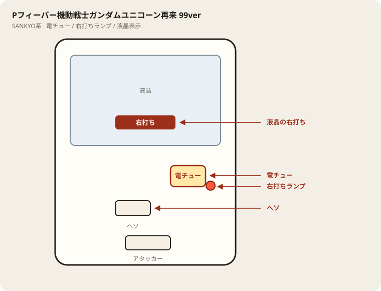

# Pフィーバー機動戦士ガンダムユニコーン再来 99ver

## 基本情報

| 項目 | 内容 |
| --- | --- |
| メーカー | SANKYO |
| 型式名 | Pフィーバー機動戦士ガンダムユニコーン再来 99ver． |
| タイプ | P機 / 甘デジ / 1種2種 / LT / ヘソ3個 |
| 導入日 | 2025年7月7日 |

## スペック

| 項目 | 内容 |
| --- | --- |
| 図柄揃い | 通常 約1/99.9、右打ち中 約1/43.7 |
| 覚醒HYPER | 突入 約51% / ST56+残保留4 / 継続 約75% |
| 超覚醒HYPER（LT） | ST100+残保留4 / 継続 約91% |
| 賞球 | 3&1&4&10 |
| 出玉 | 通常 3R約300個、右打ち中 7R約700個 |

UC再来の甘デジLT。ヘソ3個で玉持ちよい。

## 天井・遊タイム・LT

| 項目 | 内容 |
| --- | --- |
| 天井 | 非搭載 |
| 遊タイム | 非搭載 |
| カウントのリセット | 天井・遊タイムがないため、ハマり回転数は次の抽選に影響しない |

## 盤面の場所

SANKYO／関連。フィーバー系も打ち分けは液晶優先。

系列: **SANKYO系**（機種ごとの目安。個体差あり）

| 項目 | 場所 | 見方 |
| --- | --- | --- |
| 液晶（右打ち表示） | 盤面中央の液晶 | 「右打ち」表示中が電サポ中。切替の最終判断 |
| ヘソ（始動口） | 盤面中央下寄り | 通常時の始動口 |
| 電チュー | 盤面右下（液晶右下〜右レール終点） | 羽根が開く入賞口。右打ちの始動口 |
| 右打ちランプ | 電チュー付近、または盤面下部のランプ群 | 点灯中は右打ち。位置は機種差あり。液晶と併用 |
| アタッカー | 盤面下部中央寄り | 大当りラウンドの入賞口 |
| 電サポ | （状態）時短・ST・RUSH・遊タイム中 | 部品ではない。液晶の右打ち表示中 |
| 保留ランプ | 液晶下または盤面下部 | 保留の目安。右打ち終了直後の残保留に注意 |

- ヘソは中央下寄り、アタッカーは下部中央寄りが多い。
- 迷ったら液晶の指示を優先。ランプだけ見て打ち方を決めない。
- 遊タイム残は液晶表示で確認。深さだけで座らない。

## おすすめカスタム

- カスタムは演出の出方だけが変わる。抽選は変わらない。
- 先バレ／先読みがあればON。ない場合はデフォルト。

## 打ち方

- 通常時は左打ち（右打ち指示が出たら従う）。
- 電サポ中・RUSH中は打ち切る。通常に戻ったら回転率を見て継続かやめを決める。

- 遊タイムがないため、深くハマった履歴だけでは拾わない。等価の目安は1000円あたり約16.5回転。

## 総評

覚醒HYPER継続約75%。超覚醒HYPER（LT）継続約91%。遊タイムなし。

出典: P-WORLD、SANKYO、パチ&スロ必勝本
