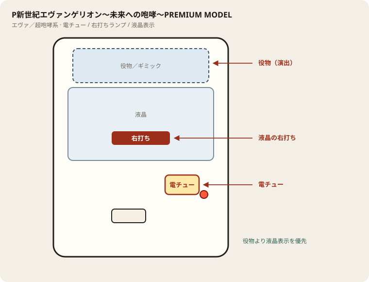

# P新世紀エヴァンゲリオン〜未来への咆哮〜PREMIUM MODEL

## 基本情報

| 項目 | 内容 |
| --- | --- |
| メーカー | ビスティ |
| 型式名 | P新世紀エヴァンゲリオン15 未来への咆哮Y |
| タイプ | P機 / ライト / V-ST |
| 導入日 | 2024年2月5日 |

## スペック

| 項目 | 内容 |
| --- | --- |
| 大当り確率 | 通常 約1/129.8、ST中 約1/35.7 |
| RUSH | 突入 約50% / ST30+時短100 / 継続 約81% |
| 賞球 | 1&5&10 |
| 出玉 | 3R約300 / 10R約1000個 |

## 天井・遊タイム・LT

| 項目 | 内容 |
| --- | --- |
| 天井 | 非搭載 |
| 遊タイム | 非搭載 |
| カウントのリセット | 天井・遊タイムがないため、ハマり回転数は次の抽選に影響しない |

## 盤面の場所

エヴァ系（超咆哮筐体含む）。役物が大きくても、右打ち切替の本命は液晶表示。

系列: **エヴァ／超咆哮系**（機種ごとの目安。個体差あり）

| 項目 | 場所 | 見方 |
| --- | --- | --- |
| 液晶（右打ち表示） | 盤面中央の液晶 | チャンスタイム／インパクト／RUSH中の「右打ち」 |
| ヘソ（始動口） | 盤面中央下寄り | 通常時の始動 |
| 電チュー | 盤面右下寄り | 右打ち中の始動口。役物の陰になりやすいので位置を先に把握 |
| 右打ちランプ | 盤面下部〜電チュー付近 | 点灯中は右打ち。液晶と矛盾したら液晶優先 |
| 役物／ギミック | 液晶上〜中央 | 演出用。打ち分けの判断材料にはしない |
| アタッカー | 盤面下部中央寄り | ラウンド消化 |
| 電サポ | （状態）チャンスタイム／インパクト／RUSH中 | 部品ではない |

- 役物動作中も右打ち指示が続いていないか液晶を見る。
- 筐体が大きいので、隣台からでも電チュー位置を座前に確認する。

## おすすめカスタム

- カスタムは演出の出方だけが変わる。抽選は変わらない。
- 先バレ／先読みがあればON。ない場合はデフォルト。

## 打ち方

- 通常時は左打ち（右打ち指示が出たら従う）。
- 電サポ中・RUSH中は打ち切る。通常に戻ったら回転率を見て継続かやめを決める。
- 遊タイムがないため、深くハマった履歴だけでは拾わない。等価の目安は1000円あたり約17.2回転。

## 総評

エヴァ未来への咆哮 PREMIUM。ライトで継続約81%。遊タイムなし。

出典: ぱちタウン、パチマガ、必勝本
