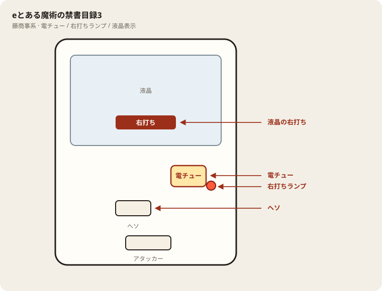

# eとある魔術の禁書目録3

## 基本情報

| 項目 | 内容 |
| --- | --- |
| メーカー | オレンジ / 藤商事 |
| 型式名 | eとある魔術の禁書目録3RHZ |
| タイプ | スマパチ / ハイミドル / LT / 1種2種混合 |
| 導入日 | 2026年11月2日 |

## スペック

| 項目 | 内容 |
| --- | --- |
| 図柄揃い | 通常 約1/348 |
| ST突入 | 約50% |
| ST全体 | 131回（前半30+後半100+最終1） / トータル継続 約75% |
| 前半 LIMIT BREAK CHANCE | 30回 / 約1/99 / 引き戻し 約27% |
| 後半 とある魔術の最強激突 | 100回 / 約1/128 / 引き戻し 約54% |
| LAST CHANCE | 1回 / 成功 約25% |
| 賞球 | 1&5&15 |
| 出玉 | 10R約1500個、10R×2約3000個（前半当たり時は上乗せループあり） |

ST中は右打ち。終了後は通常に戻ったら回転率で判断。

## 天井・遊タイム・LT

| 項目 | 内容 |
| --- | --- |
| 天井 | 非搭載 |
| 遊タイム | 非搭載 |
| カウントのリセット | 天井・遊タイムがないため、ハマり回転数は次の抽選に影響しない |

## 盤面の場所

藤商事系。液晶の右打ち表示を最終判断にする。

系列: **藤商事系**（機種ごとの目安。個体差あり）

| 項目 | 場所 | 見方 |
| --- | --- | --- |
| 液晶（右打ち表示） | 盤面中央の液晶 | 「右打ち」表示中が電サポ中。切替の最終判断 |
| ヘソ（始動口） | 盤面中央下寄り | 通常時の始動口 |
| 電チュー | 盤面右下〜中央右（液晶の右下寄り） | 羽根が開く入賞口。右打ちの始動口 |
| 右打ちランプ | 電チュー付近、または盤面下部のランプ群 | 点灯中は右打ち。位置は機種差あり。液晶と併用 |
| アタッカー | 盤面下部中央寄り | 大当りラウンドの入賞口 |
| 電サポ | （状態）時短・ST・RUSH・遊タイム中 | 部品ではない。液晶の右打ち表示中 |
| 保留ランプ | 液晶下または盤面下部 | 保留の目安。右打ち終了直後の残保留に注意 |

- ヘソは中央下寄り、アタッカーは下部中央寄りが多い。
- 迷ったら液晶の指示を優先。ランプだけ見て打ち方を決めない。
- 遊タイム残は液晶表示で確認。深さだけで座らない。

## おすすめカスタム

- カスタムは演出の出方だけが変わる。抽選は変わらない。
- 通常時は禁書目録フラッシュを本命に。期待度は40%前後がバランス良し。99%は濃厚寄りだが出現が重い。
- ボタブルUP・ラッキーエアーUPはONでよい。キャラ告知は好みで。
- ラッシュ中はモード固有カスタム（違和感／ゲコ太／ラッキードライブなど）をON。

## 打ち方

- 通常時は左打ち（右打ち指示が出たら従う）。
- 電サポ中・RUSH中は打ち切る。通常に戻ったら回転率を見て継続かやめを決める。
- 遊タイムがないため、深くハマった履歴だけでは拾わない。等価の目安は1000円あたり約17.2回転。

## 総評

3段階STのとある3。初当りALL1500個、ST突入50%。遊タイムなし。

出典: P-WORLD、なな徹、ぱちタウン、パチンコスペック解析
