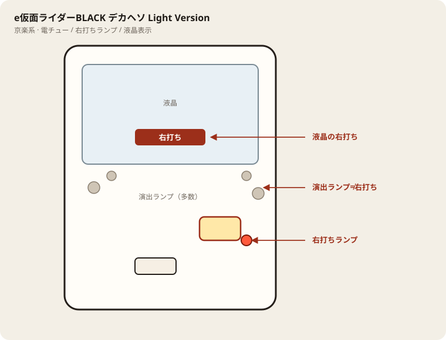

# e仮面ライダーBLACK デカヘソ Light Version

## 基本情報

| 項目 | 内容 |
| --- | --- |
| メーカー | 京楽産業. |
| 型式名 | e仮面ライダーBLACK-KRAJ3 |
| タイプ | スマパチ / ライトミドル / 1種2種混合 |
| 導入日 | 2026年11月2日 |
| 兄弟機 | ミドル版は別スペック |

## スペック

| 項目 | 内容 |
| --- | --- |
| 大当り確率 | 通常 約1/129.9、RUSH中 約1/96.0 |
| JUSTICE RUSH突入 | 約60% |
| JUSTICE RUSH | 時短120 / 継続 約72% |
| 宿命BATTLE | 突入 約25%（RUSH中大当り）/ 継続 約65% |
| 賞球 | 1&4&5&8 |
| 出玉 | 通常 約240個、RUSH中 約400個＋α |

デカヘソ・ライトミドル。宿命BATTLEは1G連特化。初回は勝利濃厚。

## 天井・遊タイム・LT

| 項目 | 内容 |
| --- | --- |
| 天井 | 非搭載 |
| 遊タイム | 非搭載 |
| カウントのリセット | 天井・遊タイムがないため、ハマり回転数は次の抽選に影響しない |

## 盤面の場所

京楽系は盤面ランプが多く、演出ランプと右打ちランプを取り違えやすい。

系列: **京楽系**（機種ごとの目安。個体差あり）

| 項目 | 場所 | 見方 |
| --- | --- | --- |
| 液晶（右打ち表示） | 盤面中央の液晶 | 切替の最終判断。演出色より表示文字を見る |
| ヘソ（始動口） | 盤面中央下寄り（デカヘソ機は特大） | 通常時の始動 |
| 電チュー | 盤面右下寄り | 右打ち時の始動口 |
| 右打ちランプ | 電チュー付近〜盤面下のランプ群 | 赤点灯が右打ちのことが多いが、機種差あり。液晶と併用 |
| 演出ランプ | 盤面左右・上部 | 信頼度演出用。右打ち判断に使わない |
| アタッカー | 盤面下部中央寄り | ラウンド消化 |
| 電サポ | （状態）時短・ST・RUSH中 | 部品ではない |

- カラフルな点灯だけで右打ちに切り替えない。
- デカヘソ機は通常時の拾いが回転率に直結する。

## おすすめカスタム

- カスタムは演出の出方だけが変わる。抽選は変わらない。
- 先バレ／先読みがあればON。ない場合はデフォルト。

## 打ち方

- 通常時は左打ち（右打ち指示が出たら従う）。
- 電サポ中・RUSH中は打ち切る。通常に戻ったら回転率を見て継続かやめを決める。
- 遊タイムがないため、深くハマった履歴だけでは拾わない。等価の目安は1000円あたり約27.7回転。

## 総評

ライトミドル・デカヘソ。JUSTICE RUSH突入約60%・継続約72%。宿命BATTLE継続約65%。遊タイムなし。

出典: なな徹、パチンコスペック解析、パチンコビレッジ、京楽公式
