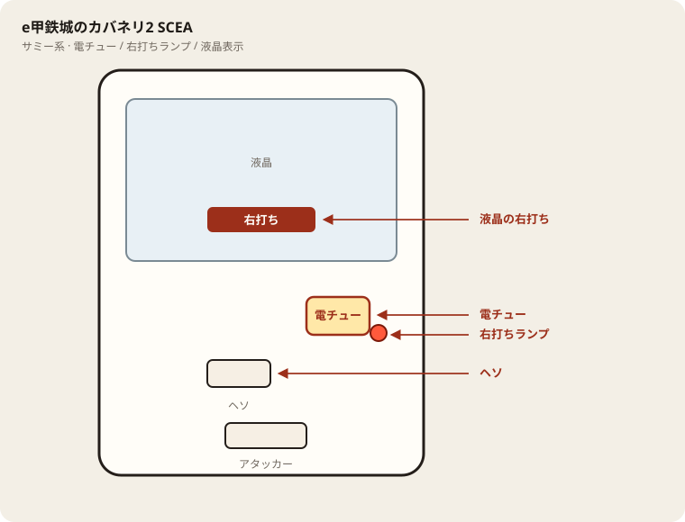

# e甲鉄城のカバネリ2 SCEA

## 基本情報

| 項目 | 内容 |
| --- | --- |
| メーカー | サミー |
| 型式名 | e甲鉄城のカバネリ2SCEA |
| 商品名 | e 甲鉄城のカバネリ2 輪廻の果報119ver. |
| タイプ | スマパチ / ライト / 1種2種混合 / ラッキートリガー |
| 導入日 | 2026年9月7日 |

## スペック

| 項目 | 内容 |
| --- | --- |
| 大当り確率 | 通常時 約1/119.8 |
| 大当り確率（RUSH中） | 約1/89.7 |
| RUSH突入率 | 約25.5% |
| RUSH | ST134回 / 継続率 約78% |
| 賞球 | 1&2&6&15 |
| カウント | 10カウント |
| 右打ち | RUSH「海門決戦」、超輪廻ループ |

通常時の初当りは約300個。約25.5%でRUSH、約74.5%で通常戻り。RUSH中の大当りはすべて1500個以上。

| 状態 | 出玉 | 行き先 | 割合 |
| --- | --- | --- | --- |
| 通常時 | 300個 | 海門決戦（ST134回） | 約25.5% |
| 通常時 | 300個 | 通常 | 約74.5% |
| RUSH中 | 超輪廻ループ（期待約6400個） | RUSH継続 | 約5% |
| RUSH中 | 1500個 | RUSH継続 | 約95% |

超輪廻ループの実体は、1500個を土台に300個×5〜25回が乗る帯で、表示上は3000個〜9000個。1500個が約70%でループする。期待獲得出玉は、3000個にループ期待約3418個を足した約6400個。V入賞が条件。

## 天井・遊タイム・LT

| 項目 | 内容 |
| --- | --- |
| 天井 | 非搭載 |
| 遊タイム | 非搭載 |
| ラッキートリガー | 超輪廻ループ（輪廻の果報）。RUSH中の大当り約5%で発動 |
| LTの中身 | 1500個が約70%ループ。最低でも3000個以上。終了後はSTに戻る |
| カウントのリセット | 天井・遊タイムがないため、通常時の回転数は救済に使えない |

## 主なモード・演出の見方

- チャレンジBONUSが通常時の300個。消化後のRUSH突入チャレンジ成功で海門決戦。
- 海門決戦はSTの消化に合わせて演出が三段になる。序盤は即当り寄りの加速ゾーン、中盤はバトルの共闘ゾーン、終盤はテンパイ煽りの覚醒ゾーン。
- カバネリBONUSは右打ち中の1500個。消化後も海門決戦が続く。
- 超輪廻ループは1500個大当りが約70%で回り、フリーズのたびに上乗せが付く。

## 盤面の場所

サミー系。液晶の右打ち表示を本命に、電チューの開放を目視する。

系列: **サミー系**（機種ごとの目安。個体差あり）

| 項目 | 場所 | 見方 |
| --- | --- | --- |
| 液晶（右打ち表示） | 盤面中央の液晶 | 「右打ち」表示中が電サポ中。切替の最終判断 |
| ヘソ（始動口） | 盤面中央下寄り | 通常時の始動口 |
| 電チュー | 盤面右下〜中央右（液晶の右下寄り） | 羽根が開く入賞口。右打ちの始動口 |
| 右打ちランプ | 電チュー付近、または盤面下部のランプ群 | 点灯中は右打ち。位置は機種差あり。液晶と併用 |
| アタッカー | 盤面下部中央寄り | 大当りラウンドの入賞口 |
| 電サポ | （状態）時短・ST・RUSH・遊タイム中 | 部品ではない。液晶の右打ち表示中 |
| 保留ランプ | 液晶下または盤面下部 | 保留の目安。右打ち終了直後の残保留に注意 |

- ヘソは中央下寄り、アタッカーは下部中央寄りが多い。
- 迷ったら液晶の指示を優先。ランプだけ見て打ち方を決めない。
- 遊タイム残は液晶表示で確認。深さだけで座らない。

## おすすめカスタム

- カスタムは演出の出方だけが変わる。抽選は変わらない。
- 通常時はイキナリフラッシュが本命（期待度約48%）。察知重視なら先読みチャンス＋激熱アップを併用。
- ラッシュ中は燦然一発告知＋無名フラッシュ。3000個濃厚を優先する。最後まで楽しみたいなら貫けランプ告知。

## 打ち方

- 通常時は左打ち。初当りの約4回に3回は300個で通常に戻る。RUSH突入は約25.5%と低めなので、入口で落ちる回数を見込んで投資額を決める。
- RUSHに入ったら134回を打ち切る。継続率約78%で、当たれば最低1500個。95%は1500個のまま継続する。
- 約5%の超輪廻ループに入ったら、ループが終わるまで右打ちを続ける。ここが万発に届く経路で、期待は約6400個。終わったあともSTが残る。
- 天井がないのでハマり台は拾わない。等価の理論値目安は12時間稼働で約17.5回転（250玉あたり、P-WORLD）。
- やめ時は、突入チャレンジ失敗で通常に戻ったあと、または海門決戦が継続せず通常に戻ったあと。ループ中はやめない。

## 総評

1/119.8で回りやすく見せて、RUSHの入口を約25.5%まで絞ったライト機。通常時は300個の空振りが多く、ここだけで打つと消耗する。入ったあとはST134回・約78%で、右打ちの大当りがすべて1500個以上という割り切りがある。

一撃は約5%の超輪廻ループに集約される。70%ループで期待約6400個、振れ幅は3000個から9000個。平均的なRUSH連チャンは1500個の積み上げになり、LTを引いた回だけ景色が変わる。回転率がボーダーを超える店で、RUSHを数回試せる時間があるときに向きがいい。

出典: P-WORLD、パチ&スロ必勝本、パチンコ計数.com
